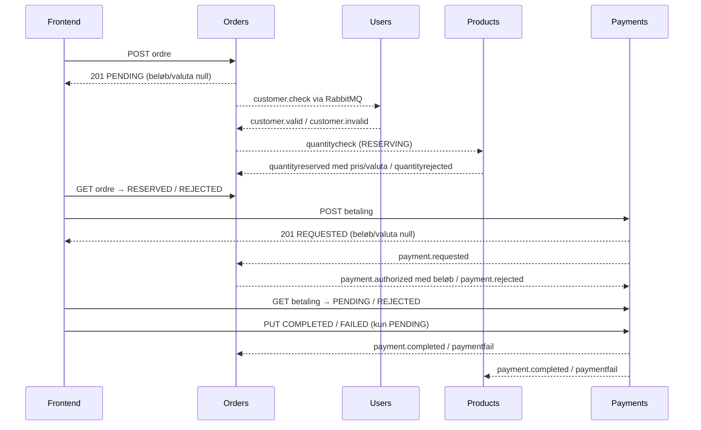

# Asynkront ordre- og betalingsflow

Beslutning og afgrænsning: [ADR-003](decisions/003-asynchronous-commerce.md).

Ordre- og betalingsoprettelse kvitterer med **201 for den gemte anmodning**.
Det betyder, at anmodningen er modtaget; resultatet læses efterfølgende via GET.
Frontenden opdaterer visningen løbende og viser ventestatus og afvisninger.



Alle stiplede servicemeddelelser i sekvensen transporteres gennem RabbitMQ.
Hver SQL-ændring, inbox-registrering og afledt outbox gemmes atomisk i ejerens database.
Users verificerer kunden, før Orders anmoder om en reservation. Products låser bilen
og bestemmer pris/valuta ved reservationen. Klientens prisfelter ignoreres.
Orders låser ordren ved betalingsgodkendelse: enten vinder annullering, eller
ordren bliver PAYMENT_PENDING og kan ikke annulleres/slettes. Payments gemmer
anmodningen før godkendelsen, så et nedbrud efter claim ikke kræver en klientretry.
Kun efter godkendelsen kan medarbejderen registrere betalingen som modtaget.

Ukendte kunder, biler eller ikke-betalbare ordrer giver en **asynkron REJECTED**.
Ugyldig JSON/UUID giver stadig 400 med det samme. Nested samlinger filtrerer kun
lokale data; en ukendt, syntaktisk gyldig kunde-/ordre-UUID giver `200 []`.
Et enkelt ukendt objekt giver fortsat 404. Betalingsretry bruger samme deterministiske
betalings-UUID og returnerer eksisterende status med 200; det genåbner ikke afvisningen.
Der er ét betalingsforsøg pr. ordre. En afvist betaling kan kræve en ny ordre.

## Beskedmetadata og payloads

Alle nye RabbitMQ-beskeder har denne envelope:

```json
{
  "eventId": "eab5e704-4b2c-4e46-971b-053057b3a40a",
  "eventType": "payment.requested",
  "occurredAt": "2026-11-04T09:00:00Z",
  "correlationId": "a1f44fe7-e1d7-45bb-8db6-f9ba430da197",
  "schemaVersion": 1,
  "payload": {
    "orderGuid": "a1f44fe7-e1d7-45bb-8db6-f9ba430da197",
    "paymentGuid": "7fa41834-bd68-4d1b-bd0a-43d0fa9f200e"
  }
}
```

`eventId` er UUID og identisk med AMQP `messageId`; `eventType` matcher routing key.
`occurredAt` er outbox-oprettelsestid i UTC, ikke tidspunktet for en genlevering.
`correlationId` er ordre-UUID gennem hele købsflowet, også det afledte produktsnapshot.
Ved selvstændigt produkt-CRUD er det produkt-UUID. Afledte events arver korrelationen.
`schemaVersion` beskriver envelopens kontrakt, mens `payload.version` kun er bilens
konkurrencestyring/projektionsversion. Ukendte ekstra felter ignoreres.

| Besked | Payload |
| --- | --- |
| customer.check / valid / invalid | orderGuid, userGuid, productGuid; endnu null totalAmount/currency |
| quantitycheck | orderGuid, userGuid, productGuid; endnu null totalAmount/currency |
| quantityreserved | Samme referencer samt autoritativ totalAmount/currency |
| quantityrejected / order.cancelled | Samme referencer; beløb/valuta kan være null |
| payment.requested / rejected | orderGuid, paymentGuid |
| payment.authorized | orderGuid, paymentGuid, userGuid, productGuid, totalAmount, currency |
| payment.completed / paymentfail | orderGuid, paymentGuid, productGuid |
| product.created / updated / reserved / removed | Komplet produktsnapshot med guid og version |

## Levering, fejl og opgradering

Publisher bruger persistent messages og venter højst tre sekunder på broker-confirm.
Ubekræftede outbox-rækker bevares. Worker forsøger igen efter cirka 350 ms plus
forbindelses-/kaldets tidsgrænse. Connect/handshake er begrænset til 2/3 sekunder.
En consumer kvitterer først efter commit; genlevering af samme event-ID deduplikeres
af SQL-inbox. Produktprojektionen bruger atomisk versionskontrol hos Product View.
Midlertidige fejl giver nack/requeue og genforbindelse. Ugyldige envelopes, ukendt
skemaversion og ugyldige obligatoriske payloadfelter giver reject til `aj.dead`.
Forretningsafvisninger er normale svar-events og skal ikke i dead-letter-køen.

Consumers accepterer også tidligere rå JSON-payloads med AMQP-messageId, så eksisterende
outbox-rækker/køer kan drænes efter opgraderingen. Gamle quantitycheck-beskeder med
en fast pris kontrolleres fortsat mod Products. Nye beskeder uden pris får prisen fra
reservationen. Opgrader hele den lokale Compose-stak samlet: gamle binære consumers
kan ikke læse den nye envelope. Det er læsekompatibilitet for gemte beskeder, ikke
en garanti om blandede versioner under en rullende deployment.

Ved opgradering fra den gamle payload-kontrakt stoppes domæne-workers først med
`docker compose stop users products orders payments product-synchronizer`, efterfulgt
af `docker compose up -d --build --wait`. Databaser, broker og volumes bevares.

Eksisterende Payments-volumes bevares. Opstart løsner den lokale NOT NULL-begrænsning
på `payments_details.product_guid`, fordi REQUESTED endnu ikke kender bilen.
Ingen placeholder-UUID gemmes. Den snævre, idempotente SQL-ændring erstatter ikke
den generelle versionsstyrede migrationsopgave DATA-01.

Der er endnu ingen forretningsfrist, automatisk udløb, begrænset retry eller operatør-replay.
Et nedbrud vises i statusfeltet, og gemte anmodninger afventer genopretning.
Der må ikke konkluderes betalingsfejl ud fra en lokal timeout: en forsinket godkendelse
kan stadig komme. Ved permanent nedbrud kræves manuel afklaring; REL-03 behandler dette.
En sen reservation af en annulleret eller soft-deleted ordre udløser frigivelse.
Vilkårlig beskedrækkefølge og flere workers er fortsat REL-02.

## Hvorfor nogle HTTP-kald bevares

Browser/proxy/gateway bruger HTTP til direkte brugerkommandoer og forespørgsler.
Gatewayens health-kald giver aktuel driftsstatus. OIDC/JWKS er identitetsprotokollen.
Synchronizer bruger Product Views interne, autentificerede HTTP-interface for at
bevare én MongoDB-ejer og vente på lagring før broker-ack. Der er ingen direkte
HTTP-kald mellem Users, Products, Orders og Payments i købsflowet eller nested opslag.

## Verifikation

`mvn clean verify` inkluderer tre unit-tests af metadata, nedarvet korrelation,
legacy-læsning og ugyldig envelope. `python scripts/check_async.py --failures`
tester direkte backend-samarbejde med PostgreSQL/RabbitMQ, autoritativ pris,
forretningsafvisninger, faktiske envelopes/dead-letter og genopretning efter
udfald af Users, Orders, Payments og Products. `scripts/smoke.py` og browserkontrollen
tester fortsat købsflowet gennem frontend/gateway. System-workflowen kører også
den selvstændige backend-/brokerkontrol.
