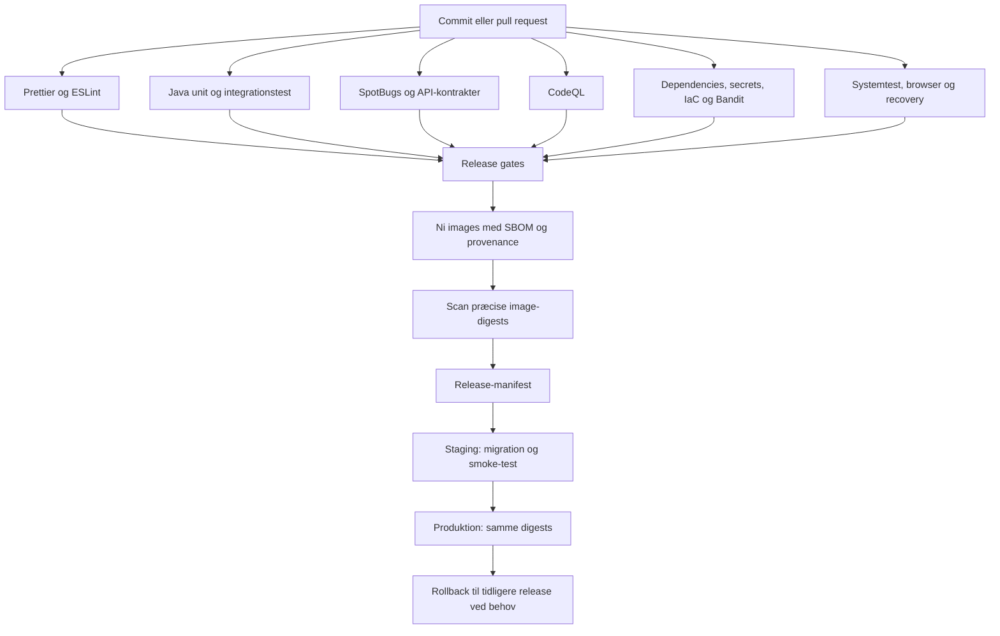

# CI/CD til eksamen

Pipeline-konfigurationen ligger i `.github/workflows`. Hvert lag har sit eget ansvar,
og en release kræver, at både kvalitet, funktion og sikkerhed er godkendt.



Release startes manuelt via `release.yaml` på `main`. Diagrammets release-grene
samles i denne workflow; de enkelte CI-workflows kan også køre selvstændigt.
`publish` styrer image-publicering, og `target` vælger ingen deployment, staging
eller produktion. Clusteradgang, secrets og GitHub Environments skal være opsat,
før en deployment kan lykkes. Beskyttelse af branches og eventuelle manuelle
environment-godkendelser konfigureres i GitHub og oprettes ikke af YAML-filerne.

| Kontrol | Hvad den undersøger | Hvornår den stopper |
| --- | --- | --- |
| Prettier | Ens formatering af egne frontend-filer, workflows og npm-værktøjer | Afvigelser fra formatteringen |
| ESLint | Ubrugte variabler, ugyldig JavaScript, eval og fejlmønstre | Fejl eller warnings |
| Surefire / Failsafe | Unit- og integrationstest for hver service | En test fejler |
| SpotBugs | Fejlmønstre i Java-bytecode | Fund over projektets tærskel |
| OpenAPI / AsyncAPI | Kontrakters gyldighed og genererede filers aktualitet | Ugyldig eller forældet kontrakt |
| actionlint / deployment-tests | Workflow-syntaks og release-/rollback-grænser | Syntaksfejl eller fejlet test |
| CodeQL | Sikkerhedsproblemer i Java med security-extended | Analysefejl; fund publiceres til code scanning |
| Trivy filesystem | Kendte dependenciesårbarheder, secrets og IaC-konfiguration | HIGH eller CRITICAL |
| Bandit | Sikkerhedsproblemer i Python-scripts | HIGH severity med mindst MEDIUM confidence |
| pip-audit | Kendte sårbarheder i de to Python-requirements med dependencies | Enhver kendt sårbarhed |
| npm audit | Kendte sårbarheder inklusive udviklingsværktøjer i begge npm-projekter | HIGH eller CRITICAL |
| System og browser | Købsflow, roller, login, broker, isolation og recovery | Fejlet acceptkontrol |
| Trivy image | Sårbarheder i det publicerede image ved præcis digest | HIGH/CRITICAL med tilgængelig rettelse |

CodeQL-fund gør ikke i sig selv analyze-steppet rødt. Brug GitHubs code-scanning
regler/rulesets, hvis bestemte fund skal blokere merge. Et grønt workflow er derfor
ikke i sig selv dokumentation for, at der ingen sikkerhedsadvarsler er.

## Arbejde lokalt

```powershell
npm ci --ignore-scripts
npm run format:check
npm run format
npm run lint
python -m unittest discover -s scripts/tests -v
```

Prettier ændrer filer med `format`; CI bruger kun `format:check`. Java, genererede
kontrakter, tredjeparts JavaScript/CSS, rapporter og runtime-data er uden for
formatteringen. `.gitattributes` fastholder LF for de formaterede filtyper.

## Sikkerhed og vedligeholdelse

`security.yaml` kører på pull requests, push til main, manuelt, ugentligt og som
en obligatorisk del af release. Ugentlig scanning kan finde nye advisories uden
kodeændringer. Matrix-jobs fortsætter uafhængigt, så flere rapporter kan indsamles,
men den afsluttende gate kræver succes fra alle jobs. Scannernes JSON-rapporter
gemmes i 14 dage, også efter fund. Scanner-/netværksfejl passerer ikke gaten.
Rapporter kan indeholde følsomme fund: begræns adgangen til Actions-artifacts.

Dependabot opretter ugentlige opdateringsforslag for Actions, Maven, npm, pip og
det fælles Dockerfile. Forslag merges ikke automatisk. Nye versioner testes af
de samme pipelines. Versionsvalg er fastlagt i manifests/lockfiler; Actions bruger
fortsat versions-tags, så fuld pinning til gennemsete commit-SHA'er er et muligt
næste skridt til beskyttelse af supply chain.

Fund skal vurderes og rettes. Der er ingen generel ignorering af sikkerhedsfund.
Demo-passwords er ikke produktionshemmeligheder, og secret-scanning garanterer
ikke, at alle hårdkodede passwords opdages. IaC-kontroller kan også finde reelle
begrænsninger i den lokale demoopsætning. En ny rød sikkerhedsgate skal undersøges,
før man erklærer løsningen klar til release.

## Gode pointer til fremlæggelsen

- CI giver hurtig feedback på kode og kontrakter. CD flytter en verificeret release
  gennem staging til produktion.
- SAST undersøger kode; SCA undersøger dependencies; IaC-scanning undersøger
  konfiguration. Systemtest undersøger den kørende applikations adfærd.
- En SBOM beskriver komponenterne. Provenance beskriver buildets oprindelse.
  Ingen af delene er i sig selv et bevis for fravær af sårbarheder.
- Image-digests sikrer, at staging og produktion anvender samme indhold.
- Parallelle jobs forkorter feedbacktiden, men bruger flere runner-minutter.
- Rollback af applikationer løser ikke automatisk en inkompatibel databasemigration;
  migrationsstrategi og backup er stadig nødvendige.

Værktøjsdokumentation: [Prettier CLI](https://prettier.io/docs/cli),
[ESLint](https://eslint.org/docs/latest/use/configure/),
[Trivy scanners](https://trivy.dev/docs/latest/guide/scanner/misconfiguration/),
[pip-audit](https://github.com/pypa/pip-audit).
