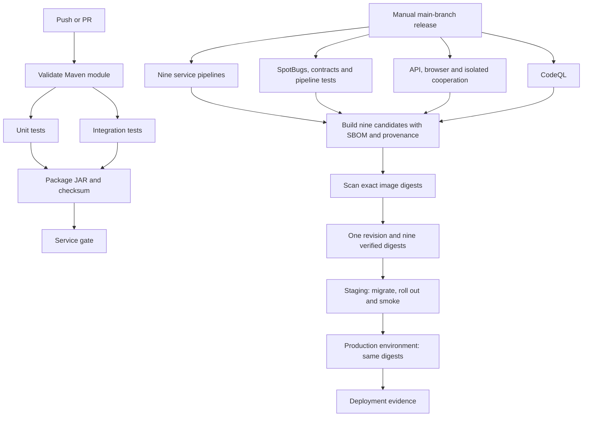

# CI/CD — build, verify, publish and deploy

The repository has nine service entry-point workflows and reusable workflows for Java checks, quality, system acceptance, image publication and Kubernetes deployment. PR/push checks run on disposable GitHub-hosted machines. Deployment runs only from a manual main-branch release/rollback on a configured runner with cluster access.

## Files and stages

| Workflow | Stages / purpose |
| --- | --- |
| `users.yaml`, `products.yaml`, `orders.yaml`, `payments.yaml`, `product-view.yaml`, `product-synchronizer.yaml`, `apigateway.yaml`, `frontend.yaml`, `confirmation-job.yaml` | Service-specific triggers; call the same reusable Java pipeline. |
| `service-ci.yaml` | Validate → parallel unit/integration jobs → package/checksum → service gate. Every job gets a fresh checkout; reports and JARs are separate artifacts. |
| `quality.yaml` | Parallel SpotBugs, OpenAPI/AsyncAPI checks and workflow/deployment tests → quality gate. |
| `system.yaml` | Separate runner environments for API/broker/recovery, browser/roles/OIDC and self-starting backend cooperation → system gate. Outage tests within one environment run sequentially. |
| `codeql.yaml` | Security queries; standalone checks and a reusable release gate. |
| `images.yaml` | Matrix of nine Buildx builds, at most three in parallel; GHCR candidate publication, SBOM/provenance, Trivy scan and revision-bound manifest assembly. |
| `release.yaml` | Trusted-ref/input validation → all checks → optional publication → optional staging → optional production → final result summary. |
| `deploy.yaml` | Environment validation → artifact provenance → plan → four owner migration Jobs → digest rollout/readiness → HTTPS/auth/catalogue smoke and optional business compensation → evidence/cleanup. |
| `rollback.yaml` | Select an earlier successful release run, explicitly confirm schema compatibility, then reuse deployment with the older digests. |

Service/quality/system gates fail when a required stage fails, is cancelled or is skipped. Image candidates can be present in GHCR before their scan completes; only a fully successful image matrix produces the deployable `release-manifest` artifact. Fixable HIGH/CRITICAL image findings block promotion. A candidate tag is not a deployment approval.

## One-time target configuration

The deployment pipeline updates an **existing AJ Motors cluster**. Bootstrap its namespace, databases/PVCs, RabbitMQ, Keycloak, Secrets, owner network policies, HTTP Services, ingress/TLS, application Deployments and the confirmation ScaledJob first. [KUBERNETES.md](KUBERNETES.md) supplies the local kind demonstration. Cluster/bootstrap administration stays separate from application releases.

1. Create GitHub environments named `staging` and `production`. Restrict deployment branches to `main`. Configure production reviewers in GitHub if production promotion must await approval; YAML cannot enable that repository setting itself.
2. Register a current self-hosted runner with label `aj-deploy` and install Python 3.12, kubectl and Bash. Default labels are `["self-hosted","linux","aj-deploy"]`. On the current Windows workstation use a current Windows runner, Git Bash, and repository variable `DEPLOY_RUNNERS=["self-hosted","Windows","aj-deploy"]`. The runner must reach the cluster API, public application URL, identity endpoint, GHCR and GitHub. A local kind API bound to localhost needs a runner on that machine.
3. Use a dedicated runner/work directory and restrict its runner group to trusted release/rollback workflows. PR jobs use GitHub-hosted runners. Deployment has an additional main-branch/manual-event guard.
4. With cluster-administrator credentials, apply [deployment-rbac.yaml](../k8s/deployment-rbac.yaml). It grants namespace-scoped deployment/ScaledJob updates, migration Job creation and diagnostic reads; it does not administer database volumes, Secrets or cluster-wide resources. Obtain a kubeconfig for that identity using your cluster's supported credentials. Keep expiry/rotation in mind; the pipeline does not silently generate cluster-admin credentials.
5. Make GHCR images readable by the cluster: either make the nine packages public or preconfigure a registry pull Secret on the target workloads/default ServiceAccount. Publishing to a public GitHub repository does not by itself guarantee that new GHCR packages are public. The deployer does not create registry credentials.
6. Configure a confidential smoke client in the target Keycloak realm with audience/claims accepted by AJ APIs. Local kind uses the configured `aj-tests` client; a real environment should have its own smoke identity. Business smoke requires its administrator role. Keep the client secret in its GitHub environment.

Set these for **each** environment:

| Type | Name | Value / purpose |
| --- | --- | --- |
| Secret | `KUBE_CONFIG_B64` | Single-line base64 of that target's kubeconfig. Never commit it. |
| Secret | `SMOKE_CLIENT_SECRET` | Confidential target Keycloak client secret. |
| Secret, optional | `TLS_CA_B64` | Base64 PEM CA for local/self-signed HTTPS. Omit for certificates trusted by the runner's normal CA store. TLS verification is always enabled. |
| Variable | `KUBE_CONTEXT` | Explicit context present in that kubeconfig, e.g. `kind-aj-exam`. |
| Variable | `PUBLIC_BASE_URL` | Target HTTPS origin, e.g. `https://localhost:8443`. |
| Variable, optional | `KUBE_NAMESPACE` | Defaults to `aj`; update the bootstrap RBAC namespace too if changed. |
| Variable, optional | `IDENTITY_BASE_URL` | Defaults to public base URL + `/identity`. |
| Variable, optional | `SMOKE_CLIENT_ID` | Defaults to `aj-tests`. |
| Variable, optional | `BUSINESS_SMOKE` | Defaults to `true` in staging and `false` in production. |
| Variable, optional | `ROLLBACK_SCHEMA_COMPATIBLE` | Set `true` only under a reviewed expand/contract compatibility policy; enables automatic restoration after rollout/smoke failure when a previous complete digest release was captured. |

`DEPLOY_RUNNERS` is a **repository** variable because runner selection happens before environment-specific configuration is loaded. Use different contexts/clusters for staging and production; the workload configuration is read from each live target, preserving its issuer, endpoints, Secret references, volumes and network settings. The same nine release digests are promoted; production never rebuilds staging images.

## Running a release

In Actions, run **Verified release and deployment** on `main`:

- `publish=false`, `target=none`: run the full release checks without publication/deployment.
- `publish=true`, `target=none`: publish scanned candidates and retain `release-manifest/release.json`.
- `publish=true`, `target=staging`: publish, migrate and verify staging.
- `publish=true`, `target=production`: verify staging first, then enter the production environment and deploy those same digests.

Remote artifact origin is checked against the release workflow path, main branch and source SHA using GitHub's API. Cross-run rollback artifacts must come from an earlier successful run. Artifacts have explicit names so Buildx build-record artifacts cannot accidentally enter manifest assembly. Release artifacts retain their digests for 90 days; deployment/scan evidence for 30 days; ordinary test reports/JARs for 14 days.

## Migration, smoke and failure handling

Before changing an application, the deployer performs server-side dry-run validation and runs four bounded Flyway Jobs using the new owner's exact image digest, existing database configuration and owner network label. A failed migration prevents the application rollout. A proof file binds successful migration to revision, all images, context, namespace and the previously observed image set; apply refuses another release's proof or out-of-band image changes.

Migration init containers remain enabled as an additional readiness boundary. Changes must be compatible with running older binaries while the migration Jobs execute. SQL/broker workers remain single-replica with Recreate. These services can be temporarily unavailable during deployment; the pipeline does not promise zero downtime.

Smoke checks verify real HTTPS trust, frontend HTML, dependency status, GraphQL and an authenticated session. Staging also creates labelled synthetic customer/car/order/payment records, confirms reservation and deliberately records a failed manual payment to verify compensation. Eligible customer/car fixtures are soft-deleted afterward; order/payment audit remains. Production defaults to read-only smoke and may opt into the same business flow through `BUSINESS_SMOKE`.

A failed rollout or smoke leaves the workflow failed even if an enabled compatible rollback succeeds. Diagnostics include workload state, events, migration logs and application logs. Kubeconfigs, TLS files, live deployment specifications and environment values are excluded from uploaded evidence. Temporary credential files are removed in an always-run cleanup step.

Automatic rollback is disabled by default. If compatibility is configured and the previous state is a complete digest-pinned release with one revision, the workflow can restore that snapshot and recheck smoke. A first deployment from local tags has no verified rollback snapshot. For a manual restoration, run **Roll back verified application release**, select the target and earlier successful release run ID, and confirm compatibility with the current database. No rollback reverses Flyway migrations or restores a database backup.

## Local verification and remaining configuration

Run `python -m unittest discover -s scripts/tests -v` and Actionlint. Deployment tests cover migration failure blocking application changes, snapshot/rollback eligibility, single-worker limits, target configuration preservation, artifact provenance, immutable/matching images and migration-proof binding. Actual remote CI, registry publication and environment deployment require the configured GitHub environments/runner/cluster; their success is not inferred from YAML or unit tests. [CI-STATUS.md](CI-STATUS.md) records that boundary.

References: [GitHub reusable workflows](https://docs.github.com/en/actions/how-tos/reuse-automations/reuse-workflows), [Docker SBOM/provenance](https://docs.docker.com/build/ci/github-actions/attestations/), [Kubernetes Jobs](https://kubernetes.io/docs/concepts/workloads/controllers/job/), [kubectl rollout status](https://kubernetes.io/docs/reference/kubectl/generated/kubectl_rollout/kubectl_rollout_status/).

The locally recorded pipeline checks and TLS-proxied smoke results are retained in [pipeline-verification.json](evidence/pipeline-verification.json), with the pipeline source fingerprint and unexecuted boundaries. Image scanning is configured but was not run locally against newly published candidates.
