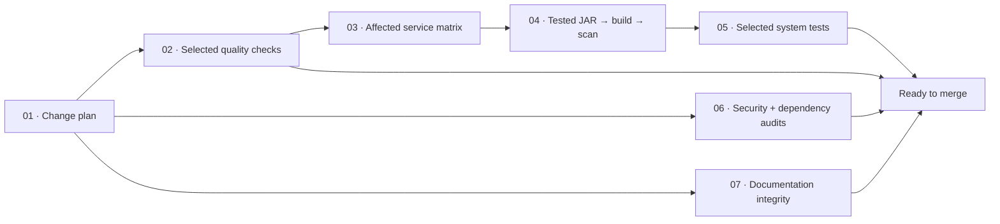
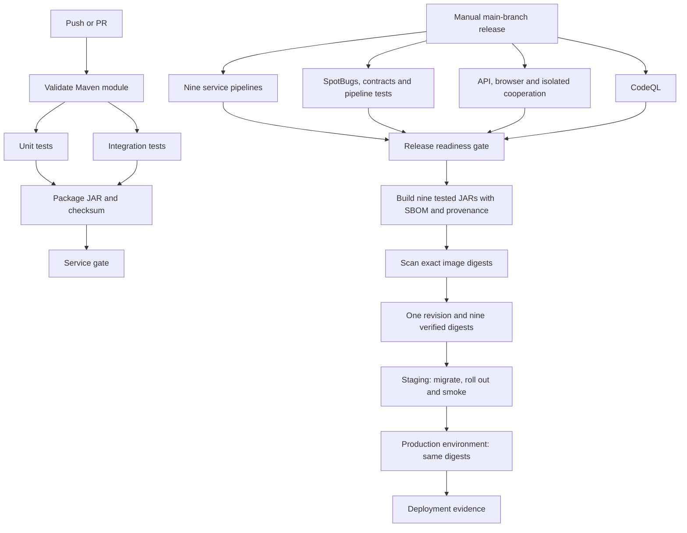

# CI/CD — build, verify, publish and deploy

`ci.yaml` is the single PR/main-push/merge-queue entry point. It plans affected work,
explains skipped tracks and presents a dependency graph with one stable **Ready to merge**
check. The nine service entry points are now manual debugging tools, avoiding duplicate
automatic runs. PR checks use disposable GitHub-hosted Linux runners; deployments remain
manual, trusted-main releases on a configured runner with cluster access.

## Change-aware CI

Each affected service expands to **validate → unit + integration → package → service gate**.
Packaging waits for both test tracks. Image verification waits for tested JARs; system
acceptance waits for selected builds/scans. Independent security and documentation tracks
can finish even when another track fails. The final gate runs after all selected work
and fails on errors, cancellation, missing jobs or unexpected skips. Only skips declared
by the change plan are accepted. Configure **Ready to merge** as the required branch check.
The workflow itself has no path filter that can leave that check permanently pending.

| Changed area | Work selected |
| --- | --- |
| Report/Markdown/SVG only | Documentation integrity; no Java/image/system matrix |
| Frontend CSS/HTML | Frontend package/tests, formatting, container scan and browser acceptance; Java static analysis/ESLint skip when unaffected |
| Frontend JavaScript | Frontend pipeline plus ESLint and browser acceptance |
| One owner backend | That service, Java analysis, contracts, API acceptance and fresh-database cooperation |
| `service-common`, parent build, Dockerfiles or workflow definitions | Full service and quality verification |
| Compose, identity, Kubernetes or monitoring configuration | Runtime/deployment validation and system acceptance |
| Missing Git base, merge queue, manual CI or release | Full verification as a safe fallback |

Renames account for both old and new paths; deletions still select their owner. Every run
uploads `ci-change-plan`, prints reasons for RUN/SKIP and writes native GitHub test-result
tables. Unit/integration XML and scan reports remain downloadable artifacts. Workflow
concurrency cancels superseded PR runs; matrices use at most three runners in parallel.

Dependency audits are selective too: Python source and requirements select their
relevant checks; npm lock/config changes select npm audit; infrastructure changes
select IaC scanning. A CSS-only change does not repeat unrelated Python dependency
audits. Selected security tracks still scan for secrets. Weekly and release runs
perform the complete security suite, including the CI tool requirements.

CI and release images use `Dockerfile.ci`: the downloaded JAR checksum is verified and
that exact tested JAR is copied into the runtime image. Image creation does not compile
another untested JAR. Maven/npm caches and Buildx caches reduce repeated work; PR images
are scanned locally without publishing to GHCR. Release candidates retain SBOM/provenance
and are promoted only after their exact digest passes scanning.

## Free tools and supply-chain controls

All added components are open source or native GitHub features. There is no external
reporting SaaS, paid formatter, paid Grafana plugin or third-party account requirement.
Prettier, ESLint, SpotBugs, Actionlint, Trivy, Bandit, pip-audit and zizmor are free tools.
CodeQL runs only for public repositories, where it is free; private repositories keep
the open-source gates and explicitly skip that optional CodeQL track.

Remote Actions are pinned to complete commit SHAs. [actions-lock.json](../.github/actions-lock.json)
records verified versions and upstream repositories; updates are deliberate through
`python scripts/pin_workflow_actions.py` or reviewed Dependabot PRs. Checkouts do not
persist repository credentials. PR workflows do not use `pull_request_target`, access
deployment secrets or publish packages. zizmor checks workflow trust boundaries in
addition to Actionlint syntax validation.

Sources: [GitHub job dependencies](https://docs.github.com/en/actions/how-tos/write-workflows/choose-what-workflows-do/use-jobs),
[GitHub job summaries](https://docs.github.com/en/actions/reference/workflow-commands-for-github-actions#adding-a-job-summary),
[zizmor installation](https://docs.zizmor.sh/installation/),
[Prettier](https://prettier.io/docs/), [Actionlint](https://github.com/rhysd/actionlint),
[Trivy](https://github.com/aquasecurity/trivy).

## Release dependencies

## Files and stages

| Workflow | Stages / purpose |
| --- | --- |
| `ci.yaml` | Change plan → selected quality → affected services → container scans → system acceptance, independent security/docs, then Ready to merge. |
| `users.yaml`, `products.yaml`, `orders.yaml`, `payments.yaml`, `product-view.yaml`, `product-synchronizer.yaml`, `apigateway.yaml`, `frontend.yaml`, `confirmation-job.yaml` | Manual service debugging; automatic runs are centralized in ci.yaml. |
| `service-ci.yaml` | Validate → parallel unit/integration jobs → package/checksum → service gate. Every job gets a fresh checkout; reports and JARs are separate artifacts. |
| `quality.yaml` | Selected Prettier, ESLint, module-scoped SpotBugs, contracts, Actionlint, zizmor and policy tests → skip-aware quality gate. |
| `container-ci.yaml` | Verify JAR checksum → build runtime image → Trivy scan; no PR publication. |
| `system.yaml` | Separate runner environments for API/broker/recovery, browser/roles/OIDC and self-starting backend cooperation → system gate. Outage tests within one environment run sequentially. |
| `codeql.yaml` | Security queries; standalone checks and a reusable release gate. |
| `security.yaml` | Mandatory release gate: Trivy dependency/secret/IaC matrix, Bandit, pip-audit and npm audit; also weekly scanning. |
| `images.yaml` | Matrix of nine Buildx builds, at most three in parallel; GHCR candidate publication, SBOM/provenance, Trivy scan and revision-bound manifest assembly. |
| `release.yaml` | Trusted-ref/input validation → all checks → optional publication → optional staging → optional production → final result summary. |
| `deploy.yaml` | Environment validation → artifact provenance → plan → four owner migration Jobs → digest rollout/readiness → HTTPS/auth/catalogue smoke and optional business compensation → evidence/cleanup. |
| `rollback.yaml` | Select an earlier successful release run, explicitly confirm schema compatibility, then reuse deployment with the older digests. |

Service/quality/system gates fail when a required stage fails, is cancelled or is skipped. Image candidates can be present in GHCR before their scan completes; only a fully successful image matrix produces the deployable `release-manifest` artifact. Fixable HIGH/CRITICAL image findings block promotion. A candidate tag is not a deployment approval.

## One-time target configuration

The deployment pipeline updates an **existing AJ Motors cluster**. Bootstrap its namespace, databases/PVCs, RabbitMQ, Keycloak, Secrets, owner network policies, HTTP Services, ingress/TLS, application Deployments and the confirmation ScaledJob first. [KUBERNETES.md](KUBERNETES.md) supplies the local kind demonstration. Cluster/bootstrap administration stays separate from application releases.

1. Create GitHub environments named `staging` and `production`. Restrict deployment branches to `main`. Configure production reviewers in GitHub if production promotion must await approval; YAML cannot enable that repository setting itself.
2. Register a current self-hosted runner with label `aj-deploy` and install Python 3.12, kubectl and Bash. Default labels are `["self-hosted","linux","aj-deploy"]`. On the current Windows workstation use a current Windows runner, Git Bash, and repository variable `DEPLOY_RUNNERS=["self-hosted","Windows","aj-deploy"]`. The runner must reach the cluster API, public application URL, identity endpoint, GHCR and GitHub. A local kind API bound to localhost needs a runner on that machine.
3. Use a dedicated runner/work directory and restrict its runner group to trusted release/rollback workflows. PR jobs use GitHub-hosted runners. Deployment has an additional main-branch/manual-event guard.
4. With cluster-administrator credentials, apply [deployment-rbac.yaml](../k8s/deployment-rbac.yaml). It grants namespace-scoped deployment/ScaledJob updates, migration Job creation and diagnostic reads; it does not administer database volumes, Secrets or cluster-wide resources. Obtain a kubeconfig for that identity using your cluster's supported credentials. Keep expiry/rotation in mind; the pipeline does not silently generate cluster-admin credentials.
5. Make GHCR images readable by the cluster: either make the nine packages public or preconfigure a registry pull Secret on the target workloads/default ServiceAccount. Publishing to a public GitHub repository does not by itself guarantee that new GHCR packages are public. The deployer does not create registry credentials.
6. Configure a confidential smoke client in the target Keycloak realm with audience/claims accepted by AJ APIs. Local kind uses the configured `aj-tests` client; a real environment should have its own smoke identity. Business smoke requires its administrator role. Keep the client secret in its GitHub environment.

Set these for **each** environment:

| Type | Name | Value / purpose |
| --- | --- | --- |
| Secret | `KUBE_CONFIG_B64` | Single-line base64 of that target's kubeconfig. Never commit it. |
| Secret | `SMOKE_CLIENT_SECRET` | Confidential target Keycloak client secret. |
| Secret, optional | `TLS_CA_B64` | Base64 PEM CA for local/self-signed HTTPS. Omit for certificates trusted by the runner's normal CA store. TLS verification is always enabled. |
| Variable | `KUBE_CONTEXT` | Explicit context present in that kubeconfig, e.g. `kind-aj-exam`. |
| Variable | `PUBLIC_BASE_URL` | Target HTTPS origin, e.g. `https://localhost:8443`. |
| Variable, optional | `KUBE_NAMESPACE` | Defaults to `aj`; update the bootstrap RBAC namespace too if changed. |
| Variable, optional | `IDENTITY_BASE_URL` | Defaults to public base URL + `/identity`. |
| Variable, optional | `SMOKE_CLIENT_ID` | Defaults to `aj-tests`. |
| Variable, optional | `BUSINESS_SMOKE` | Defaults to `true` in staging and `false` in production. |
| Variable, optional | `ROLLBACK_SCHEMA_COMPATIBLE` | Set `true` only under a reviewed expand/contract compatibility policy; enables automatic restoration after rollout/smoke failure when a previous complete digest release was captured. |

`DEPLOY_RUNNERS` is a **repository** variable because runner selection happens before environment-specific configuration is loaded. Use different contexts/clusters for staging and production; the workload configuration is read from each live target, preserving its issuer, endpoints, Secret references, volumes and network settings. The same nine release digests are promoted; production never rebuilds staging images.

## Running a release

In Actions, run **Verified release and deployment** on `main`:

- `publish=false`, `target=none`: run the full release checks without publication/deployment.
- `publish=true`, `target=none`: publish scanned candidates and retain `release-manifest/release.json`.
- `publish=true`, `target=staging`: publish, migrate and verify staging.
- `publish=true`, `target=production`: verify staging first, then enter the production environment and deploy those same digests.

Remote artifact origin is checked against the release workflow path, main branch and source SHA using GitHub's API. Cross-run rollback artifacts must come from an earlier successful run. Artifacts have explicit names so Buildx build-record artifacts cannot accidentally enter manifest assembly. Release artifacts retain their digests for 90 days; deployment/scan evidence for 30 days; ordinary test reports/JARs for 14 days.

## Migration, smoke and failure handling

Before changing an application, the deployer performs server-side dry-run validation and runs four bounded Flyway Jobs using the new owner's exact image digest, existing database configuration and owner network label. A failed migration prevents the application rollout. A proof file binds successful migration to revision, all images, context, namespace and the previously observed image set; apply refuses another release's proof or out-of-band image changes.

Migration init containers remain enabled as an additional readiness boundary. Changes must be compatible with running older binaries while the migration Jobs execute. SQL/broker workers remain single-replica with Recreate. These services can be temporarily unavailable during deployment; the pipeline does not promise zero downtime.

Smoke checks verify real HTTPS trust, frontend HTML, dependency status, GraphQL and an authenticated session. Staging also creates labelled synthetic customer/car/order/payment records, confirms reservation and deliberately records a failed manual payment to verify compensation. Eligible customer/car fixtures are soft-deleted afterward; order/payment audit remains. Production defaults to read-only smoke and may opt into the same business flow through `BUSINESS_SMOKE`.

A failed rollout or smoke leaves the workflow failed even if an enabled compatible rollback succeeds. Diagnostics include workload state, events, migration logs and application logs. Kubeconfigs, TLS files, live deployment specifications and environment values are excluded from uploaded evidence. Temporary credential files are removed in an always-run cleanup step.

Automatic rollback is disabled by default. If compatibility is configured and the previous state is a complete digest-pinned release with one revision, the workflow can restore that snapshot and recheck smoke. A first deployment from local tags has no verified rollback snapshot. For a manual restoration, run **Roll back verified application release**, select the target and earlier successful release run ID, and confirm compatibility with the current database. No rollback reverses Flyway migrations or restores a database backup.

## Local verification and remaining configuration

Run `python -m unittest discover -s scripts/tests -v` and Actionlint. Deployment tests cover migration failure blocking application changes, snapshot/rollback eligibility, single-worker limits, target configuration preservation, artifact provenance, immutable/matching images and migration-proof binding. Actual remote CI, registry publication and environment deployment require the configured GitHub environments/runner/cluster; their success is not inferred from YAML or unit tests. [CI-STATUS.md](CI-STATUS.md) records that boundary.

References: [GitHub reusable workflows](https://docs.github.com/en/actions/how-tos/reuse-automations/reuse-workflows), [Docker SBOM/provenance](https://docs.docker.com/build/ci/github-actions/attestations/), [Kubernetes Jobs](https://kubernetes.io/docs/concepts/workloads/controllers/job/), [kubectl rollout status](https://kubernetes.io/docs/reference/kubectl/generated/kubectl_rollout/kubectl_rollout_status/).

The locally recorded pipeline checks and TLS-proxied smoke results are retained in [pipeline-verification.json](evidence/pipeline-verification.json), with the pipeline source fingerprint and unexecuted boundaries. Image scanning is configured but was not run locally against newly published candidates.

See [CI/CD til eksamen](CI-CD-EXAM.md) for the expanded quality/security controls and local commands.
