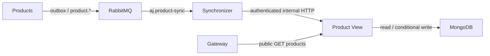

# Product View ejer MongoDB

Produktlæsemodellens eneste databaseejer er **Product View**. Product Synchronizer er
en beskedrelay med RabbitMQ- og HTTP-adgang. Synchronizer har ingen MongoDB-driver,
MongoDB-konfiguration eller forbindelse til databasenetværket.



## Internt projektions-API

`PUT /internal/projections/products/{productGuid}` findes kun i Product View og
videresendes ikke af gatewayen. Det kræver headeren `X-Projection-Token`.

```json
{
  "eventId": "UUID fra RabbitMQ messageId",
  "topic": "product.updated",
  "snapshot": {
    "guid": "samme UUID som i stien",
    "version": 3,
    "brand": "Volvo",
    "model": "EX30",
    "price": 279900.00,
    "currency": "DKK",
    "status": "AVAILABLE"
  }
}
```

Eksemplet viser de centrale validerede felter. Relayen sender hele det eksisterende
produktsnapshot med alle specifikationer, billeder, udstyr og tidsstempler fra eventet.
Tilladte topics er `product.created`, `product.updated`, `product.reserved` og
`product.removed`. Produkt- og eventidentitet skal være UUID'er; produktversion skal
være et ikke-negativt heltal. Produkt-GUID i sti og snapshot skal være ens.

| Svar | Betydning |
| --- | --- |
| 204 | Snapshot er gemt, eller en identisk/ældre produktversion er allerede overhalet |
| 400 | Ugyldig identitet, version, topic eller centrale produktfelter |
| 401 | Manglende eller forkert intern adgangsnøgle |
| 503 | Lagring er utilgængelig, eller samtidige opdateringer skal forsøges igen |

`GET /internal/projections/health` kræver samme nøgle og kontrollerer databasen.
Synchronizers `/health` kræver både fungerende brokerbehandling og denne ejerforbindelse.

## Levering, dubletter og rækkefølge

Synchronizer kvitterer først RabbitMQ-leveringen efter et 2xx-svar fra Product View.
Ved netværksfejl, 401/403, manglende ejerendpoint eller serverfejl beholdes beskeden til
genforsøg. En forkert adgangsnøgle taber derfor ikke køens events, mens konfigurationen rettes.
Et 400-svar identificerer et ugyldigt event, som flyttes til den eksisterende dead-letter-kø.

Product View anvender en unik GUID-indeksconstraint og versionsbetinget, atomisk erstatning.
Hvis en anden request har opdateret dokumentet siden opslaget, genlæses den aktuelle version
før et nyt forsøg. En langsom retry kan dermed ikke overskrive en nyere version.
En sletning gemmes som tombstone med sin version, så ældre snapshots ikke genopliver bilen.
Et mistet HTTP-svar kan genleveres sikkert med samme produktversion.

Dette er idempotens/versionering af produktprojektionen, ikke en generel løsning på
forretningshandlernes rækkefølge eller parallel outbox-behandling. De resterende regler
for ordre, reservation og betaling behandles fortsat i `REL-02` og `REL-03`.

## Konfiguration og netværk

| Service | Indstilling | Docker-default |
| --- | --- | --- |
| Product View | `MONGO_URI` / `MONGO_DB` | Egen MongoDB på `product-view-data` |
| Product View og Synchronizer | `PROJECTION_API_TOKEN` | `aj-projection-local` til lokal demonstration |
| Synchronizer | `PRODUCT_VIEW_URL` | `http://product-view:7000` |

Ved JVM-kørsel bruger klienten `http://localhost:7006`. Tilpas den interne nøgle i begge
processer, fx via `PROJECTION_API_TOKEN` i Compose-miljøet. Standardnøglen er kun en
lokal demokonfiguration; en produktionshemmelighed skal håndteres særskilt.

MongoDB er ikke publiceret på en værtsport ved normal opstart. Databasenetværket deles
kun mellem Product View og dens MongoDB-container. Ved databaseinspektion kan operatøren bruge:

```powershell
docker compose exec product-view-mongo mongosh product_view
```

Hvis man specifikt udvikler Product View som en lokal JVM-proces, kan man vælge en
debug-override, som publicerer databasen på loopback-port 27018:

```powershell
docker compose -f docker-compose.yml -f compose.mongo-debug.yml up -d
```

Denne debugmulighed er ikke del af standardopstarten. Eksisterende MongoDB-volume og
data bevares ved ændringen af netværk/ejerskab. Ingen dataflytning eller nulstilling er nødvendig.

## Verifikation

```powershell
mvn clean verify
python scripts/check_projection.py --failures
```

Java-integrationstests kontrollerer intern autentifikation, inputvalidering, fejl ved
lagring og relayens behandling af permanente versus midlertidige fejl. Den kørende
systemkontrol efterprøver netværks-/driveradskillelse, versionsrækkefølge, dubletter,
tombstones, samtidige snapshots og ventende events under udfald af ejer og database.
Testens egne synlige produktposter fjernes bagefter gennem de relevante interfaces;
fjernede dokumenter beholder en skjult tombstone. Kør ikke samtidigt med andre nedbrudstests.

Versionsbetingede databaseoperationer følger princippet om atomiske compound operations i
[MongoDB Java-driverens dokumentation](https://www.mongodb.com/docs/drivers/java/sync/current/crud/compound-operations/).
