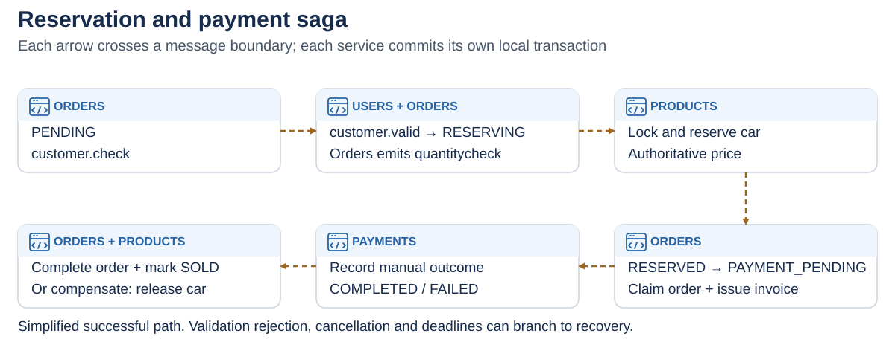
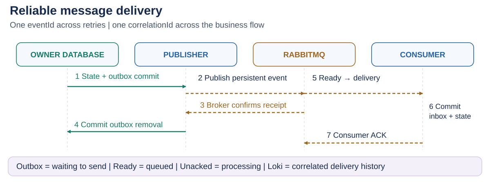
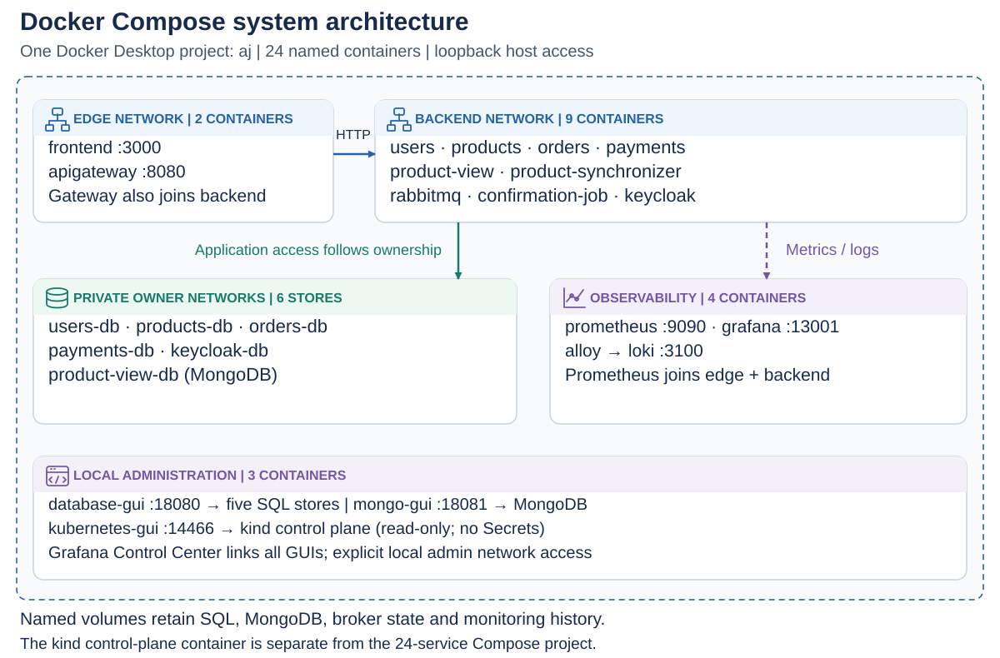
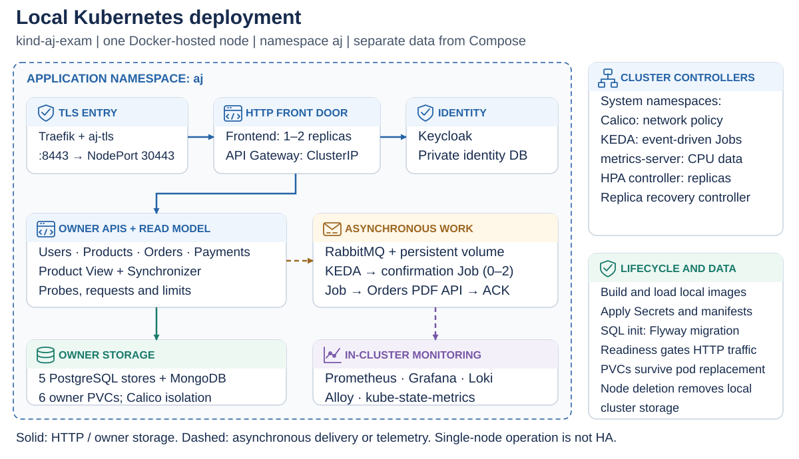
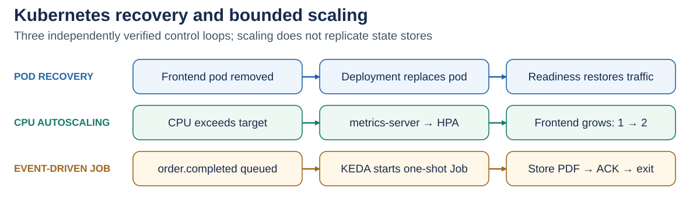
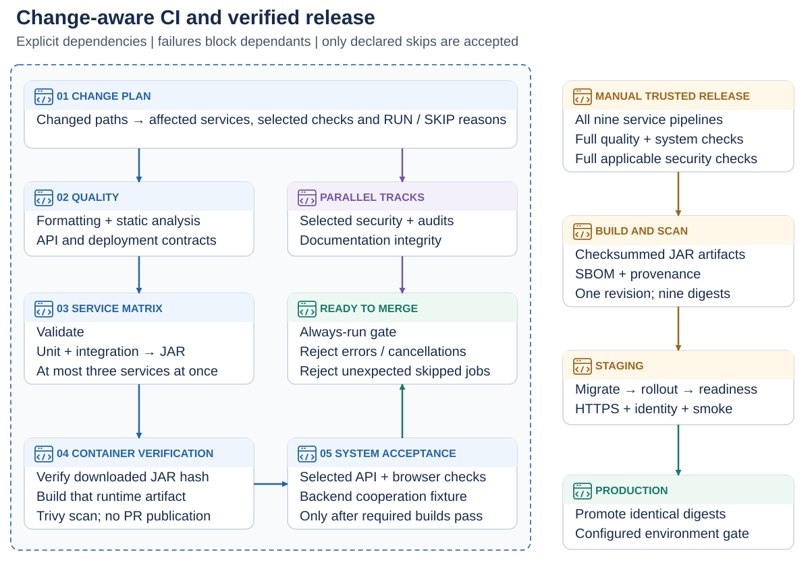
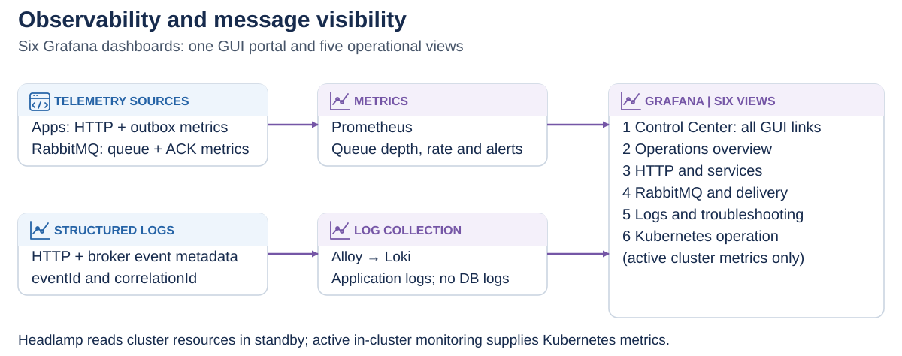
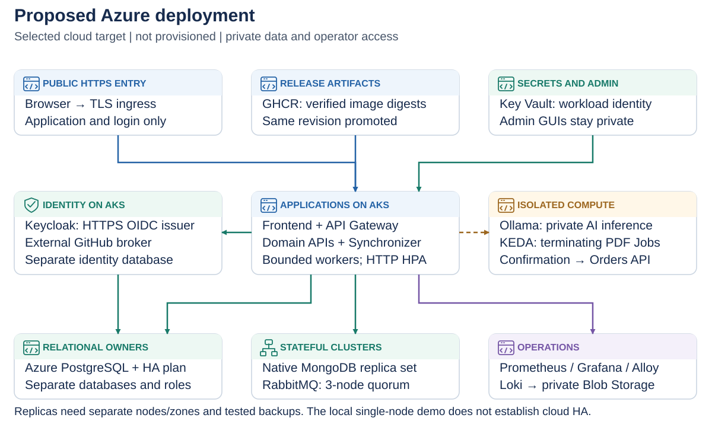
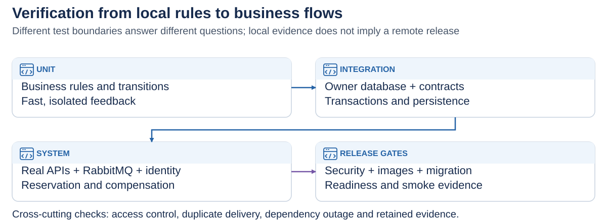

# AJ Motors

## Development of Large Systems — Project Report

**Authors**

- Ahmad Abdel Razak Hussein Alkaseb
- Jeppe Rønning Koch
- Asger Valdemar Bergøe
- Laith Abdel Razak Hussein Alkaseb

**Institution:** Business Academy Copenhagen (EK)  
**Course:** Development of Large Systems  
**Delivery date:** 11 December 2026  
**Status of this document:** Working report, requirements and deployment review updated on 12 November 2026

**Repository:** [AhmadAlkaseb/aj](https://github.com/AhmadAlkaseb/aj)

This report covers the technical and project-management topics in Mandatory Assignments 1 and 2 and follows the report structure in the final project description. It distinguishes implemented behaviour from proposed work.

<!-- PDF layout: the cover has no page number; the next page starts at 1. -->
\thispagestyle{empty}
\clearpage
\pagenumbering{arabic}

## List of figures

| Figure | Description | Location |
| --- | --- | --- |
| 1 | System architecture | Section 2.1; [SVG](report-figures/architecture.svg) |
| 2 | Databases and ownership references | Section 2.2; [SVG](report-figures/databases.svg) |
| 3 | API endpoints and request contracts | Section 2.3; [SVG](report-figures/api-contracts.svg) |
| 4 | API response contracts | Section 2.3; [SVG](report-figures/api-responses.svg) |
| 5 | Reservation and payment saga | Section 2.4.5 |
| 6 | Reliable message delivery | Section 2.4.7; [SVG](report-figures/message-delivery.svg) |
| 7 | Docker Compose system architecture | Section 3.1; [SVG](report-figures/docker-compose.svg) |
| 8 | Local Kubernetes deployment | Section 3.2; [SVG](report-figures/kubernetes-deployment.svg) |
| 9 | Kubernetes recovery and bounded scaling | Section 3.2; [SVG](report-figures/kubernetes-recovery.svg) |
| 10 | Verification and gated release pipeline | Section 3.2.2 |
| 11 | Observability and message visibility | Section 3.2.3; [SVG](report-figures/observability.svg) |
| 12 | Proposed Azure deployment | Section 3.3 |
| 13 | Verification boundaries | Section 4.1 |

## List of appendices

- Appendix A: Mandatory Assignment 1 coverage.
- Appendix B: Mandatory Assignment 2 coverage.
- Appendix C: Final-project requirement assessment.
- Appendix D: Installation and verification procedure.
- Appendix E: Evidence, documentation and outstanding decisions.

## Table of contents

1. [Introduction](#1-introduction)
2. [System architecture](#2-system-architecture)
3. [Environments description](#3-environments-description)
4. [Testing](#4-testing)
5. [Project management and team collaboration](#5-project-management-and-team-collaboration)
6. [Discussion](#6-discussion)
7. [Reflection](#7-reflection)
8. [Conclusion](#8-conclusion)
9. [References](#9-references)
10. [Appendix](#10-appendix)

Figures 1, 7 and 8 distinguish logical, Compose and Kubernetes architecture. [5]

# 1. Introduction

## 1.1. Problem description

AJ Motors is an online platform for a small, selected collection of exclusive cars. A customer should be able to inspect a car, register their details, reserve an available vehicle and complete an order when payment is recorded. [4]

The main technical problem is coordinating changes that belong to different services.

The implemented development system contains customer management, car management, a separate product catalogue, orders, manual payment registration and asynchronous catalogue synchronisation. Its frontend remains available when individual backend components fail and reports which functions are unavailable.

For examination demonstrations, startup automatically inserts 20 fictional customers, cars, orders and payments with stable references. Six examples are completed, four have pending payments and ten cars remain available after failed historical payments.

Stripe remains outside scope. Identity uses self-hosted Keycloak/OpenID Connect with exam accounts and self-registration. The requirement names an external identity provider; local Keycloak alone is therefore not asserted as unambiguously meeting that condition. GitHub federation is implemented as an idempotent broker configurator and redirect verifier; activation needs an owned OAuth app and a real browser login. See [EXTERNAL-LOGIN.md](EXTERNAL-LOGIN.md). [3], [20], [31], [35], [36]

## 1.2. Functional and non-functional requirements

### Functional requirements

| ID | Requirement and acceptance criterion | Status |
| --- | --- | --- |
| FR-01 | Create/read/edit/soft-delete customer profiles; reject duplicate email | Implemented; distinct from login identity |
| FR-02 | Browse catalogue and vehicle details | Implemented |
| FR-03 | Filter by brand/model/status/price/year/mileage with bounded pages | Implemented in GraphQL owner |
| FR-04 | Maintain car listings; block changes/removal of reserved or sold cars | Implemented |
| FR-05 | Reserve with validated customer, authoritative price and availability | Implemented asynchronously |
| FR-06 | Competing buyers cannot both reserve one car | Selected concurrent scenario passes |
| FR-07 | Record manual payment; sell on success or release on failure | Implemented; no money transfer |
| FR-08 | View own orders and cancel eligible reservations | Backend ownership enforced |
| FR-09 | Keep frontend available with useful dependency error/retry | Implemented; no backend failover |
| FR-10 | Token authentication, roles and ownership | Local OIDC implemented; external-provider boundary in Appendix C |
| FR-11 | Use GraphQL queries and REST commands in one real frontend workflow | Catalogue → reservation implemented |
| FR-12 | Backend AI API workflow with validation and failure handling | Real local draft workflow verified |
| FR-13 | Trigger an isolated task that finishes and terminates | KEDA PDF Job verified |

API interoperability, AI, authentication and isolated serverless work are compulsory. [3]

### Non-functional requirements

| ID | Target | Verification and limits |
| --- | --- | --- |
| NFR-01 | Interactive latency below 2s under defined load | 10,000 cars/20 clients: p95 3.782s, quieter repeat 1.139s; 4.8 |
| NFR-02 | 99% availability excluding agreed maintenance | Unmeasured target; no historical SLA claim |
| NFR-03 | Retain committed work through broker outage | Selected outbox/recovery scenario passes |
| NFR-04 | Exclusive car allocation | Concurrent reservation scenario |
| NFR-05 | Reproducible, independent deployment | Separate images/Compose; shared build coupling remains |
| NFR-06 | One owner per data store | Network/credential review and owner APIs; explicit GUI admin exception |
| NFR-07 | Workload-driven scaling | Real frontend HPA 1→2; KEDA Jobs; bounded stateful workers |
| NFR-08 | Protected identities, actions and sensitive data | Real-token ownership, TLS/isolation checks; production trust separate |
| NFR-09 | Diagnose distributed failures | Correlated logs, metrics, dashboards and controlled alert |
| NFR-10 | Predictable schema/contract evolution | Flyway, API v1 and message-envelope compatibility |
| NFR-11 | Desktop/mobile usability | Selected browser flows; no accessibility audit |

Targets are not guarantees: containers alone prove neither scalability nor availability.

## 1.3. Technology stack and rationale

| Area | Choice and rationale |
| --- | --- |
| Backend | Java 17/Javalin and Maven: consistent HTTP/runtime/build tooling; shared code reduces duplication but couples builds. |
| Frontend | HTML/CSS/JavaScript served by Javalin: real catalogue/admin workflows without React, which was only an earlier proposal. |
| Owner data | PostgreSQL 16, Hibernate/JPA and Flyway: constraints, local transactions/locks and explicit schema history. |
| Catalogue | MongoDB 7: bounded document queries over denormalised product snapshots; no claim of intrinsic superiority to SQL. [30] |
| Communication | REST/JSON commands, GraphQL catalogue queries and RabbitMQ AMQP events with outbox/inbox recovery. [7], [19] |
| Identity and AI | Keycloak OIDC/JWT; Products calls local Ollama for bounded, human-reviewed drafts. [20], [26], [31] |
| Runtime | Compose for development; kind/Calico/HPA/KEDA for local production simulation, owner isolation and isolated Jobs. |
| Verification | JUnit/Mockito/H2 plus real container tests, Playwright, static/contract/security checks and gated GitHub Actions. [27], [28] |
| Operations/models | Prometheus, Alloy, Loki and Grafana; editable PlantUML/Mermaid/SVG figures and native administration GUIs. |

Choices support the course's distributed-systems goals. Their trade-offs and actual evidence, including bounded concurrency and a single-node environment, are discussed below.

# 2. System architecture

## 2.1. Introduction to the microservices architecture

The application separates customer information, authoritative product state, product queries, orders and payments. A gateway routes public API requests, while RabbitMQ coordinates reservation outcomes, payment outcomes and read-model changes.

*Figure 1. Logical system architecture. Solid arrows represent synchronous HTTP or owner database access; dashed arrows represent RabbitMQ delivery. Editable overview: [model sources](report-figures/README.md); full UML: [Architecture.puml](application/Architecture.puml).*

This view describes responsibilities and communication independently of the runtime. The frontend uses Keycloak for browser login, and backends validate tokens using its public keys.

There are five separately runnable domain/API backends: Users, Products, Product View, Orders and Payments. [3]

Each application has an independent process and container configuration. The monorepo also has a parent Maven build and `service-common`. Independence at runtime should not be confused with complete independence of source changes or build tooling.

The full Compose environment has twenty-four containers: eight application containers, a PDF worker, five PostgreSQL servers, MongoDB, RabbitMQ, Keycloak, four observability containers and three administration GUIs. Kubernetes uses separate workload resources and starts a terminating PDF Job on demand; its pod count is therefore not the Compose container count.

## 2.2. Microservices description

### Users

Users isolates customer profile maintenance and customer-existence decisions from commercial orders. Its protected REST API manages names, email, telephone and address; Keycloak issues credentials, while Users independently validates tokens, roles and ownership. It consumes `customer.check` and produces `customer.valid` or `customer.invalid`, allowing Orders to wait without a synchronous dependency on Users.

Its PostgreSQL store owns customer UUIDs, profile fields, unique emails and deletion markers, with local transactions and inbox/outbox records. PostgreSQL supplies the constraints required by profile updates; no other business service reads this store. Broker failure retains accepted outgoing work; database failure blocks profile commands. Workers remain single-replica pending broader concurrency verification. Public contracts and event payloads are referenced in Section 2.3.

### Products

Products owns authoritative vehicle details, sale price, availability and reservation ownership. Isolating these rules prevents Orders or the catalogue from choosing inventory outcomes. REST supports administrative maintenance and a human-reviewed AI description draft; public catalogue queries normally use Product View. Products consumes `quantitycheck`, `order.cancelled`, `paymentfail` and `payment.completed`, and produces reservation outcomes and `product.*` snapshots.

Its private PostgreSQL database supports constraints, transactional reservation locks, retained release signals and inbox/outbox records. The actual Ollama call receives only bounded vehicle facts and cannot change price or inventory. A broker outage causes projection lag while local updates remain queued; an unavailable database rejects commands. Inventory workers use one replica and Recreate rollout because arbitrary parallel-worker histories have not been verified.

### Product View

Product View separates catalogue queries from authoritative product commands. It exposes read-only REST and typed GraphQL consumed by the real frontend, plus a private authenticated projection-write API. It neither subscribes directly to RabbitMQ nor produces business events: Product Synchronizer relays the original product event identity and snapshot to its owner API.

MongoDB owns the `product_view` document model, embedding the display fields needed by catalogue filters without cross-service joins. Conditional version updates, inbox identity and tombstones reject stale snapshots and resurrection. Query depth, page size and filters are bounded. Reads can continue from an existing projection while messaging is unavailable, with visible eventual-consistency limits; MongoDB failure prevents catalogue reads. Section 4.8 reports the 10,000-car measurement rather than assuming the projection is faster. Database choice and ownership are documented in [ADR-002](decisions/002-projection-ownership.md).

### Product Synchronizer

The synchronizer isolates reliable event delivery from catalogue query/storage responsibilities. It consumes `product.created`, `product.updated`, `product.reserved` and `product.removed` from `aj.product-sync`, forwarding the envelope to Product View's authenticated internal HTTP API. It exposes health/metrics, no public business API, and emits no new domain event.

It owns no database and has neither MongoDB credentials nor database-network access. Acknowledgement follows successful owner storage; temporary owner/broker failures retry and malformed data dead-letters. Original event identity and projection versions make selected redeliveries harmless. It remains a bounded single-replica worker; raising replicas is a separate verification task. Local database GUIs have explicit administration access, an exception to application ownership rather than another business writer.

### Orders

Orders isolates purchase intent and saga progress from customer, inventory and financial ownership. Its REST API creates/views orders, cancels eligible reservations and serves owned PDF confirmations. Its private PostgreSQL store contains order state, deadlines, public customer/product UUID references, status audit, PDF, inbox and outbox. Local relational integrity does not create foreign keys into other services.

Creation commits PENDING with `customer.check`. Valid customer outcomes lead to `quantitycheck`; reservation outcomes produce RESERVED or rejection. `payment.requested` claims a reserved order and produces `payment.authorized` or `payment.rejected`. Payment outcomes complete/fail the order; completion emits `order.completed`. Cancellation and expiry release eligible inventory; `payment.reconcile` requests stored outcomes. New validation expires after five minutes and unpaid reservations after thirty; ambiguous payment becomes REVIEW_REQUIRED. The API, confirmation writer and workers enforce separate access boundaries. Broker outages retain committed work; database outages block commands. Single-replica workers/Recreate and retained signals bound currently verified concurrency.

### Payments

Payments owns manual payment registration and immutable terminal outcomes, separately from inventory and order lifecycle. REST creates/retrieves payment records and permits authorised outcome registration; it does not transfer money. Its PostgreSQL store owns amounts, payment/order references, status audit and inbox/outbox. Unique order references and a deterministic payment identity prevent duplicate creation; terminal success cannot be changed to failure.

It publishes `payment.requested`, consumes `payment.authorized`/`payment.rejected`, and takes invoice values from the authorised owner response rather than client input. Terminal outcomes emit `payment.completed` or `paymentfail`; `payment.reconcile` republishes a stored outcome for recovery. Broker failure leaves outgoing work pending, while database failure blocks registration. Processing remains single-replica: adding workers without verifying cross-order locking and replay semantics would not establish safe scalability.

### Confirmation processor

The isolated processor consumes `order.completed` from `aj.confirmations`, generates a PDF and stores it through Orders' private authenticated API. It has no own database and emits no business event. Orders retains the first PDF per order, so retrying storage does not create duplicate documents. Transient failures requeue; malformed messages dead-letter. Compose keeps the processor available as a worker; Kubernetes uses a KEDA ScaledJob that terminates after one delivery, with a configured maximum of two concurrent Jobs. This isolates an elastic background task without treating an always-running HTTP service as serverless. [12]

### Frontend, gateway and supporting infrastructure

The frontend also provides Keycloak login/logout, silent SSO and a validated identity display. [20], [31]

The frontend provides a public catalogue and role-aware customer, order and payment views.

The gateway routes product reads to Product View, writes to Products and the remaining resource operations to their owning services.

RabbitMQ and the databases are infrastructure, not additional business microservices or third-party integrations. Running them in local containers does not make them external services in the business architecture. They are nevertheless independent failure domains.

### Data model and ownership

*Figure 2. Current database model. Source: [Databases.puml](application/Databases.puml). SQL field types and constraints were checked against the running development databases.*

Users, Products, Orders and Payments each use a main identifier table, a details table and a deletion table.

Order and payment references use public UUIDs so that services need not share internal numeric IDs. Local SQL foreign keys protect local relations only. Cross-service existence is checked through the owning API or a workflow, with the usual risk that remote state changes after a lookup.

The MongoDB read model contains a complete product snapshot, a version, an event identity and a deletion flag. Price is stored as Decimal128. SQL and read-model timestamp representations are currently not fully uniform, which should be made explicit in machine-readable contracts.

## 2.3. Communication between microservices

### REST and API interoperability

Public REST resources use `/api/v1` and JSON field names in camelCase.

*Figure 3. Implemented operations and requests. Source: [API Contracts.puml](<application/API Contracts.puml>); detailed contracts: [API.md](API.md).*

*Figure 4. Implemented response representations. Source: [API Contract Responses.puml](<application/API Contract Responses.puml>).*

The diagrams reference generated, validated [OpenAPI contracts](contracts/openapi/frontend.json), a vendored Swagger UI at /swagger/index.html, the [GraphQL schema](../product-view/src/main/resources/catalogue.graphqls) and [AsyncAPI contracts](contracts/asyncapi.json). Per-service READMEs explain responsibility, startup, configuration and tests. [21], [22]

Product View exposes typed GraphQL catalogue queries used by the actual frontend. [3], [19]

The frontend sends bounded GraphQL queries to `POST /api/v1/graphql`; the subsequent reservation uses REST. The SDL and OpenAPI contracts define field-level details.

### Asynchronous messages

The `aj.events` topic exchange distributes JSON messages to six durable consumer queues. A shared envelope contains `eventId`, `eventType`, `occurredAt`, `correlationId`, `schemaVersion: 1` and `payload`. AMQP `messageId` matches eventId. The order UUID follows the entire purchase as correlationId, including derived product snapshots. Product payload.version remains a separate state version.

The AsyncAPI contract specifies the envelope and payloads; event identity remains stable across retries while correlation follows the order.

| Routing key | Producer | Consumers | Business purpose |
| --- | --- | --- | --- |
| `customer.check` | Orders | Users | Validate the referenced customer |
| `customer.valid`, `customer.invalid` | Users | Orders | Continue or reject customer validation |
| `quantitycheck` | Orders | Products | Request an exclusive car reservation and authoritative price |
| `quantityreserved` | Products | Orders | Confirm the reservation |
| `quantityrejected` | Products | Orders | Reject an unavailable or outdated-price reservation |
| `order.cancelled` | Orders | Products | Release an eligible reservation |
| `payment.requested` | Payments | Orders | Claim an eligible RESERVED order |
| `payment.authorized`, `payment.rejected` | Orders | Payments | Supply authoritative invoice or reject creation |
| `payment.completed` | Payments | Orders, Products | Complete the order and mark the car sold |
| `paymentfail` | Payments | Orders, Products | Fail the order and release the car |
| `product.created`, `product.updated`, `product.reserved`, `product.removed` | Products | Product Synchronizer | Update the catalogue snapshot or tombstone |
| `order.completed` | Orders | Confirmation job | Generate and persist one PDF artifact |
| `payment.reconcile` | Orders | Payments | Republish the stored terminal outcome for recovery |

The queues are `aj.users`, `aj.products`, `aj.orders`, `aj.payments`, `aj.product-sync` and the isolated `aj.confirmations` queue. Invalid messages can be moved through the dead-letter exchange to `aj.dead`; transient dependency failures are retried.

Reservation requests include order/product/customer references and initially null price fields; confirmation adds the authoritative amount/currency. Payment requests include order/payment identifiers; authorisation adds invoice fields, and outcomes include the product reference. [4], [22]

### Why both communication styles are used

HTTP provides immediate user-facing commands and queries, health status and OIDC/JWKS exchange. Customer validation, product reservation, payment initiation and outcomes use RabbitMQ, so these domain interactions can wait for an unavailable consumer. [3]

## 2.4. Patterns and techniques

### 2.4.1. CQRS

Products is the command-side authority, while Product View serves a separate MongoDB query representation. This is a concrete application of CQRS to a read-oriented catalogue rather than a requirement to split every domain. [6]

### 2.4.2. Immutable data, tombstones and snapshots

Deletion markers in PostgreSQL and tombstones in MongoDB retain evidence that a record was removed. Product messages carry full-state snapshots, allowing the projection to replace a product's display state without retrieving each individual field from Products.

The immutable information is deliberately scoped: removal markers, versioned snapshots and append-only order/payment status audit. Profile and product detail fields remain mutable, and confirmed outbox entries are removed.

### 2.4.3. Idempotence

SQL consumers record processed event identities in an inbox as part of the transaction that changes business state. A redelivered event with the same identity is ignored. Payment creation uses one stable identity per order, and repeating the same terminal payment result does not emit another outcome.

Users, Products and Orders support identity-scoped Idempotency-Key headers. A request fingerprint, original result and outbox commit in the owning SQL transaction.

### 2.4.4. Commutative message handlers

Within a versioned projection, an older product version is ignored after a newer snapshot or tombstone has been applied. For distinct versions, that gives the projection the same final state whether an older snapshot arrives before or after the newer one.

Products retains reservation signals so cancellation/failure received before quantitycheck blocks a late reservation. Paid inventory cannot be freed by a stale cancellation. [3]

### 2.4.5. Saga pattern

The implemented reservation/payment flow uses local database transactions and compensating release events. [8]

Saga recovery includes stored deadlines, compensation, periodic reconciliation and an explicit manual-review state. It still depends on eventual infrastructure recovery or informed operator action; a permanently ambiguous payment is kept visible rather than silently released. The tests cover selected crash boundaries, not every possible distributed history.

### 2.4.6. Caching

No Redis cache or explicit application response cache is implemented. The MongoDB catalogue is a persistent read projection, not a disposable cache with a time-to-live. Caching could be evaluated for expensive catalogue reads after adding pagination and measurements, but it is not presented as a used pattern.

### 2.4.7. Transactional outbox and reliable delivery

A domain update and its outgoing outbox record commit in one local SQL transaction. A worker publishes the stored message and removes the outbox record only after broker confirmation. [9]

SQL consumers commit the business handler and inbox insertion together. The acknowledgement follows the completed transaction; an exception takes the retry/dead-letter path.

Persistent messages, durable queues, publisher confirms and consumer acknowledgements serve different points in delivery. A consumer acknowledgement is issued after processing; a publisher confirm alone does not prove that business processing completed. These mechanisms support recovery but do not establish exactly-once execution. [7]

*Figure 6. Distinct persistence and acknowledgement boundaries. The consumer commits its local state and inbox before acknowledging; the publisher removes the outbox record after broker confirmation.*

Figure 6 also explains the operational states: outbox entries are waiting to be sent, Ready messages are waiting in RabbitMQ, and Unacked messages have been delivered but not yet acknowledged. A fast transition may fall between metric scrapes; correlated logs retain the observed publish/process/acknowledge events.

# 3. Environments description

## 3.1. Development environment with Docker Compose

The root `docker-compose.yml` maps Figure 1 to the concrete deployment in Figure 7. `./scripts/start.ps1` starts all twenty-four containers under one Docker Desktop project, `aj`, including monitoring and the PDF worker. Explicit names such as `rabbitmq`, `users-db` and `grafana` remove generated name suffixes. Containers use service DNS internally; published host ports bind to loopback.

*Figure 7. The implemented twenty-four-container Compose deployment. Cards group containers by operational responsibility; owner networks still isolate each database rather than granting every backend access to every store.*

The gateway bridges the edge and backend networks. Each SQL owner and Product View use dedicated data networks; Adminer and Mongo Express receive explicit local administration access to their respective stores. `product-view-db` is the MongoDB container name, while `product-view-mongo` remains its Compose service DNS name. Prometheus joins edge and backend to scrape both frontend and backend metrics. Volumes retain databases, broker state and monitoring history; migration from the earlier `aj-monitoring` project preserves its data.

Grafana opens **AJ Control Center**, linking all five SQL databases, MongoDB, Headlamp, RabbitMQ, Keycloak, Swagger and Actions. GUIs open in separate tabs. Headlamp has read-only resource/log access without Secret access. Local administration uses one configurable username/password across the application and tools; each tool retains its own login form, and internal service credentials retain their separate roles. The PDF worker stays available with `CONFIRMATION_WORKER=true`, whereas the same application terminates after one delivery in Kubernetes. Per-service Compose files remain an alternative development mode with their separately documented volumes. See [LOCAL_SETUP.md](LOCAL_SETUP.md).

Demonstration seeding is enabled by default and can be disabled with `DEMO_DATA_ENABLED=false`. Stable fixture identities prevent duplicate insertion across restarts. These fixtures initialise historical example states; they are not evidence that twenty new purchases have been executed through live APIs at every startup. MongoDB receives the twenty product snapshots asynchronously.

| Component | Local port | Persistent storage |
| --- | --- | --- |
| Frontend / API Gateway | 3000 / 8080 | None |
| Users / PostgreSQL | 7002 / 5433 | Dedicated Users volume |
| Products / PostgreSQL | 7003 / 5434 | Dedicated Products volume |
| Orders / PostgreSQL | 7004 / 5435 | Dedicated Orders volume |
| Payments / PostgreSQL | 7005 / 5436 | Dedicated Payments volume |
| Product View / MongoDB | 7006 / private (optional debug 27018) | Dedicated projection volume |
| Product Synchronizer | 7007 | No database; RabbitMQ and owner API |
| RabbitMQ / management interface | 5672 / 15672 | Broker volume |
| Keycloak / identity PostgreSQL | 8180 / private | Dedicated identity volume |
| Grafana / Prometheus / Loki | 13001 / 9090 / 3100 | Separate monitoring volumes |
| Alloy / confirmation worker | No public port | Collector positions / Orders-owned PDF |
| Adminer / Mongo Express / Headlamp | 18080 / 18081 / 14466 | Local administration; ignored Headlamp kubeconfig |

MongoDB has no published database port in normal startup. Adminer joins the five SQL owner networks and Mongo Express joins the MongoDB network for explicit local administration; business services retain their ownership boundaries. Java applications use internal port 7000.

Images include the Java runtime and run the application under a non-root user. Health checks distinguish process liveness from dependency availability. Named volumes survive an ordinary Compose shutdown. They are persistence, not a backup strategy. Development credentials and unencrypted local HTTP are unsuitable as a production security configuration.

## 3.2. Local Kubernetes deployment simulating production

The local `kind-aj-exam` environment runs a Kubernetes node as a Docker container. Kubernetes manages its own pods rather than adopting the existing Compose containers. Figure 8 maps the logical system to namespace `aj`, Deployments, ClusterIP Services, owner PVCs, Calico policies and Traefik TLS ingress at `https://localhost:8443`. SQL init containers migrate before application schema validation. This is a tested single-node simulation, not host-failure HA. [3], [10]

*Figure 8. Application resources inside namespace aj and the supporting cluster controllers. Grouped owner APIs represent separate Deployments and Services. Persistent stores keep individual claims and owner-only ingress policies.*

Compose and Kubernetes use separate persistent data. Active Kubernetes mode pauses Compose. Normal local startup keeps the control plane reachable by Headlamp in standby, scales AJ Deployments to zero and pauses the confirmation ScaledJob. The control-plane container is separate from the twenty-four Compose containers; data is not deleted. Runtime Secrets and TLS keys remain outside committed manifests. Image-ID annotations cause changed local images to roll out even when the `:local` tag is reused. Probes gate traffic and container recovery; resource requests/limits bound workloads. Keycloak has additional CPU and startup allowance for its first schema import. See [KUBERNETES.md](KUBERNETES.md).

*Figure 9. Separate control loops for pod replacement, CPU-driven frontend scaling and queue-driven PDF Jobs. More frontend replicas do not replicate the databases or RabbitMQ.*

The 11 November local verification replaced a deleted frontend pod, completed a TLS purchase and KEDA PDF Job, blocked an unrelated pod from Users' database, and scaled frontend from one to two ready replicas. Temporary load/probe resources were removed. These are observed local results, not an availability guarantee; machine-readable results are retained in `test-results/kubernetes-results.json`.

### 3.2.1. Technologies and isolated tasks

kind supplies the local cluster; Calico enforces owner network boundaries. Random runtime secrets and local TLS keys are kept outside committed manifests. The confirmation console application consumes its own durable order.completed queue, generates a PDF, writes through the Orders owner API and exits. It acknowledges only after storage; repeating the task preserves the first document. KEDA ScaledJob supplies event-driven scheduling rather than a permanently running service renamed as serverless. [10], [12]

Products calls an actual local Ollama model to draft descriptions from validated brand/model/year. It forwards no customer/payment information, applies schema/output/time limits, and inserts text for human approval. It cannot change invoice values or availability. Adapter failure tests and an actual browser-to-model run are documented in [AI.md](AI.md). The model and Kubernetes can be demonstrated separately within the workstation memory budget. [26]

### 3.2.2. CI/CD pipeline

One automatic entry point, `ci.yaml`, handles PRs, main pushes and merge queues. Its change plan explains RUN/SKIP decisions and selects affected services and checks; service entry points are manual debugging tools. Documentation-only edits skip application builds. Frontend changes select browser checks, backend edits select owner/API/cooperation checks, and shared build/workflow changes select the full suite. Unknown Git bases use full verification. Weekly and release runs retain complete security verification. [27], [28], [29]

*Figure 10. Change-aware CI and complete release verification. Dependency failures block downstream work; only skips declared by the change plan are accepted. Publication and deployment are explicit release choices.*

Each service separates validation, parallel unit/integration jobs and packaging. Containers copy the checksummed JAR from the successful service pipeline. The final gate always runs and rejects failed, cancelled, missing or unexpectedly skipped work; configure **Ready to merge** as the required branch check. Native summaries show selection reasons and test results. Matrices run at most three services concurrently and superseded PR runs are cancelled.

Prettier, ESLint, SpotBugs, Actionlint, zizmor, Trivy, Bandit and dependency audits are free/open-source controls. Remote Actions use immutable commit SHAs; checkouts do not retain credentials. CodeQL is selected only where the repository is public. Fixable HIGH/CRITICAL image findings block promotion. [29], [34]

Release readiness precedes image publication. Server-side validation and bounded owner Flyway Jobs precede application changes; migration proofs bind the release and unchanged target state. Staging verifies HTTPS/authentication and compensation; production promotes identical image digests. Compatible rollback restores images, not database history. Actual GitHub runs and environment protection settings are documented only after observation; local passes do not establish remote execution. See [CI-CD.md](CI-CD.md) and Appendix E.

### 3.2.3. Monitoring and logging

Prometheus scrapes application histograms/counters, outbox age/count, projection lag and RabbitMQ queue metrics. Alloy forwards application-only logs to Loki. HTTP and broker records share business correlation IDs without recording payloads, tokens or passwords; database logs are excluded. Figure 11 separates the metrics and log paths. [24], [25]

*Figure 11. Complementary metrics and log pipelines. The five operational dashboards and a sixth Control Center portal are provisioned in both runtimes; Kubernetes resource panels require the in-cluster kube-state-metrics source.*

The dashboards cover operations, HTTP/services, RabbitMQ/delivery, logs and Kubernetes operation. Control Center adds links to all administration GUIs; Headlamp can inspect standby resources independently of active Kubernetes application metrics.

Compose monitoring belongs to project `aj`; Kubernetes deploys its own Prometheus, Loki, Alloy, Grafana and kube-state-metrics. The 12 November Compose checks validated six dashboards, thirty-five panel queries, nine healthy scrape targets and isolated RabbitMQ delivery. GUI checks passed five SQL logins, Mongo Express and read-only Headlamp node access; reading Secrets returned 403. The earlier active Kubernetes baseline had ten healthy scrape targets.

### 3.2.4. Autoscaling configuration

Frontend HPA uses real CPU metrics with a one-to-two replica range. [11], [12]

Application scaling is separate from database replication and broker HA. More replicas cannot remove a single state-store failure or guarantee faster queries. The local cluster demonstrates the configured mechanisms; its actual scaling/job result is recorded in EVIDENCE.md rather than assumed from YAML.

## 3.3. Cloud deployment plan

### Provider investigation and choice

The supplied example selected Azure. This report retains Azure as the proposed cloud direction, while distinguishing that planning decision from deployed infrastructure. [4]

| Provider | Relevant option | Assessment for this project |
| --- | --- | --- |
| AWS | ECS for managed container orchestration | A viable container platform, but the team would still need to configure persistence, messaging, identity and operations around the application. [13] |
| Google Cloud | Cloud Run for container-based services | A viable managed service option; continuously running workers and persistent infrastructure require an explicit hosting design. [14] |
| Microsoft Azure | Container Apps or AKS | Container Apps offers managed container execution; AKS provides a Kubernetes-oriented path closer to the required local-cluster exercise. [15], [16] |

The selected cloud plan uses **AKS**, retaining the local Kubernetes workload model rather than operating Container Apps alongside it. This is a proposed target, not provisioned infrastructure. One Azure region and private VNet contain applications, identity, messaging and stores; public ingress exposes only HTTPS application/login endpoints. Adminer, Mongo Express and Headlamp stay private behind operator access. [16], [32]

*Figure 12. Selected cloud deployment plan, including identity, AI and isolated jobs. It preserves owner APIs and private stores; it is not a record of provisioned services.*

| Component | Selected target and trade-off |
| --- | --- |
| Applications and release images | AKS with separate system/application pools; GHCR digest-pinned images. Reuse one registry and the existing release manifest. Stateless frontend may scale; transactional workers retain tested limits. |
| Relational stores | Azure Database for PostgreSQL Flexible Server; separate databases/roles for four owners and Keycloak. Begin with a shared server only if shared capacity/failure exposure is acceptable; split hot or critical owners. |
| Catalogue and broker | Native MongoDB replica set and three-node RabbitMQ with quorum queues on separate persistent volumes/nodes. Retain driver semantics; operating replicas and restoring backups remain team responsibilities. |
| Identity | Keycloak on AKS with its own SQL database, public HTTPS issuer and private admin access. External GitHub brokering requires an OAuth app; no provider credentials are assumed. |
| AI and PDF | Private Ollama workload with an explicit memory/GPU budget, bounded calls and human approval; KEDA schedules terminating PDF Jobs from RabbitMQ and writes through Orders. |
| Operations and secrets | Self-hosted Prometheus/Grafana/Alloy/Loki, with private Azure Blob log storage; Key Vault and workload identity deliver secrets. Local GUI ports/passwords are not cloud access policy. |

### Application and database availability

The plan uses separate application replicas and rolling releases where business semantics permit. A managed PostgreSQL HA configuration can use separated primary/standby replicas, including zone-redundant options; this must be explicitly selected and funded. Four logical databases on one physical server retain some schema separation but share a failure domain, so physical separation is an explicit cost-versus-isolation decision. [17]

The MongoDB service must support the actual driver, Decimal128, indexes and update behaviour. A nominally compatible cloud database is not assumed to be a drop-in replacement without tests. The cloud plan replaces the single local broker with quorum queues on three separate nodes and a tested backup/recovery procedure. A MongoDB replica set similarly separates replicas across nodes; neither topology is demonstrated by the local single-node environment.

### Cost, latency and elasticity

The pricing strategy uses on-demand compute until measurements justify reservations/savings commitments; scale stateless pools and Jobs within limits, while budgeting continuously running database, broker, identity and monitoring capacity. Configure budget alerts, log retention, storage lifecycle and backup retention before provisioning. No cloud purchase is made for this project. [33]

The cost strategy starts with a measured workload, a budget ceiling and the smallest adequate development configuration. Main cost categories are application compute, stateful database capacity, persistent storage, backups, broker/observability resources, traffic and AI inference. Azure Container Apps offers consumption-based and other pricing options, but exact cost depends on the chosen region and workload. No fixed monthly figure is claimed. [18]

Keep chatty application and data dependencies near each other, bound request timeouts and measure end-to-end latency before selecting larger instances. Scale-to-zero may reduce cost for intermittent jobs, but cold starts can conflict with an interactive latency target. Database and broker capacity remain constraints even when application replicas increase.

### Security, data management and releases

The proposed production environment uses TLS, private data endpoints, restricted service access and centrally managed secrets. Customer and payment metadata require a retention policy and tested recovery procedure. Data volumes must not be treated as the only backup.

A release should use an immutable image identifier, pass automated quality gates, apply reviewed migrations, roll out gradually and run post-deployment checks. An application rollback must be compatible with the migrated schema. Publishing and deployment workflows are defined but their remote execution remains unverified; and local development passwords must not be copied into a cloud environment.

Actual cloud deployment is not required by the final project. The local Kubernetes simulation, its evidence and a justified cloud plan are required. [3]

# 4. Testing

## 4.1. Testing strategy and scope

Tests progress from isolated rules through API/database/message boundaries to cooperating services. The reviewed Java evidence contains 28 unit and 14 integration tests; the API system suite has six scenarios with failure checks enabled. Browser checks supplement rather than replace backend cooperation. Counts identify that recorded run, not every current suite. [TESTING.md](TESTING.md) and [EVIDENCE.md](EVIDENCE.md) retain commands, dates and limits.

## 4.2. Unit testing

JUnit/Mockito isolate validation, routing and core decisions. Shared tests cover UUID/money/text/status rules, event metadata/correlation/legacy payloads and stable fixtures. Domain suites cover customer validation, exclusive inventory, order claim/expiry, terminal payments, projection versions/query bounds, relay responses and PDF content. Signed-token tests cover issuer/audience, expiry and forged signatures. These are business-focused suites without an asserted coverage percentage.

## 4.3. Integration testing

Temporary Javalin servers exercise real HTTP validation/proxy errors; owner tests check authenticated input/storage boundaries. Hibernate/H2 tests validate representative mappings, while separate PostgreSQL/MongoDB/RabbitMQ scenarios cover native stores and messaging. H2 is not evidence of PostgreSQL locking semantics. The cooperation fixture starts fresh owner databases, checks Flyway history and inbox records, then verifies reservation and failed-payment compensation. [3]

## 4.4. System-level cooperation testing

The API suite checks contracts/duplicate emails, successful reservation/payment, failed-payment release, competing buyers, catalogue update/deletion and recovery from selected dependency outages. These scenarios exercise distributed business behaviour.

`scripts/cooperation.py` separately starts four owning backends, private stores, RabbitMQ and identity under a unique Compose project. It asserts authoritative states and processed messages without frontend/gateway dependence, retains diagnostics and cleans only fixture volumes. This meets the distinct backend-cooperation boundary; a browser purchase alone would not. [3]

## 4.5. Security testing

Real-provider/browser tests verify customer/admin login, reload and logout. Direct-port tests check ownership, denied administrative actions, protected customer mapping and self-registration linkage. Catalogue reads are public; protected operations fail with 401/403 independently of frontend buttons. Internal projection/PDF writers use separate credentials and are not publicly proxied. Kubernetes adds TLS and enforced network policies. Local credentials/certificates do not establish production trust. External-provider federation still needs the separate real-account verification described in Appendix E. [20], [31]

## 4.6. Static analysis and static testing

SpotBugs' quality profile fails on configured high-priority findings. Reviewed defects included ignored shutdown errors, verifier inheritance and broad proxy handling. CI also runs selected Prettier/ESLint, contract checks, Actionlint and zizmor; Trivy, Bandit and dependency audits cover relevant security tracks. CodeQL is public-repository only. Static passes do not prove absence of vulnerabilities. [29]

## 4.7. Test execution in CI/CD

Surefire runs unit tests and Failsafe integration tests. Selected service tests gate packaging; container scans gate selected system acceptance. Independent security/docs tracks join an always-run `Ready to merge` gate. Only declared skips are accepted; failures/cancellations/unexpected skips fail the pipeline. Full release verification does not skip owner tests because of a path-only change. Artifacts contain native JUnit summaries and diagnostics. [27], [28]

The 12 November local review passed 47 Python policy/deployment/federation tests, Actionlint, formatting and high-confidence/high-severity zizmor checks. These results verify local logic and workflow definitions, not GitHub runner execution. Section 3.2.2 and [CI-STATUS.md](CI-STATUS.md) explain the remaining remote boundary.

## 4.8. Evidence, limitations and trade-offs

Recorded local evidence covers real-token ownership/self-registration, browser-to-model AI, command/payment retries, late-reservation protection, manual review, PDF deduplication, four fresh migrated owners, restore and a correlated-log/firing-alert demonstration. Active Kubernetes previously verified HTTPS commerce, a terminating KEDA PDF Job, database isolation and real CPU HPA scaling from one to two frontend replicas. These observations remain tied to their recorded runs.

The isolated performance fixture used 10,000 cars, 200 GraphQL queries and 20 concurrent clients. The first shared-load p95 was **3.782s**, missing the two-second target; a quieter repeat achieved median **0.616s**, p95 **1.139s**, maximum **1.263s**. Both results are retained in [PERFORMANCE.md](PERFORMANCE.md). This is direct-backend latency, not an internet SLA, long-term availability result or controlled architectural comparison.

Tests cover selected histories and failures, not unrestricted worker concurrency, all contradictory event outcomes or host-failure HA. Workers retain bounded replicas; the local single-node cluster cannot survive host loss. Availability remains a target. Remote delivery and individual collaboration evidence require their own observations.

# 5. Project management and team collaboration

## 5.1. Strategy and collaboration

The adopted approach is lightweight and Scrum-inspired: short sprints, brief standups, a To Do / In Progress / Review / Done board, demonstration and retrospective. This is a working agreement, not evidence that ceremonies occurred. Done requires acceptance behaviour, relevant checks and updated contracts/documentation. [TEAM-PLAN.md](TEAM-PLAN.md) retains the proposed September–November schedule separately from actual verification dates.

Observed technical corrections include replacing shared projection access with an owner API, retaining saga signals for retries, consolidating local administration and introducing change-aware CI gates. These source/test observations do not establish attendance or individual personal experience.

## 5.2. Methods, responsibilities and evidence

| Proposed owner | Responsibility | Reviewer |
| --- | --- | --- |
| Ahmad | Users, identity and access | Jeppe |
| Jeppe | Products, catalogue, GraphQL and AI | Asger |
| Asger | Orders, Payments, reliability and confirmation | Laith |
| Laith | Kubernetes, observability, delivery and restore | Ahmad |

Frontend, contracts, tests and report accompany each workstream. The allocation is a review plan, not attribution of existing code. Actual issues/PRs should identify owner, reviewer and acceptance evidence.

The working model allocates one main workstream and one review responsibility to each participant, with shared frontend/test/report work. Balanced allocation is not measured historical effort. Authentic per-student branches/PRs remain part of the final delivery; the inspected history and its attribution limits are recorded in the submission review, without manufacturing commits or equal-hour claims.

## 5.3. Versioning strategies

**Source.** The Git monorepo uses intended short-lived branches, reviewed PRs and protected release checks. Release manifests bind immutable image digests to a source revision. Shared Maven `1.0.0` coordinates builds; it is not evidence of independent release histories. Actual GitHub runs/settings require observation, not an accepted assumption. [CI-STATUS.md](CI-STATUS.md)

**Data.** SQL owners apply immutable Flyway migrations before Hibernate validation. Fresh databases run the full sequence; existing reviewed local schemas require explicit baseline opt-in. Upgrade tests and migration proofs gate deployment. Orders V3 preserves status transitions separately from mutable details. Backups/restore and MongoDB deletion fences are owner responsibilities. Application rollback never reverses database history. [23]

**Interfaces.** REST uses `/api/v1`; breaking changes require migration or a new version. GraphQL adds compatible fields/deprecations with schema checks. Message schemaVersion 1 differs from product-state version; unknown envelopes dead-letter and legacy raw payloads remain readable. This does not establish arbitrary mixed-binary rolling compatibility. [19]

## 5.4. Documentation strategy

Each HTTP service and confirmation processor has a README. OpenAPI/Swagger, GraphQL SDL and AsyncAPI document interfaces; architecture sources, ADRs and procedures explain ownership, deployment and recovery. Reviews update contracts, tests, figures and prose together. The report explains decisions and refers to detailed specifications rather than duplicating code-level descriptions. [21], [22]

# 6. Discussion

## 6.1. Advantages and challenges of distribution

Separating domains makes ownership and failure behaviour visible. An inventory rule belongs in Products, while recording payment belongs in Payments. The separate catalogue can keep serving its existing projection while product-message processing is temporarily interrupted.

The cost is distributed coordination.

The current application therefore demonstrates an educational distributed architecture. [3]

## 6.2. Pattern benefits and costs

CQRS separates catalogue reads from authoritative writes while adding projection lag and recovery work.

The key lesson is that applying a named pattern is not equivalent to satisfying all its desired outcomes. The current versioned projection is a useful technique; it is not proof that every handler is commutative or safe under concurrent replicas.

## 6.3. Scalability and autoscaling

Application, messaging and database scaling must be evaluated separately.

The immediate scaling priorities are pagination, bounded database access, useful latency/backlog measurements and safe worker coordination. HPA/KEDA configuration should follow those measurements, rather than serve as a substitute for concurrency design. [11], [12]

## 6.4. Possible improvements

The implemented extension covers backend access control, GraphQL consumption, real local AI, Kubernetes, isolated job execution, migrations, distributed observability and service-specific tests. Remaining delivery evidence is tracked separately from local acceptance; the authors must provide authentic collaboration examples and individual reflections.

Further improvements include measured query/index tuning, longer-running availability observation, stricter broker permissions per producer, broader fault/permutation testing and managed data-store HA. The measured latency target and remaining human/remote evidence are reported honestly; feature completion is not a claim of production readiness.

# 7. Reflection

The following lessons follow from source changes and observed tests. They do not replace the authors' personal accounts.

**Distributed workflow.** Order creation alone could not enforce stock ownership. Explicit reservation ownership, retained early outcomes and deadlines make recovery possible, but ambiguous payment must remain visible for reconciliation rather than release inventory automatically.

**Design correction.** Product Synchronizer's shared database access became an authenticated owner API. This improved ownership while adding an HTTP failure boundary that must preserve broker retry identity. Separately, consolidated administration improves usability without removing each tool's authentication or application network boundaries.

**Delivery.** An independent green job is insufficient when required work silently skips. The new pipeline declares expected tracks and checks failures/cancellations/unexpected skips. A local syntax/test pass still differs from a successful remote run and deployment.

**Database learning.** Public UUIDs are cross-service references, not SQL foreign keys. Read models lag, mutable details are not an event archive, and migrations/rollback need compatibility rather than assuming application rollback restores data.

**Next iteration.** Begin with a real REST/GraphQL/identity vertical slice, define owner contracts and failure histories early, and test migrations/security before storing important data. The first latency run missed its target; retain failures alongside improvements rather than selecting only favourable measurements.

**Individual reflection drafts for participant approval.** The following balanced technical perspectives follow the agreed workstream model; they are drafts, not assertions of personal events or completed meetings.

| Participant | Reflection draft |
| --- | --- |
| Ahmad | Access control needs independent backend ownership checks. A next iteration should define customer mapping and own-versus-other tests before administrative UI work. |
| Jeppe | A separate catalogue enables flexible queries but adds lag. AI drafts need bounded facts and human approval; future optimisation should follow reproducible measurements. |
| Asger | Local transaction success does not finish a purchase. Retained signals, deadlines and manual review make retries/ambiguous payments explicit; define these histories before implementation. |
| Laith | Reliable delivery needs migration/readiness gates and useful logs, not only containers. Establish restore and outage checks early, and separate local evidence from remote release claims. |

The Scrum-inspired retrospective asks whether integration tests and cross-review exposed problems early enough. Dates, attendance, personal examples and actual effort remain for author confirmation; [TEAM-PLAN.md](TEAM-PLAN.md) retains the working model.

# 8. Conclusion

AJ Motors demonstrates five domain APIs, asynchronous commerce, separate data ownership, real REST/GraphQL, local identity/AI and a terminating Kubernetes task. Selected tests establish reservation, compensation, projection and recovery behaviour. Independent deployment requires explicit contracts, retained state and verification. Local results remain distinct from production guarantees, remote release evidence and personal collaboration accounts.

# 9. References

The references use numbered citations. Official documentation and original pattern descriptions support technical claims; source-code observations and local test evidence are identified separately. Original online sources were consulted on 4 November; the final architecture/identity/CI review consulted official sources on 12 November 2026. Local assignment documents are supplied course material.

1. EK, *Mandatory Assignment 1 — Development of Large Systems*, supplied PDF, pp. 1–2. [Document][1].
2. EK, *Mandatory Assignment 2 — Development of Large Systems*, supplied PDF, pp. 1–2. [Document][2].
3. EK, *Final Project — Development of Large Systems: Project Description*, supplied PDF, pp. 1–7. [Document][3].
4. Project group, *DLS Report Version One.docx*, supplied example draft. The original local input is not copied into this repository by this report.
5. EK, *Development of Large Systems 2025/2026*, course catalogue. [Online][5].
6. Microsoft, *Command Query Responsibility Segregation (CQRS) pattern*, Azure Architecture Center. [Online][6].
7. RabbitMQ, *Consumer Acknowledgements and Publisher Confirms*. [Online][7].
8. C. Richardson, *Pattern: Saga*, Microservices.io. [Online][8].
9. C. Richardson, *Pattern: Transactional outbox*, Microservices.io. [Online][9].
10. Kubernetes, *Deployments*. [Online][10].
11. Kubernetes, *Horizontal Pod Autoscaling*. [Online][11].
12. KEDA, *Scaling Jobs*, version 2.21 documentation. [Online][12].
13. AWS, *What is Amazon Elastic Container Service?* [Online][13].
14. Google Cloud, *What is Cloud Run?* [Online][14].
15. Microsoft, *Azure Container Apps overview*. [Online][15].
16. Microsoft, *What is Azure Kubernetes Service (AKS)?* [Online][16].
17. Microsoft, *High availability in Azure Database for PostgreSQL flexible server*. [Online][17].
18. Microsoft Azure, *Azure Container Apps pricing*. [Online][18].
19. GraphQL Foundation, *Learn GraphQL*. [Online][19].
20. OpenID Foundation, *OpenID Connect Core 1.0 incorporating errata set 2*, 2023. [Specification][20].
21. OpenAPI Initiative, *OpenAPI Specification v3.1.1*, 2024. [Specification][21].
22. AsyncAPI Initiative, *AsyncAPI Specification 2.6.0*. [Specification][22].
23. Redgate, *Flyway: Migrations*. [Online][23].
24. Grafana Labs, *Loki overview*. [Online][24].
25. Prometheus, *Overview*. [Online][25].
26. Ollama, *Generate a response — API reference*. [Online][26].
27. Apache Maven, *Maven Failsafe Plugin — Introduction*. [Online][27].
28. GitHub, *Reuse workflows*. [Online][28].
29. GitHub, *About code scanning*. [Online][29].
30. MongoDB, *Best Practices for Data Modeling in MongoDB*. [Online][30].
31. Keycloak, *JavaScript adapter*, official documentation. [Online][31].
32. Microsoft, *Baseline architecture for an AKS cluster*. [Online][32].
33. Microsoft, *Best practices for cost optimization in AKS*. [Online][33].
34. GitHub, *GitHub Actions billing*. [Online][34].
35. Keycloak, *Server Administration Guide — GitHub identity provider*. [Online][35].
36. GitHub, *Creating an OAuth app*. [Online][36].

[1]: <mandatory assignments/Mandatory assignment 1.pdf>
[2]: <mandatory assignments/Mandatory assignment 2.pdf>
[3]: <mandatory assignments/Final project description.pdf>
[4]: #9-references
[5]: https://katalog.kea.dk/course/9942251/2025-2026
[6]: https://learn.microsoft.com/en-us/azure/architecture/patterns/cqrs
[7]: https://www.rabbitmq.com/docs/confirms
[8]: https://microservices.io/patterns/data/saga.html
[9]: https://microservices.io/patterns/data/transactional-outbox.html
[10]: https://kubernetes.io/docs/concepts/workloads/controllers/deployment/
[11]: https://kubernetes.io/docs/concepts/workloads/autoscaling/horizontal-pod-autoscale/
[12]: https://keda.sh/docs/2.21/concepts/scaling-jobs/
[13]: https://docs.aws.amazon.com/AmazonECS/latest/developerguide/Welcome.html
[14]: https://docs.cloud.google.com/run/docs/overview/what-is-cloud-run
[15]: https://learn.microsoft.com/en-us/azure/container-apps/overview
[16]: https://learn.microsoft.com/en-us/azure/aks/what-is-aks
[17]: https://learn.microsoft.com/en-us/azure/postgresql/high-availability/concepts-high-availability
[18]: https://azure.microsoft.com/en-us/pricing/details/container-apps/
[19]: https://graphql.org/learn/
[20]: https://openid.net/specs/openid-connect-core-1_0.html
[21]: https://spec.openapis.org/oas/v3.1.1.html
[22]: https://www.asyncapi.com/docs/reference/specification/v2.6.0
[23]: https://documentation.red-gate.com/flyway/flyway-concepts/migrations
[24]: https://grafana.com/docs/loki/latest/get-started/overview/
[25]: https://prometheus.io/docs/introduction/overview/
[26]: https://docs.ollama.com/api/generate
[27]: https://maven.apache.org/surefire/maven-failsafe-plugin/
[28]: https://docs.github.com/en/actions/how-tos/reuse-automations/reuse-workflows
[29]: https://docs.github.com/en/code-security/code-scanning/introduction-to-code-scanning/about-code-scanning
[30]: https://www.mongodb.com/docs/manual/data-modeling/best-practices/
[31]: https://www.keycloak.org/securing-apps/javascript-adapter
[32]: https://learn.microsoft.com/en-us/azure/architecture/reference-architectures/containers/aks/baseline-aks
[33]: https://learn.microsoft.com/en-us/azure/aks/best-practices-cost
[34]: https://docs.github.com/en/billing/concepts/product-billing/github-actions
[35]: https://www.keycloak.org/docs/latest/server_admin/index.html#_github
[36]: https://docs.github.com/en/apps/oauth-apps/building-oauth-apps/creating-an-oauth-app

# 10. Appendix

These compact appendices are included in this PDF. Detailed matrices and procedures in the repository supplement them rather than replacing delivered content. [REPORT-SUPPLEMENT.md](REPORT-SUPPLEMENT.md) retains the full supporting narrative.

## Appendix A. Mandatory Assignment 1 coverage

| Required topic | Delivered report coverage |
| --- | --- |
| Idea, functional/non-functional requirements, stack | 1.1–1.3: acceptance criteria, rationale and limits |
| Architecture, frontend REST/GraphQL and channels | 2.1–2.3: Figure 1, API/AsyncAPI references and event table |
| Patterns, ownership and responsibilities | 2.2–2.4; 5.2: implemented mechanisms and named proposed owners |
| Cloud investigation, CI/CD, testing and monitoring | 3.2–3.3; 4: selected cloud target and verification boundaries |
| Management, documentation and versioning | 5: actual evidence separated from proposed practice |
| Public repository and presentation | Repository on cover; Assignment 1 PowerPoint in `documentation/submission/` |

## Appendix B. Mandatory Assignment 2 coverage

| Required topic | Delivered evidence and report coverage |
| --- | --- |
| Partly functional development environment | 3.1: containerised services, private stores and broker |
| Automated basic tests executable in CI | 4.2–4.7: unit/integration plus reusable workflows |
| Asynchronous interaction | 2.3–2.4: reservation/payment/projection via RabbitMQ |
| Existing-system documentation and deployment plan | Per-service READMEs/contracts; 3.2–3.3 deployment models |
| Continued report and presentation | This report; Assignment 2 PowerPoint in `documentation/submission/` |

## Appendix C. Final-project assessment

| Requirement family | Coverage and remaining qualification |
| --- | --- |
| Five backends; real REST/GraphQL/frontend workflow | 2.1–2.3: five domain APIs, separate worker and confirmation task |
| Async communication and owned stores | 2.2–2.3: AMQP business workflow, authenticated owner writers |
| CQRS, immutable information, idempotence, commutativity, saga | 2.4: implemented scope; tested histories do not imply arbitrary concurrency |
| Authentication, authorisation and external identity | 4.5: real local OIDC/access tests; GitHub broker tooling implemented; owned OAuth credentials and real browser login pending |
| Actual AI and isolated serverless task | 3.2.1: Products/Ollama workflow and terminating KEDA PDF Job |
| Compose, Kubernetes, monitoring, migrations and scaling | 3.1–3.2; local evidence, single-node HA limitation |
| Unit, API/queue/database integration and backend cooperation | 4: CI selection and strict failure gates; GitHub run evidence remains separate |
| Standard interfaces and per-service documentation | 2.3; 5.4: OpenAPI, GraphQL SDL and AsyncAPI references |
| Contribution history and personal reflection | 5; 7: current Git evidence recorded; all authors must supply authentic individual evidence |

## Appendix D. Installation and verification

Clone the monorepo from the cover link. Install Docker Desktop with Linux containers and Python; run `./scripts/start.ps1` from the root. The bootstrap builds applications, prepares/migrates databases, configures local accounts and starts all twenty-four Compose services without deleting volumes. Java/Maven are needed for host-side Java tests, not normal Docker startup. Full commands and dependencies are in [LOCAL_SETUP.md](LOCAL_SETUP.md) and [TESTING.md](TESTING.md).

Open AJ Motors at `http://localhost:3000` and Grafana Control Center at `http://localhost:13001`. Default local administrator: `admin / Admin123!`; customer: `kunde01 / Demo123!`. Override the common administrator in ignored `.env`. These are local demonstration accounts, not cloud credentials. Verify with `python scripts/check_local.py`, `python scripts/check_gui_hub.py` and `python scripts/check_operations.py`.

Use `python scripts/kubernetes.py standby` for read-only Headlamp while Compose serves the app. Use `./scripts/start.ps1 -Runtime kubernetes` for the active Kubernetes demo and `https://localhost:8443`; its separate data/credentials are documented in [KUBERNETES.md](KUBERNETES.md). Return with `./scripts/start.ps1`. Install Playwright/Chromium for browser checks and run outage demonstrations sequentially. Named volumes provide persistence; backup/restore is verified separately.

## Appendix E. Evidence and delivery boundaries

The 12 November review passed 47 CI/deployment/federation policy tests, Actionlint, formatting and high-confidence/high-severity zizmor checks. Live Compose checks passed twenty-four containers, six dashboards, thirty-five panel queries, nine metrics targets and isolated RabbitMQ publish/consume. Browser checks passed all five SQL GUI logins, Mongo Express and Headlamp node access while Secret reads were denied. Logs/screenshots remain in ignored `test-results`; compact results belong in [EVIDENCE.md](EVIDENCE.md).

The runtime-only CI Dockerfile built a local image from an existing packaged JAR. This does not replace an actual GitHub execution or published release. The user cannot authenticate GitHub here; local execution is the alternative evidence, not a new GitHub run. No new branch-protection setting, registry digest or cloud rollout is asserted. GitHub broker configuration has five safety tests; actual external identity still requires owned app credentials and successful real-account login. Participants must confirm personal experience and supply missing contribution evidence before submission. [CI-STATUS.md](CI-STATUS.md) and the submission checklist track these remaining external inputs.

Assignment 1 and 2 require upload of the report, repository link and their respective PowerPoint to itsLearning. The final delivery requires the report, repository link and installation procedure in WISEflow. Prepared files are indexed in `documentation/submission/README.md`; platform upload and group registration must be confirmed by the students.
