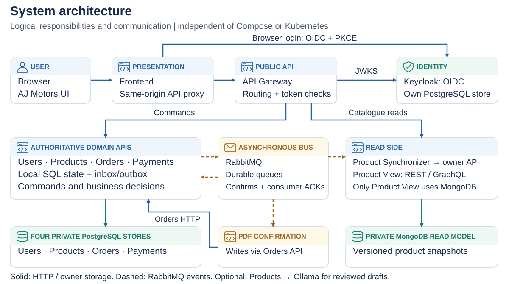
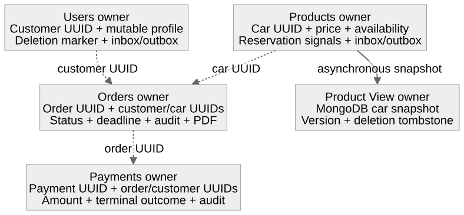
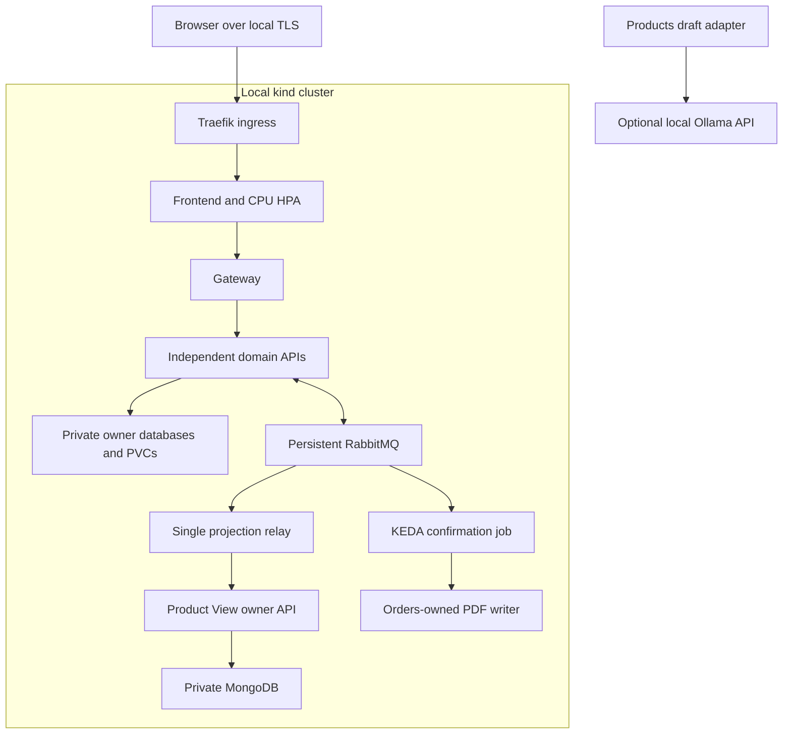
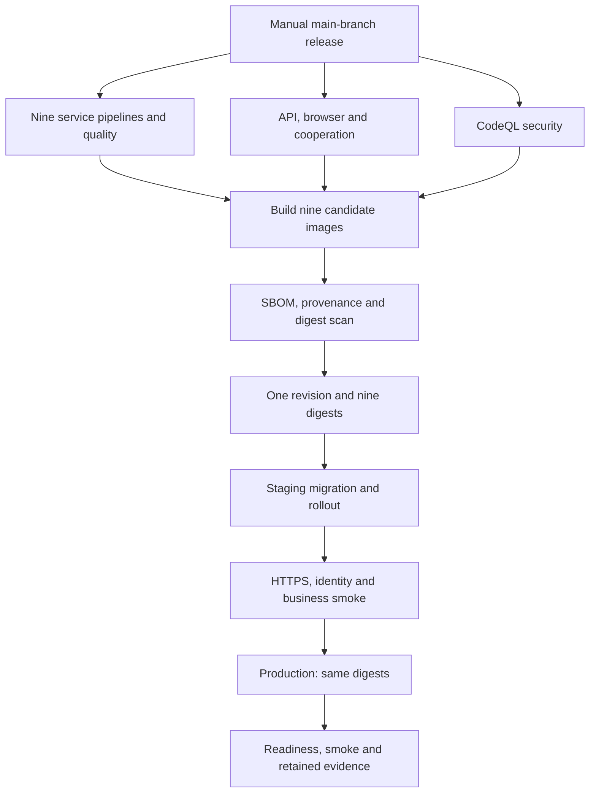
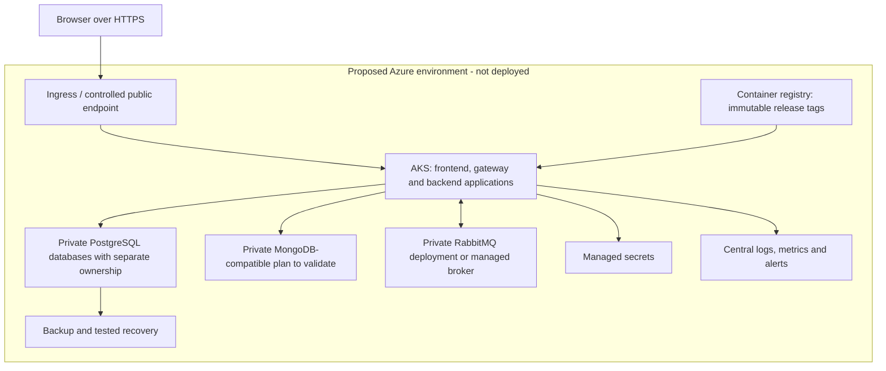

# AJ Motors

## Development of Large Systems — Project Report

**Authors**

- Ahmad Abdel Razak Hussein Alkaseb
- Jeppe Rønning Koch
- Asger Valdemar Bergøe
- Laith Abdel Razak Hussein Alkaseb

**Institution:** Business Academy Copenhagen (EK)  
**Course:** Development of Large Systems  
**Delivery date:** 11 December 2026  
**Status of this document:** Working report, updated against the application on 5 November 2026

**Repository:** [AhmadAlkaseb/aj](https://github.com/AhmadAlkaseb/aj)

This report covers the technical and project-management topics in Mandatory Assignments 1 and 2 and follows the report structure in the final project description. It distinguishes implemented behaviour from proposed work. It does not claim that the application already satisfies every final-project requirement. The remaining work is recorded in [TODO.md](TODO.md). Administrative upload instructions and presentation material are outside this report's scope. [1], [2], [3]

The supplied *DLS Report Version One.docx* was used as an example and an initial description of the business idea. Statements in that document about React, Stripe, OAuth, deployed cloud infrastructure and planned capabilities have been checked against the current application rather than copied as implementation facts. [4]

<!-- PDF layout: the cover has no page number; the next page starts at 1. -->
\thispagestyle{empty}
\clearpage
\pagenumbering{arabic}

## List of figures

| Figure | Description | Location |
| --- | --- | --- |
| 1 | Implemented application architecture | Section 2.1; [SVG](application/Architecture.svg) |
| 2 | Implemented databases and ownership references | Section 2.2; [SVG](application/Databases.svg) |
| 3 | Implemented API endpoints and request contracts | Section 2.3; [SVG](<application/API Contracts.svg>) |
| 4 | Implemented API response contracts | Section 2.3; [SVG](<application/API Contract Responses.svg>) |
| 5 | Local Kubernetes deployment | Section 3.2 |
| 6 | Verification and gated release pipeline | Section 3.2.2 |
| 7 | Proposed Azure deployment | Section 3.3 |

## List of appendices

- Appendix A: Mandatory Assignment 1 coverage.
- Appendix B: Mandatory Assignment 2 coverage.
- Appendix C: Final-project requirement assessment.
- Appendix D: Installation and verification procedure.
- Appendix E: Evidence, documentation and outstanding decisions.

## Table of contents

1. [Introduction](#1-introduction)
2. [System architecture](#2-system-architecture)
3. [Environments description](#3-environments-description)
4. [Testing](#4-testing)
5. [Project management and team collaboration](#5-project-management-and-team-collaboration)
6. [Discussion](#6-discussion)
7. [Reflection](#7-reflection)
8. [Conclusion](#8-conclusion)
9. [References](#9-references)
10. [Appendix](#10-appendix)

The Markdown version uses navigable headings and stores the PDF layout settings. Figures 1–4 use compact A4 overviews; complete UML and field-level contracts remain available in the linked application diagrams. Pandoc/Tectonic applies an unnumbered cover, numbered following pages, running headers, framed syntax-highlighted code and vector figures. The PDF export supplies a paginated contents index and checks the actual page count against the course catalogue’s thirty-page limit for four students. Export metadata is retained separately from the editable report. [5]

# 1. Introduction

## 1.1. Problem description

AJ Motors is an online platform for a small, selected collection of exclusive cars. A customer should be able to inspect a car, register their details, reserve an available vehicle and complete an order when payment is recorded. Staff need to maintain listings and follow reservations and payments. The business idea is taken from the supplied project example; a claim that scarcity increases sales has not been measured by this project. [4]

The main technical problem is coordinating changes that belong to different services. Reserving a car, creating an order and registering payment must produce a consistent business outcome even though their records are stored in different databases. An interrupted connection must not silently lose an accepted update, and competing buyers must not both obtain the same car.

The implemented development system contains customer management, car management, a separate product catalogue, orders, manual payment registration and asynchronous catalogue synchronisation. Its frontend remains available when individual backend components fail and reports which functions are unavailable. It demonstrates distributed coordination rather than real financial settlement: the payment service records a result; it does not move money.

For examination demonstrations, startup automatically inserts 20 fictional customers, cars, orders and payments with stable references. Six examples are completed, four have pending payments and ten cars remain available after failed historical payments. Each service seeds only its own SQL data; catalogue snapshots use the existing outbox and projection workflow. Existing edits and soft-deleted identities are preserved. See [demonstration data](DEMO_DATA.md) for configuration and verification.

Stripe remains outside scope. Identity uses a self-hosted third-party Keycloak/OpenID Connect provider with imported exam accounts and self-registration. Signed access tokens are verified independently in each backend; customers access only their own profile/orders/payments and administrator actions are protected server-side. This is local OIDC integration, not federation to an external Google or Microsoft account. See [AUTH.md](AUTH.md) and [the identity decision](decisions/001-local-oidc.md). [3], [20], [31]

## 1.2. Functional and non-functional requirements

### Functional requirements

The requirements below separate the business capabilities in the prototype from capabilities needed to complete the final specification.

| ID | Requirement | Acceptance criterion | Current status |
| --- | --- | --- | --- |
| FR-01 | Maintain customer information | A valid customer can be created, retrieved, edited and soft-deleted; duplicate email addresses are rejected | Implemented; customer records are not login accounts |
| FR-02 | Browse the catalogue | The frontend lists cars from the product read model and opens a detailed view | Implemented |
| FR-03 | Search and filter cars | Search by brand/model and filter by availability; extend with price/year/mileage ranges | Implemented: server-side filters and bounded GraphQL pages |
| FR-04 | Maintain car listings | Create and edit specifications and price; remove an eligible listing | Implemented; reserved/sold cars cannot be edited or deleted |
| FR-05 | Reserve a car | An order references one customer and one car; authoritative price and availability are checked | Implemented through asynchronous reservation |
| FR-06 | Prevent conflicting reservations | Concurrent requests for the same car leave only one successful reservation | Implemented and covered by a system test |
| FR-07 | Register payment | An eligible order receives one manual payment record; success sells the car and failure releases it | Implemented; no external payment execution |
| FR-08 | View and manage orders | Retrieve orders, including a customer's orders, and cancel eligible reservations | Implemented; own-resource access enforced in backends |
| FR-09 | Report partial outages | Show a useful message and retry action while the frontend itself remains reachable | Implemented; this does not provide backend failover |
| FR-10 | Authenticate and authorise users | Validated tokens, roles and ownership protect customer and administrative operations | Implemented and ownership-tested against real tokens |
| FR-11 | Consume REST and GraphQL in a real frontend workflow | The frontend uses GraphQL for an agreed query and REST for a related command | Implemented: GraphQL catalogue and REST commands |
| FR-12 | Use an AI service in backend business logic | A backend invokes a defined AI API in an actual workflow with validation and failure handling | Implemented and exercised locally |
| FR-13 | Execute an isolated serverless task | A separately triggered function/job performs a bounded task and terminates | Implemented and exercised locally |

The final-project requirements for API interoperability, AI, authentication and serverless work are compulsory. They are not treated as optional product ideas. [3]

### Non-functional requirements

| ID | Requirement or target | Verification approach | Current evidence |
| --- | --- | --- | --- |
| NFR-01 | Normal interactive requests should complete within two seconds under an agreed load | Measure latency percentiles with a reproducible dataset and concurrency level | First p95 3.782s; quieter repeat 1.139s at 10,000 cars / 20 clients; see 4.8 |
| NFR-02 | Target at least 99% service availability, excluding agreed maintenance | Define an observation period and monitor requests and failures | Target from initial scope, not a measured result |
| NFR-03 | A committed domain change must not be lost merely because RabbitMQ is unavailable | Interrupt the broker and verify outbox delivery after recovery | A selected outage case passes; no universal durability claim |
| NFR-04 | One car must not be allocated to two active buyers | Exercise concurrent reservation attempts | Covered by one automated cooperation scenario |
| NFR-05 | Components should be reproducible and separately deployable | Build application images and start per-service Compose configurations | Implemented locally; shared build tooling remains a dependency |
| NFR-06 | Services should retain clear data boundaries | Review database connections and access rights | Each store has one owner; Synchronizer uses Product View's internal API |
| NFR-07 | Services should scale according to workload | Demonstrate HPA/KEDA and safe concurrent processing | Verified frontend CPU HPA 1→2 and event-triggered KEDA job |
| NFR-08 | Sensitive actions and data must be protected | Verify TLS, identity, authorisation and secret handling | Local backend access checks and HTTPS/network isolation verified; production trust remains a separate deployment concern |
| NFR-09 | Operational failures should be diagnosable across services | Correlated logs, metrics, dashboards and alerts | Central logs, metrics/dashboard and controlled alert verified |
| NFR-10 | Data and contracts must evolve predictably | Apply versioned migrations and compatibility tests | Flyway history, v1 APIs and versioned message envelopes implemented |
| NFR-11 | The interface should work on desktop and mobile | Browser checks at representative viewport sizes | Selected flows checked locally; no accessibility audit |

These targets give the project measurable acceptance criteria. Containerisation alone does not establish scalability, and a successful restart test does not establish a production availability percentage.

## 1.3. Technology stack and rationale

| Area | Current technology | Reason for the choice and its limitation |
| --- | --- | --- |
| Backend | Java 17, Maven and Javalin | Consistent language and HTTP framework across the services; Maven coordinates reproducible builds. A shared library reduces duplication but couples build-time changes |
| Frontend | HTML, CSS and JavaScript served by a Java/Javalin application | Supports the current catalogue and administrative flows without a separate JavaScript build toolchain. React was an earlier proposal, not the implemented frontend |
| Relational data | PostgreSQL 16 and Hibernate/JPA | Relational records and local transactional updates support customers, orders, payments and authoritative product state |
| Read model | MongoDB 7 | A denormalised product document contains the fields needed by catalogue queries. Document modelling is an explicit design choice, not proof that MongoDB is always faster than SQL. [30] |
| Messaging | RabbitMQ 4.1 using AMQP | Durable queues, publication confirmation and consumer acknowledgements support recoverable asynchronous delivery. [7] |
| HTTP contracts | REST with JSON and public UUIDs | Familiar resource operations; `/api/v1` separates the public contract from internal SQL IDs |
| Automated testing | JUnit 5, Mockito, H2 and Python unittest | Small isolated tests, HTTP/database integration checks and container-based workflows cover different failure boundaries |
| Development runtime | Docker and Docker Compose | Each application image includes its Java runtime; the environment also starts databases and the broker |
| CI | GitHub Actions, Maven Surefire and Failsafe | Service-specific workflows run shared checks and available service tests; a separate workflow starts the distributed system. [27], [28] |
| Diagrams | PlantUML source and SVG | Diagrams are editable, versionable and viewable without a live application |

The implementation also includes a real GraphQL catalogue, a Products-to-Ollama draft workflow, Kubernetes manifests, a terminating confirmation job, versioned migrations and a separate monitoring stack. Runtime evidence is identified in [EVIDENCE.md](EVIDENCE.md); an implemented definition is distinguished from a successfully exercised deployment.

# 2. System architecture

## 2.1. Introduction to the microservices architecture

The application separates customer information, authoritative product state, product queries, orders and payments. A gateway routes public API requests, while RabbitMQ coordinates reservation outcomes, payment outcomes and read-model changes.



*Figure 1. The implemented architecture. Solid arrows represent synchronous communication or database access; dashed arrows represent asynchronous delivery. Editable source: [Architecture.puml](application/Architecture.puml).*

There are five separately runnable domain/API backends: Users, Products, Product View, Orders and Payments. Product Synchronizer is an additional backend worker. This count does not include the frontend, the gateway, databases, RabbitMQ or the shared build library. The design therefore has at least five backend applications without relying on the gateway's inclusion. [3]

Each application has an independent process and container configuration. The monorepo also has a parent Maven build and `service-common`. Independence at runtime should not be confused with complete independence of source changes or build tooling.

The development environment has sixteen containers: eight applications, four business PostgreSQL servers, one MongoDB server, one RabbitMQ broker, Keycloak and its separate PostgreSQL identity database. Their current responsibilities and limitations are described below; the API diagrams and specifications are referenced rather than reproduced as implementation listings.

## 2.2. Microservices description

### Users

Users owns customer profile information: name, email, telephone and address. Keeping this responsibility separate avoids making orders the owner of customer maintenance. Its REST API supports profile management; it does not currently issue credentials, authenticate users or validate roles.

Users owns stable customer UUIDs, profile details and deletion markers in PostgreSQL. Unique email addresses are enforced locally. Imported identities carry administrator-controlled customer references; self-registered identities receive a stable profile derived from the trusted issuer/subject. Profile and login identity remain separate. Users consumes customer.check and emits customer.valid/invalid in its own transaction, without reading another database.

Users can temporarily be unavailable while an accepted order waits in the durable workflow. Backend role checks and local ownership filters prevent direct-port access to another customer’s resources. Deleted profiles are hidden, while logical references and historical orders are retained according to the examination policy. A single SQL owner is still an availability boundary.

### Products

Products owns the authoritative car description, sale price, availability and reservation owner. It exposes REST operations for listing maintenance and authoritative service-to-service reads. Public catalogue GET requests normally use Product View instead.

The service consumes `quantitycheck`, `order.cancelled`, `paymentfail` and `payment.completed`. A successful reservation changes the car to RESERVED and publishes `quantityreserved`; rejection publishes `quantityrejected`. Product changes produce `product.created`, `product.updated`, `product.reserved` or `product.removed` for the read model.

Its PostgreSQL database supports local transactions and locking around competing reservations. Price and currency are checked again when the reservation command is processed, preventing an order based on an outdated quoted amount from being silently accepted at a different price. A matching successful payment changes the car to SOLD; an eligible cancellation or failure releases it.

When RabbitMQ is unavailable, product maintenance can still commit an update with a pending outbox entry. The catalogue will lag until delivery recovers. This increases resilience to broker outages but can create a backlog. Current throughput, lock contention and multiple-worker safety have not been measured or demonstrated.

### Product View

Product View exposes a read-only REST catalogue backed by MongoDB. Its document contains the car's display fields and embedded engine, performance and dimension data. A catalogue query need not join customer, order or payment records.

Product View is the sole owner of the MongoDB projection. It does not consume RabbitMQ directly: its internal authenticated HTTP interface accepts full snapshots relayed by Product Synchronizer. The public query interface excludes deletion tombstones. A committed product update may temporarily be absent or outdated because delivery is asynchronous.

The GraphQL query executes bounded brand/model/status/price/year/mileage filters and pagination in the MongoDB owner. Query depth/complexity and page size are limited. The measured 10,000-car/20-client workload is reported separately from architectural expectations: a read projection does not by itself prove a latency target.

### Product Synchronizer

Product Synchronizer consumes `product.*` snapshots and relays the original event identity, topic and snapshot to Product View. It has no MongoDB driver, database configuration or database-network access. Product View applies the newer version using conditional replacement and retains removal tombstones; stale and duplicate snapshots are acknowledged without overwriting newer state.

The worker exposes health endpoints but no public business API. Health covers RabbitMQ and the authenticated projection-owner connection. A delivery is acknowledged only after the owner's successful HTTP response. Network, storage and credential failures cause retry; invalid payloads rejected with 400 follow the dead-letter path. The worker accesses neither Products PostgreSQL nor MongoDB.

The original shared-database access was replaced by an explicit ownership boundary, recorded in [ADR-002](decisions/002-projection-ownership.md). MongoDB is on a private network connected only to Product View; its port is not exposed in normal startup. The internal writer is not forwarded by the public gateway and requires a separate service credential. Existing data and volumes are retained. See [PROJECTION.md](PROJECTION.md) for the interface and recovery contract. [3]

### Orders

Orders owns the commercial intent to buy one specific car and the progress of that transaction. REST operations create and inspect orders and permit eligible edits or cancellation. It stores its own PostgreSQL records with customer, product and payment UUID references; these are not foreign keys into other databases.

Creating an order stores PENDING and `customer.check` atomically. Users validates the customer asynchronously; Orders then becomes RESERVING and publishes `quantitycheck`. Products reserves under its own lock and returns the authoritative amount/currency. Reservation events move the order to RESERVED or REJECTED; the initial response has null amount/currency. Payment results can subsequently move it to COMPLETED or FAILED. Cancellation publishes `order.cancelled`, allowing Products to compensate by releasing the reservation.

A `payment.requested` message claims a RESERVED order under its lock and changes it to PAYMENT_PENDING. Orders commits the claim and `payment.authorized` invoice together; an ineligible order yields `payment.rejected`. This serialises payment start against cancellation without a distributed transaction or direct domain-service HTTP call.

New customer/car validation expires after five minutes; an unpaid reservation after thirty minutes. Compensation releases eligible inventory. A PAYMENT_PENDING timeout becomes REVIEW_REQUIRED and keeps the car reserved while reconciliation asks Payments for its stored outcome. A late verified outcome remains valid. Historical demonstration fixtures are intentionally timeless. [RELIABILITY.md](RELIABILITY.md) documents these rules and their limits.

### Payments

Payments owns payment registration and its terminal outcome, isolating that responsibility from product availability. Its REST API creates and retrieves a manual payment and records COMPLETED or FAILED. The payment method indicates manual recording, bank transfer or cash; the service does not execute those transfers.

The amount is taken from an eligible order rather than accepted from the client. A deterministic payment identity and a unique order reference make repeated creation return the same record. A terminal result cannot be changed to the opposite result. Successful and failed outcomes are published as `payment.completed` and `paymentfail`.

Payments privately stores a REQUESTED record before publishing payment.requested. Orders claims eligible inventory and replies with authoritative invoice fields; Payments becomes PENDING or REJECTED. A per-order lock and deterministic payment identity serialise concurrent requests. Retries return the existing payment and current state. A terminal result cannot be changed, and ambiguous outcomes require investigation rather than an automatic financial-failure assumption.

### Frontend, gateway and supporting infrastructure

The frontend also provides Keycloak login/logout, silent SSO and a validated identity display. Its public client uses Authorization Code + PKCE S256; tokens remain in memory and gateway verification checks signature, issuer, audience and lifetime. Identity data belongs to Keycloak, with customer UUID attributes linking the imported demonstration identities to customer profiles. [20], [31]

The frontend provides a public catalogue and role-aware customer, order and payment views. Product search/details use GraphQL; reservations and administrative operations use REST through the same-origin proxy and gateway. Customer lists are restricted to their own records by the backend, independently of hidden frontend controls. An administrator can request an AI description draft and review it before saving.

The gateway routes product reads to Product View, writes to Products and the remaining resource operations to their owning services. It aggregates backend health for the status view. This centralises public routing but also makes the gateway a failure boundary. If it is stopped, the frontend still serves its assets and displays an API connectivity error; no alternate gateway is automatically selected.

RabbitMQ and the databases are infrastructure, not additional business microservices or third-party integrations. Running them in local containers does not make them external services in the business architecture. They are nevertheless independent failure domains.

### Data model and ownership



*Figure 2. Current database model. Source: [Databases.puml](application/Databases.puml). SQL field types and constraints were checked against the running development databases.*

Users, Products, Orders and Payments each use a main identifier table, a details table and a deletion table. The details relation is one-to-one; the deletion relation permits at most one marker through a unique local foreign key. This layout separates identity and removal metadata, but the details remain mutable. It is not an immutable history of every change.

Order and payment references use public UUIDs so that services need not share internal numeric IDs. Local SQL foreign keys protect local relations only. Cross-service existence is checked through the owning API or a workflow, with the usual risk that remote state changes after a lookup.

The MongoDB read model contains a complete product snapshot, a version, an event identity and a deletion flag. Price is stored as Decimal128. SQL and read-model timestamp representations are currently not fully uniform, which should be made explicit in machine-readable contracts.

## 2.3. Communication between microservices

### REST and API interoperability

Public REST resources use `/api/v1` and JSON field names in camelCase. UUIDs identify resources. The common success responses are 200, 201 and 204; validation, absence, conflicts and unavailability use structured 400, 404, 409 and 503 responses respectively. Product list responses currently contain full snapshots, not a separate reduced listing DTO.


*Figure 3. Implemented operations and requests. Source: [API Contracts.puml](<application/API Contracts.puml>); detailed contracts: [API.md](API.md).*


*Figure 4. Implemented response representations. Source: [API Contract Responses.puml](<application/API Contract Responses.puml>).*

The diagrams reference generated, validated [OpenAPI contracts](contracts/openapi/frontend.json), a vendored Swagger UI at /swagger/index.html, the [GraphQL schema](../product-view/src/main/resources/catalogue.graphqls) and [AsyncAPI contracts](contracts/asyncapi.json). Per-service READMEs explain responsibility, startup, configuration and tests. The standard contracts complement the diagrams rather than replacing behavioural explanation. [21], [22]

Product View exposes typed GraphQL catalogue queries used by the actual frontend. Selecting a car leads to a REST order request; Products still determines price and availability during the asynchronous reservation. The query API cannot mutate inventory or choose invoice amounts. This is application interoperability, separate from the older exercises in system-integration/. [3], [19]

The following bounded query illustrates the implemented schema. The frontend sends it as JSON to `POST /api/v1/graphql`; the subsequent reservation uses REST.

```graphql
query {
  products(limit: 24, filter: {status: "AVAILABLE", maxPrice: 500000}) {
    total
    hasMore
    items { guid brand model year price currency }
  }
}
```


### Asynchronous messages

The `aj.events` topic exchange distributes JSON messages to six durable consumer queues. A shared envelope contains `eventId`, `eventType`, `occurredAt`, `correlationId`, `schemaVersion: 1` and `payload`. AMQP `messageId` matches eventId. The order UUID follows the entire purchase as correlationId, including derived product snapshots. Product payload.version remains a separate state version.

This illustrative envelope uses synthetic UUIDs; the correlation identifies the order while the event has its own identity. It is a contract example, not a recorded production message.

```json
{
  "eventId": "11111111-1111-4111-8111-111111111111",
  "eventType": "customer.check",
  "occurredAt": "2026-11-05T08:00:00Z",
  "correlationId": "22222222-2222-4222-8222-222222222222",
  "schemaVersion": 1,
  "payload": {
    "orderGuid": "22222222-2222-4222-8222-222222222222",
    "userGuid": "33333333-3333-4333-8333-333333333333",
    "productGuid": "44444444-4444-4444-8444-444444444444",
    "totalAmount": null,
    "currency": null
  }
}
```


| Routing key | Producer | Consumers | Business purpose |
| --- | --- | --- | --- |
| `customer.check` | Orders | Users | Validate the referenced customer |
| `customer.valid`, `customer.invalid` | Users | Orders | Continue or reject customer validation |
| `quantitycheck` | Orders | Products | Request an exclusive car reservation and authoritative price |
| `quantityreserved` | Products | Orders | Confirm the reservation |
| `quantityrejected` | Products | Orders | Reject an unavailable or outdated-price reservation |
| `order.cancelled` | Orders | Products | Release an eligible reservation |
| `payment.requested` | Payments | Orders | Claim an eligible RESERVED order |
| `payment.authorized`, `payment.rejected` | Orders | Payments | Supply authoritative invoice or reject creation |
| `payment.completed` | Payments | Orders, Products | Complete the order and mark the car sold |
| `paymentfail` | Payments | Orders, Products | Fail the order and release the car |
| `product.created`, `product.updated`, `product.reserved`, `product.removed` | Products | Product Synchronizer | Update the catalogue snapshot or tombstone |
| `order.completed` | Orders | Confirmation job | Generate and persist one PDF artifact |
| `payment.reconcile` | Orders | Payments | Republish the stored terminal outcome for recovery |

The queues are `aj.users`, `aj.products`, `aj.orders`, `aj.payments`, `aj.product-sync` and the isolated `aj.confirmations` queue. Invalid messages can be moved through the dead-letter exchange to `aj.dead`; transient dependency failures are retried. Transient retries use backoff without an automatic retry-count cap; poison messages dead-letter. An operator replay tool and central queue/dead-letter alerts are configured; operator decisions remain necessary for persistent faults.

Reservation requests include order/product/customer references and initially null price fields; confirmation adds the authoritative amount/currency. Payment requests include order/payment identifiers; authorisation adds invoice fields, and outcomes include the product reference. Product messages contain the complete public snapshot. Consumers validate common metadata and accept old raw payloads to drain existing queues; the local stack must be upgraded together. Timeout, retry and compatibility rules are in [ASYNC.md](ASYNC.md). Aggregate and per-service AsyncAPI contracts document payloads, producers, consumers and queue bindings. [4], [22]

### Why both communication styles are used

HTTP provides immediate user-facing commands and queries, health status and OIDC/JWKS exchange. Customer validation, product reservation, payment initiation and outcomes use RabbitMQ, so these domain interactions can wait for an unavailable consumer. Nested collections filter local data and return empty lists for unknown UUIDs. The remaining internal projection HTTP call preserves Product View as sole MongoDB owner and supplies storage confirmation before broker acknowledgement. These boundaries are recorded in [ADR-003](decisions/003-asynchronous-commerce.md). [3]

## 2.4. Patterns and techniques

### 2.4.1. CQRS

Products is the command-side authority, while Product View serves a separate MongoDB query representation. This is a concrete application of CQRS to a read-oriented catalogue rather than a requirement to split every domain. The additional projection introduces eventual consistency and another operational dependency. CQRS permits different read and write models, but does not by itself prove better performance; the project has no comparative benchmark. [6]

### 2.4.2. Immutable data, tombstones and snapshots

Deletion markers in PostgreSQL and tombstones in MongoDB retain evidence that a record was removed. Product messages carry full-state snapshots, allowing the projection to replace a product's display state without retrieving each individual field from Products.

The immutable information is deliberately scoped: removal markers, versioned snapshots and append-only order/payment status audit. Profile and product detail fields remain mutable, and confirmed outbox entries are removed. There is no full event-sourcing archive or general time-travel query. Exam retention keeps identity/deletion fences, inbox keys, history and tombstones; a production erasure schedule requires a separate policy.

### 2.4.3. Idempotence

SQL consumers record processed event identities in an inbox as part of the transaction that changes business state. A redelivered event with the same identity is ignored. Payment creation uses one stable identity per order, and repeating the same terminal payment result does not emit another outcome.

Users, Products and Orders support identity-scoped Idempotency-Key headers. A request fingerprint, original result and outbox commit in the owning SQL transaction. Identical concurrent retries return one resource; reusing a key with another body returns 409. Payments deliberately uses one stable payment per order and returns its current result on retry. Requests without command keys do not gain a general creation guarantee.

### 2.4.4. Commutative message handlers

Within a versioned projection, an older product version is ignored after a newer snapshot or tombstone has been applied. For distinct versions, that gives the projection the same final state whether an older snapshot arrives before or after the newer one.

Products retains reservation signals so cancellation/failure received before quantitycheck blocks a late reservation. Paid inventory cannot be freed by a stale cancellation. Orders retains early matching payment outcomes until a valid claim exists. Projection CAS and tombstones converge to the newest version under reordering. Selected permutations and duplicate deliveries are tested; contradictory producer outcomes are not declared equivalent histories. Workers remain single-replica with Recreate rollouts, while the stateless frontend scales independently. [3]

### 2.4.5. Saga pattern

The implemented reservation/payment flow uses local database transactions and compensating release events. Successful reservation followed by `paymentfail` returns an eligible car to AVAILABLE and marks the order FAILED. Cancellation similarly releases a reservation. This is a partial choreography-based saga: services react to outcomes rather than participating in one distributed transaction. [8]

Saga recovery includes stored deadlines, compensation, periodic reconciliation and an explicit manual-review state. It still depends on eventual infrastructure recovery or informed operator action; a permanently ambiguous payment is kept visible rather than silently released. The tests cover selected crash boundaries, not every possible distributed history.

### 2.4.6. Caching

No Redis cache or explicit application response cache is implemented. The MongoDB catalogue is a persistent read projection, not a disposable cache with a time-to-live. Caching could be evaluated for expensive catalogue reads after adding pagination and measurements, but it is not presented as a used pattern.

### 2.4.7. Transactional outbox and reliable delivery

A domain update and its outgoing outbox record commit in one local SQL transaction. A worker publishes the stored message and removes the outbox record only after broker confirmation. If publication succeeds but the database acknowledgement is interrupted, the same event may be published again. Inbox deduplication and projection versions handle selected duplicate cases. This implements the central outbox idea without a database/broker distributed transaction. [9]

The SQL-consumer branch in `service-common/Bus.java` performs the business handler and inbox insertion together. The acknowledgement follows the completed transaction; an exception takes the retry/dead-letter path.

```java
db.tx(em -> {
    if (em.find(Inbox.class, id) == null) {
        handler.accept(em, topic, event.payload());
        em.persist(new Inbox(id));
    }
    return null;
});
channel.basicAck(msg.getEnvelope().getDeliveryTag(), false);
```


Persistent messages, durable queues, publisher confirms and consumer acknowledgements serve different points in delivery. A consumer acknowledgement is issued after processing; a publisher confirm alone does not prove that business processing completed. These mechanisms support recovery but do not establish exactly-once execution. [7]

# 3. Environments description

## 3.1. Development environment with Docker Compose

The root Compose file starts the full development topology shown in Figure 1. Per-service Compose files support developing an application with its associated database, using shared messaging/network infrastructure. Services are addressed by container DNS names internally and exposed on loopback host ports for local development.

Demonstration seeding is enabled by default and can be disabled with `DEMO_DATA_ENABLED=false`. Stable fixture identities prevent duplicate insertion across restarts. These fixtures initialise historical example states; they are not evidence that twenty new purchases have been executed through live APIs at every startup. MongoDB receives the twenty product snapshots asynchronously.

| Component | Local port | Persistent storage |
| --- | --- | --- |
| Frontend / API Gateway | 3000 / 8080 | None |
| Users / PostgreSQL | 7002 / 5433 | Dedicated Users volume |
| Products / PostgreSQL | 7003 / 5434 | Dedicated Products volume |
| Orders / PostgreSQL | 7004 / 5435 | Dedicated Orders volume |
| Payments / PostgreSQL | 7005 / 5436 | Dedicated Payments volume |
| Product View / MongoDB | 7006 / private (optional debug 27018) | Dedicated projection volume |
| Product Synchronizer | 7007 | No database; RabbitMQ and owner API |
| RabbitMQ / management interface | 5672 / 15672 | Broker volume |

MongoDB is private in the standard environment. An explicit debug override can expose loopback port 27018 for local JVM development. Java applications use internal port 7000. SQL databases have their own application data networks, and the MongoDB network connects only Product View and its database.

Images include the Java runtime and run the application under a non-root user. Health checks distinguish process liveness from dependency availability. Named volumes survive an ordinary Compose shutdown. They are persistence, not a backup strategy. Development credentials and unencrypted local HTTP are unsuitable as a production security configuration.

## 3.2. Local Kubernetes deployment simulating production

The local kind environment has separate application Deployments, internal Services, owner PVCs, Calico network policies and a TLS ingress. SQL init containers migrate before application schema validation. The manifests and reproducible lifecycle are in [KUBERNETES.md](KUBERNETES.md); exact runtime checks are listed in [EVIDENCE.md](EVIDENCE.md). A single-node simulation is not host-failure HA. [3], [10]



*Figure 5. Implemented local deployment definition. Applications remain separate despite being grouped for readability. Runtime results, including scaling and job execution, are identified explicitly in the evidence record.*

### 3.2.1. Technologies and isolated tasks

kind supplies the local cluster; Calico enforces owner network boundaries. Random runtime secrets and local TLS keys are kept outside committed manifests. The confirmation console application consumes its own durable order.completed queue, generates a PDF, writes through the Orders owner API and exits. It acknowledges only after storage; repeating the task preserves the first document. KEDA ScaledJob supplies event-driven scheduling rather than a permanently running service renamed as serverless. [10], [12]

Products calls an actual local Ollama model to draft descriptions from validated brand/model/year. It forwards no customer/payment information, applies schema/output/time limits, and inserts text for human approval. It cannot change invoice values or availability. Adapter failure tests and an actual browser-to-model run are documented in [AI.md](AI.md). The model and Kubernetes can be demonstrated separately within the workstation memory budget. [26]

### 3.2.2. CI/CD pipeline

Each service pipeline separates module validation, parallel unit/integration checks, JAR packaging/checksums and a final gate. Quality runs separate SpotBugs, contract and workflow/deployment-test jobs. System acceptance uses independent runners for API/broker recovery, browser/identity and fresh-database cooperation. CodeQL is a separate release requirement. Failed, cancelled or skipped required checks block the relevant gate. [27], [28], [29]



*Figure 6. Implemented multi-stage workflow definitions. GitHub environment configuration controls production approval; actual remote execution remains a separate observation.*

Image builds use a bounded matrix, registry cache, SBOM and provenance. Fixable HIGH/CRITICAL image findings block promotion. The assembled artifact binds all nine digests to one verified source revision. Staging runs first; production promotes the same images without rebuilding. Environment-specific runner access, HTTPS endpoints, credentials and registry pull access must be configured as described in [CI-CD.md](CI-CD.md).

Deployment reads live target configuration and changes application images/revision annotations. Server-side validation and four bounded owner Flyway Jobs precede application changes; proof files bind migrations to the release and unchanged target images. Readiness is followed by real HTTPS, catalogue and identity checks, plus synthetic reservation/payment-compensation smoke in staging. Production defaults to read-only smoke. Event workers retain single-replica Recreate deployments; zero downtime is not promised.

A separate workflow restores an earlier successful release's digests only with explicit compatibility with the current schema. Automatic restoration is optional under the same reviewed compatibility policy and requires a complete previous snapshot. Failed deployments remain failed even if restoration succeeds. Migration, rollout and smoke evidence is retained without credential files. Twelve local deployment-boundary tests and an actual TLS-proxied Compose smoke passed; remote GitHub execution and a digest-based Kubernetes rollout are not inferred from those checks.

### 3.2.3. Monitoring and logging

Prometheus scrapes application histograms/counters, outbox age/count, projection lag and RabbitMQ queue metrics. Grafana provisions an operations dashboard; Alloy forwards application-only structured logs to Loki. HTTP and broker records share the business correlation ID without logging payloads, tokens or passwords. Database logs are excluded from central collection to avoid row-value leakage. [24], [25]

The local verification checked nine live targets, a trace through Users/Orders/Products and a firing dependency alert during a controlled broker interruption. Monitoring runs separately from the Kubernetes demonstration to conserve workstation resources. Health, latency and queue metrics describe different failures; none alone proves business correctness or historical availability. See [OBSERVABILITY.md](OBSERVABILITY.md).

### 3.2.4. Autoscaling configuration

Frontend HPA uses real CPU metrics with a one-to-two replica range. A temporary workload verifies scaling and is removed afterwards. Confirmation jobs scale from their own queue and terminate after one task. SQL/broker workers remain at one replica with Recreate rollout, avoiding an unverified overlap of old/new workers. Projection CAS still protects concurrent HTTP snapshot writes. [11], [12]

Application scaling is separate from database replication and broker HA. More replicas cannot remove a single state-store failure or guarantee faster queries. The local cluster demonstrates the configured mechanisms; its actual scaling/job result is recorded in EVIDENCE.md rather than assumed from YAML.

## 3.3. Cloud deployment plan

### Provider investigation and choice

The supplied example selected Azure. This report retains Azure as the proposed cloud direction, while distinguishing that planning decision from deployed infrastructure. [4]

| Provider | Relevant option | Assessment for this project |
| --- | --- | --- |
| AWS | ECS for managed container orchestration | A viable container platform, but the team would still need to configure persistence, messaging, identity and operations around the application. [13] |
| Google Cloud | Cloud Run for container-based services | A viable managed service option; continuously running workers and persistent infrastructure require an explicit hosting design. [14] |
| Microsoft Azure | Container Apps or AKS | Container Apps offers managed container execution; AKS provides a Kubernetes-oriented path closer to the required local-cluster exercise. [15], [16] |

For the Kubernetes-aligned target, the plan is Azure Kubernetes Service for applications, a container registry for versioned images and managed PostgreSQL where justified. Azure Container Apps remains a simpler hosting alternative for suitable components, rather than an additional platform that must also be operated. Hosting choice will be confirmed against the team's budget and completed local deployment. [15], [16]



*Figure 7. Cloud planning diagram. No cloud subscription, cloud cluster, cloud identity service, managed database, certificate or managed broker is provisioned. The local Keycloak integration is described separately.*

### Application and database availability

The plan uses separate application replicas and rolling releases where business semantics permit. A managed PostgreSQL HA configuration can use separated primary/standby replicas, including zone-redundant options; this must be explicitly selected and funded. Four logical databases on one physical server retain some schema separation but share a failure domain, so physical separation is an explicit cost-versus-isolation decision. [17]

The MongoDB service must support the actual driver, Decimal128, indexes and update behaviour. A nominally compatible cloud database is not assumed to be a drop-in replacement without tests. RabbitMQ needs a persistence, backup and availability plan; the current single broker with durable queues is not a highly available cluster.

### Cost, latency and elasticity

The cost strategy starts with a measured workload, a budget ceiling and the smallest adequate development configuration. Main cost categories are application compute, stateful database capacity, persistent storage, backups, broker/observability resources, traffic and AI inference. Azure Container Apps offers consumption-based and other pricing options, but exact cost depends on the chosen region and workload. No fixed monthly figure is claimed. [18]

Keep chatty application and data dependencies near each other, bound request timeouts and measure end-to-end latency before selecting larger instances. Scale-to-zero may reduce cost for intermittent jobs, but cold starts can conflict with an interactive latency target. Database and broker capacity remain constraints even when application replicas increase.

### Security, data management and releases

The proposed production environment uses TLS, private data endpoints, restricted service access and centrally managed secrets. Customer and payment metadata require a retention policy and tested recovery procedure. Data volumes must not be treated as the only backup.

A release should use an immutable image identifier, pass automated quality gates, apply reviewed migrations, roll out gradually and run post-deployment checks. An application rollback must be compatible with the migrated schema. Automated publishing and deployment are backlog items, and local development passwords must not be copied into a cloud environment.

Actual cloud deployment is not required by the final project. The local Kubernetes simulation, its evidence and a justified cloud plan are required. [3]

# 4. Testing

## 4.1. Testing strategy and scope

The strategy separates isolated logic checks, component-boundary integration and cooperation of deployed services. Fast Java tests should reject simple defects before the more expensive container scenarios run. A passed test establishes the behaviour exercised by that scenario; it does not establish full coverage, production security or performance at scale.

The latest isolated Java run contains 28 unit tests and 14 integration tests; the Python system suite runs six scenarios when the failure option is enabled. An additional browser script checks selected desktop/mobile interactions and outage messages. The [test guide](TESTING.md) records the commands and limitations.

## 4.2. Unit testing

Three unit tests in the shared API library exercise canonical UUID validation, accepted/rejected money values, required text and restricted status choices. Three shared event-envelope unit tests cover metadata validation, inherited correlation and legacy payloads. Two gateway tests check command/query routing and ownership of nested resource routes. Mockito isolates the routing decision from a live HTTP server.

Three additional fixture tests check stable and non-colliding identities, consistency with the normal payment retry identity, and coherent product/order/payment example states. A separate demonstration-data verification script checks the actual API data and can restart the four applications to verify that edits survive without duplicate insertion.

The shared checks accompany every service build, while domain suites cover customer validation, exclusive inventory rules, order claim/expiry decisions, terminal payment transitions, projection versions/query bounds and relay response handling. GraphQL resolver/schema tests and PDF content checks exercise their own boundaries. These are deliberately small business-focused suites, not a coverage-percentage claim. [3]

## 4.3. Integration testing

Two shared integration tests start actual Javalin HTTP servers on temporary ports. They verify structured validation errors through the proxy and a 503 response when the upstream is stopped. A product integration test exercises Hibernate persistence against H2 in PostgreSQL mode. Six further HTTP integration tests validate the owner's authentication/input/storage responses and the relay's event envelope/retry handling.

The suites combine real local HTTP boundaries, representative Hibernate/H2 mapping and real PostgreSQL/MongoDB/RabbitMQ scenarios. H2 alone is not treated as proof of PostgreSQL semantics. The isolated cooperation fixture creates all four empty owner databases, checks migration history and processed inbox records, then tests reservation and failed-payment compensation without frontend or gateway.

## 4.4. System-level cooperation testing

The current Python scenarios check:

1. Contract validation, missing references and duplicate email handling.
2. Successful reservation/payment, authoritative pricing and repeat payment requests.
3. Failed payment and release of the reserved car.
4. Concurrent attempts to reserve the same car.
5. Product updates, projection synchronisation and soft deletion.
6. Recovery after stopping the synchronizer, broker, Users database and gateway.

The system workflow starts the dependent containers before executing these scenarios. It preserves failure diagnostics and fails on a failing test. This is useful distributed behaviour evidence.

The end-to-end API suite is supplemented by scripts/cooperation.py --exclusive. It starts four owning backends, their private databases, broker and identity provider under a unique Compose project, asserts authoritative state and processed broker messages, saves diagnostics and removes only its own volumes. This specifically addresses backend cooperation rather than relying on a UI purchase journey. [3]

## 4.5. Security testing

Signed-token unit tests check issuer/audience, expiry, token type and forged signatures. Real provider/browser tests check customer/admin login, reload and logout. Security checks also exercise direct service ports, customer access to own versus other records, denied administrator actions, protected customer mapping and automatic self-registration linkage. A role claim is tested together with backend enforcement. [20], [31]

Public catalogue reads remain available without login. Protected operations fail closed with 401/403, including direct backend ports. Internal projection/PDF writers require separate service credentials and are not forwarded by the gateway. Kubernetes adds private Services, TLS and enforced owner network policies; the local certificate and published demo users are not a production trust configuration.

## 4.6. Static analysis and static testing

SpotBugs runs in the quality Maven profile with a High-severity failure threshold. Actual findings were corrected: ignored shutdown exceptions, confusing JWT-verifier inheritance and broad proxy exception handling. No blanket suppression is used. The quality workflow also validates OpenAPI, AsyncAPI and workflow syntax; CodeQL is configured as a separate security scan. Local results and actual GitHub runs are distinguished. [29]

## 4.7. Test execution in CI/CD

Surefire runs unit tests and Failsafe runs integration tests. Reusable per-service workflows keep these stages identifiable; system, security, broker, projection, PDF and isolated-cooperation scripts run in the system workflow. Non-zero results fail their jobs, and diagnostic reports are retained. A release waits for quality and system checks for the same revision. [27], [28]

The maintained [evidence record](EVIDENCE.md) contains counts, artifact dates and observed outcomes rather than an assumed coverage percentage. It records successful real-token ownership/self-registration checks, an actual browser-to-model draft, concurrent command/payment retries, late-reservation protection, manual payment review, PDF deduplication, four fresh migrated database owners, real restore checks and a central-log/controlled-alert demonstration. The local Kubernetes run verified HTTPS commerce, a terminating KEDA PDF job, enforced database isolation and real CPU-driven HPA scaling from one to two frontend replicas. Remote-release results remain separate.

The first measured 10,000-car workload used twenty concurrent clients and two hundred GraphQL requests. Its p95 was approximately 3.78 seconds, above the two-second target. Other local verification was running at the same time; this is an observed shared-workload result, not a production SLA or a controlled comparison proving that one architecture is faster. [PERFORMANCE.md](PERFORMANCE.md) defines the repeatable workload.

## 4.8. Evidence and limits

The maintained [evidence record](EVIDENCE.md) contains artifact dates, source fingerprint and observed outcomes. The latest isolated Java/SpotBugs run passed 28 unit and 14 integration checks. Local system checks verified real-token ownership/self-registration, a browser-to-model draft, concurrent retries, delayed-reservation protection, manual payment review, PDF deduplication, four fresh migrated database owners, actual restore checks and central logs with a firing alert. Kubernetes verified HTTPS commerce, KEDA PDF execution, database isolation and CPU HPA scaling from one to two frontend replicas. A broker recreation preserved its node identity and a durable probe message.

The performance fixture creates a separate 10,000-car Mongo database, executes 200 bounded GraphQL queries with 20 concurrent clients and removes only that fixture. The first shared-load run measured p95 **3.782 seconds**, missing the two-second target. A quieter repeat with the normal Compose stack running, and the separate Kubernetes/monitoring demos stopped, measured median **0.616 seconds**, p95 **1.139 seconds** and maximum **1.263 seconds**. Both observations are retained in [PERFORMANCE.md](PERFORMANCE.md). The repeat met this direct-backend target; neither run establishes internet latency, an end-to-end SLA or long-term availability.

The tests cover selected boundaries and message interleavings. They do not prove arbitrary contradictory outcomes, unrestricted parallel workers, historical availability or production security. Workers remain bounded while stateless HTTP and isolated jobs demonstrate scaling. Demonstration histories remain intact; cooperation/performance databases are isolated. Remote delivery and authors' historical reflections require their own evidence.

# 5. Project management and team collaboration

## 5.1. Strategy and collaboration

The agreed working approach is lightweight and Scrum-inspired rather than a complete implementation of Scrum. The team plans short sprints, holds brief daily standups to discuss progress and blockers, and uses a shared To Do / In Progress / Review / Done board. Each sprint ends with a demonstration and a short retrospective. These are the adopted working agreements. The dated schedule below is a proposed project narrative, not an attendance record or evidence of completed historical sprints.

A task is Done when its behaviour meets its acceptance criteria, relevant checks pass, and contracts/documentation are updated. A local demonstration and a remotely verified release are recorded separately.

### Proposed September–November schedule

The group uses the following suggested allocation for 1 September–30 November 2026. Dates organise the report's planning example; actual verification dates remain in EVIDENCE.md. Standups are planned for approximately ten minutes at 09:00 on agreed working days, with planning at each sprint's start and a short review/retrospective at its end.

| Period | Sprint goal | Shared work and review focus |
| --- | --- | --- |
| 1–11 September | Requirements and architecture | All four define their domain, acceptance criteria and ownership boundaries. |
| 14–25 September | Services, REST and databases | Ahmad: Users; Jeppe: Products; Asger: Orders/Payments; Laith: Compose and application connections. |
| 28 September–9 October | Asynchronous commerce | Asger/Jeppe: reservation, compensation and projection; Ahmad: customer validation; Laith: broker/system configuration. |
| 12–23 October | Security, GraphQL and AI | Ahmad: identity/ownership; Jeppe: catalogue/AI; Asger: business contracts; Laith: automated contract checks. |
| 26 October–6 November | Migrations, retries and recovery | Domain owners add focused tests; Asger covers saga/PDF work and Laith coordinates CI, onboarding and restore. |
| 9–20 November | Runtime verification and measurements | Laith: Kubernetes/monitoring; Asger: jobs/recovery; Jeppe: catalogue performance/frontend; Ahmad: security/logging checks. |
| 23–30 November | Report and demonstration review | Everyone updates their contracts, figures, evidence and installation notes, then reviews another workstream. |

The last two periods are future plans relative to this report's 5 November review date. The full Danish working plan and individual reflection prompts are in [TEAM-PLAN.md](TEAM-PLAN.md).


## 5.2. Methods, responsibilities and evidence

The following balanced allocation organises the proposed work and review. It does not assign authorship of previously created code or substitute for each student's actual Git contributions.

| Named owner | Main responsibility | Reviewer |
| --- | --- | --- |
| Ahmad Abdel Razak Hussein Alkaseb | Users, identity and access control | Jeppe Rønning Koch |
| Jeppe Rønning Koch | Products, catalogue, GraphQL and AI | Asger Valdemar Bergøe |
| Asger Valdemar Bergøe | Orders, Payments, reliability and confirmation jobs | Laith Abdel Razak Hussein Alkaseb |
| Laith Abdel Razak Hussein Alkaseb | Kubernetes, observability, delivery and backup/restore | Ahmad Abdel Razak Hussein Alkaseb |

Frontend, tests, contracts and report updates accompany each workstream. Shared acceptance review checks the complete purchase flow. Each issue should retain an owner, reviewer, acceptance evidence and documentation links. Actual meeting examples, individual reflections and contribution evidence must be supplied or confirmed by the participants before they are presented as historical facts. The complete accepted implementation choices are recorded in [IMPLEMENTATION-PLAN.md](IMPLEMENTATION-PLAN.md).

## 5.3. Versioning strategies

### Source code

Source code is managed with Git in a monorepo. The intended policy uses short-lived feature branches, reviewed pull requests and protected release branches. Releases should have immutable tags and images tied to a commit identifier. The Maven modules currently share a `1.0.0` version; that alone is not evidence of independent release management. Actual individual contribution history and remote release evidence remain separate from the proposed allocation. The user has accepted CI-02 as a working assumption and deferred its remaining remote execution; [CI-STATUS.md](CI-STATUS.md) records which outcomes have not been observed.

### Databases

Each SQL owner uses Flyway before Hibernate schema validation. Existing reviewed local schemas explicitly baseline at version 1; subsequent additive migrations preserve data. Empty installations execute the full version sequence. Migration history, backups and test fixtures belong to each owner; no shared global SQL schema is introduced.

The implemented policy uses immutable applied migration files, safe local baseline opt-in, empty-database and upgrade verification, and a migration gate before Kubernetes readiness. MongoDB restore preserves snapshot versions and deletion tombstones; a full rebuild must include deletion fences from the authoritative owner, not only public active cars. Application rollback does not automatically reverse data migrations. [23]

For example, the Orders V3 migration adds an append-only status table alongside the mutable order details:

```sql
CREATE TABLE state_audit (
  id bigint GENERATED BY DEFAULT AS IDENTITY PRIMARY KEY,
  aggregate_guid uuid NOT NULL,
  old_status varchar(40), new_status varchar(40) NOT NULL,
  correlation_id varchar(100),
  recorded_at timestamptz NOT NULL DEFAULT now()
);
```


### APIs and messages

REST uses `/api/v1`. Compatible additions should preserve existing clients; breaking changes need an explicit migration or new REST version. The GraphQL schema should evolve through compatible fields and deprecation, with schema-change checks rather than assuming every schema edit is safe. [19]

The implemented message envelope uses schemaVersion 1, separate from the product business-state version. Event identity/type/time/correlation are validated consistently. Unknown envelope versions dead-letter, and legacy raw payloads remain readable. This is persisted-message compatibility, not mixed-binary rolling-upgrade compatibility; [ASYNC.md](ASYNC.md) documents the deployment boundary.

## 5.4. Documentation strategy

Documentation belongs next to the source it describes. The monorepo README explains onboarding, `API.md` describes current REST/messages, `TESTING.md` records verification commands, and `application/` contains editable UML and viewable SVGs. This report explains system-level decisions and should reference those contracts rather than embed all API details again.

Every HTTP application and the isolated confirmation job has a README. OpenAPI, GraphQL SDL and AsyncAPI schemas are checked automatically and linked to the API guide and UML. Contract changes and source diagrams are reviewed together; API v1 and persisted-message compatibility remain explicit deployment boundaries. [21], [22]

Architecture decisions should record context, alternatives and consequences. The identity-provider scope decision is now recorded in ADR-001. Projection ownership is resolved in ADR-002 and asynchronous commerce in ADR-003; worker concurrency is explicitly bounded to one replica with Recreate deployments. Proposed features must remain labelled as proposed until their implementation and evidence are reviewed.

# 6. Discussion

## 6.1. Advantages and challenges of distribution

Separating domains makes ownership and failure behaviour visible. An inventory rule belongs in Products, while recording payment belongs in Payments. The separate catalogue can keep serving its existing projection while product-message processing is temporarily interrupted.

The cost is distributed coordination. A database transaction cannot atomically commit an order, reserve a car and record a payment in three independent stores. Synchronous validation adds availability dependencies; asynchronous processing adds lag and requires explicit outcomes, retries and compensation. More deployable units also mean more configuration, health checks and diagnostic work.

The current application therefore demonstrates an educational distributed architecture. A small real-world car retailer might reasonably begin with a modular monolith and one transactional database. Microservices are justified here by the course's distributed-systems objectives, not by an unmeasured claim that this small catalogue requires large-scale infrastructure. [3]

## 6.2. Pattern benefits and costs

CQRS separates catalogue reads from authoritative writes while adding projection lag and recovery work. Tombstones and state audit preserve specific facts rather than a complete immutable database. Outbox/inbox support at-least-once recovery; stored saga signals and deadlines address selected ordering/abandonment cases. These mechanisms reduce particular failures while increasing operational complexity.

The key lesson is that applying a named pattern is not equivalent to satisfying all its desired outcomes. The current versioned projection is a useful technique; it is not proof that every handler is commutative or safe under concurrent replicas.

## 6.3. Scalability and autoscaling

Application, messaging and database scaling must be evaluated separately. More HTTP replicas may increase throughput until database connections or locks become the bottleneck. More worker replicas may reduce backlog only if their state transitions and duplicate handling remain correct. A single broker or database host still limits availability even when application replicas increase.

The immediate scaling priorities are pagination, bounded database access, useful latency/backlog measurements and safe worker coordination. HPA/KEDA configuration should follow those measurements, rather than serve as a substitute for concurrency design. [11], [12]

## 6.4. Possible improvements

The implemented extension covers backend access control, GraphQL consumption, real local AI, Kubernetes, isolated job execution, migrations, distributed observability and service-specific tests. Remaining delivery evidence is tracked separately from local acceptance; the authors must provide authentic collaboration examples and individual reflections.

Further improvements include measured query/index tuning, longer-running availability observation, stricter broker permissions per producer, broader fault/permutation testing and managed data-store HA. The measured latency target and remaining human/remote evidence are reported honestly; feature completion is not a claim of production readiness.

# 7. Reflection

This section records technical observations supported by the current artefacts. Personal learning, collaboration difficulties and meeting history must be reviewed and supplemented by all four authors before submission; they cannot be inferred from the source code.

**Designing the distributed workflow.** The most important design change was making a car reference and a reservation owner explicit instead of treating order creation as a sufficient inventory update. The resulting workflow exposes states such as PENDING, RESERVED and PAYMENT_PENDING. It also reveals unfinished cases: an abandoned claim is a business concern even if every process is healthy.

**Distinguishing planned and implemented work.** The supplied draft described several proposed integrations. The implemented platform now uses a lightweight frontend, manual payment, local Keycloak, actual GraphQL, a local AI adapter and explicit message contracts. Recording observed results and remaining evidence is more useful than copying earlier design statements as implementation facts.

**Database experience.** Stable UUIDs across services differ from SQL foreign keys. Local integrity constraints cannot enforce every cross-service rule, and a read-model update is not simultaneous with a write-side commit. Soft delete retains a marker, not an immutable history of all details. These distinctions should influence both schema and test design.

**What to do differently next.** Review the final requirements before extending infrastructure, establish one owner for each data boundary, define message schemas and saga failure cases early, and add migration/security checks before storing real data. Develop a small vertical slice involving the intended REST/GraphQL/identity workflow before expanding administrative screens.

### Individual reflection drafts for author review

The following technical reflection drafts follow the agreed allocation. They do not assert personal experiences or attribute existing commits; each participant should confirm the wording and add a real review or problem-solving example.

| Participant | Suggested reflection focus |
| --- | --- |
| Ahmad Abdel Razak Hussein Alkaseb | Authentication alone does not establish authorisation. Independent backend checks and own-versus-other resource tests make the access boundary explicit. A personal example should identify an actual security review or test. |
| Jeppe Rønning Koch | Catalogue queries can use a separate read model while reservation still relies on authoritative inventory. AI drafts need bounded input/output and human approval. A personal example should describe a real filter or draft-validation decision. |
| Asger Valdemar Bergøe | Local transaction success does not finish a distributed order. Retained signals, idempotence and manual review address retries and ambiguous outcomes. A personal example should explain a real recovery or compensation case. |
| Laith Abdel Razak Hussein Alkaseb | Deployment requires more than containers: migration gates, network boundaries, useful metrics and actual restore verification. A personal example should name the evidence used to diagnose a real operational problem. |

The lightweight process deliberately omits a full Scrum role/ceremony structure. The proposed retrospective asks what blocked integration, whether work/reviews were balanced, and which boundary should be tested earlier. Actual meeting attendance, disagreements and personal learning still require participant confirmation.

# 8. Conclusion

AJ Motors has a functional local distributed prototype with five domain/API backends, an additional projection worker, a frontend, a gateway, isolated SQL databases and RabbitMQ. Selected workflows demonstrate exclusive reservation, manual payment outcomes, catalogue projection and recovery after dependency outages. The inspected Java test evidence contains 28 passing unit tests and 14 passing integration tests; the previously reviewed system run contains six passing scenarios. Automatic fictional data supports a demonstration without entering every example manually.

The implementation now covers the local commerce, identity, GraphQL, AI, migration, reliability, contract and operational work described here. The evidence table distinguishes successfully verified behaviour from definitions awaiting an actual run. CI-02 is accepted as an assumption for this version, with remote results explicitly unverified. The dated collaboration plan and individual reflection drafts require author confirmation before they are described as historical experience.

The project demonstrates separate ownership, asynchronous business coordination, mixed API styles, local identity/AI integration and operational verification. The practical lesson is that independent deployment requires explicit contracts, retained state and recovery rules. Local evidence, remote delivery and the authors’ reflection remain separate claims; no production availability or unverified collaboration history is asserted.

# 9. References

The references use numbered citations. Official documentation and original pattern descriptions support technical claims; source-code observations and local test evidence are identified separately. Online sources were consulted on 4 November 2026. Local assignment documents are supplied course material.

1. EK, *Mandatory Assignment 1 — Development of Large Systems*, supplied PDF, pp. 1–2. [Document][1].
2. EK, *Mandatory Assignment 2 — Development of Large Systems*, supplied PDF, pp. 1–2. [Document][2].
3. EK, *Final Project — Development of Large Systems: Project Description*, supplied PDF, pp. 1–7. [Document][3].
4. Project group, *DLS Report Version One.docx*, supplied example draft. The original local input is not copied into this repository by this report.
5. EK, *Development of Large Systems 2025/2026*, course catalogue. [Online][5].
6. Microsoft, *Command Query Responsibility Segregation (CQRS) pattern*, Azure Architecture Center. [Online][6].
7. RabbitMQ, *Consumer Acknowledgements and Publisher Confirms*. [Online][7].
8. C. Richardson, *Pattern: Saga*, Microservices.io. [Online][8].
9. C. Richardson, *Pattern: Transactional outbox*, Microservices.io. [Online][9].
10. Kubernetes, *Deployments*. [Online][10].
11. Kubernetes, *Horizontal Pod Autoscaling*. [Online][11].
12. KEDA, *Scaling Jobs*, version 2.21 documentation. [Online][12].
13. AWS, *What is Amazon Elastic Container Service?* [Online][13].
14. Google Cloud, *What is Cloud Run?* [Online][14].
15. Microsoft, *Azure Container Apps overview*. [Online][15].
16. Microsoft, *What is Azure Kubernetes Service (AKS)?* [Online][16].
17. Microsoft, *High availability in Azure Database for PostgreSQL flexible server*. [Online][17].
18. Microsoft Azure, *Azure Container Apps pricing*. [Online][18].
19. GraphQL Foundation, *Learn GraphQL*. [Online][19].
20. OpenID Foundation, *OpenID Connect Core 1.0 incorporating errata set 2*, 2023. [Specification][20].
21. OpenAPI Initiative, *OpenAPI Specification v3.1.1*, 2024. [Specification][21].
22. AsyncAPI Initiative, *AsyncAPI Specification 2.6.0*. [Specification][22].
23. Redgate, *Flyway: Migrations*. [Online][23].
24. Grafana Labs, *Loki overview*. [Online][24].
25. Prometheus, *Overview*. [Online][25].
26. Ollama, *Generate a response — API reference*. [Online][26].
27. Apache Maven, *Maven Failsafe Plugin — Introduction*. [Online][27].
28. GitHub, *Reuse workflows*. [Online][28].
29. GitHub, *About code scanning*. [Online][29].
30. MongoDB, *Best Practices for Data Modeling in MongoDB*. [Online][30].
31. Keycloak, *JavaScript adapter*, official documentation. [Online][31].

[1]: <mandatory assignments/Mandatory assignment 1.pdf>
[2]: <mandatory assignments/Mandatory assignment 2.pdf>
[3]: <mandatory assignments/Final project description.pdf>
[4]: #9-references
[5]: https://katalog.kea.dk/course/9942251/2025-2026
[6]: https://learn.microsoft.com/en-us/azure/architecture/patterns/cqrs
[7]: https://www.rabbitmq.com/docs/confirms
[8]: https://microservices.io/patterns/data/saga.html
[9]: https://microservices.io/patterns/data/transactional-outbox.html
[10]: https://kubernetes.io/docs/concepts/workloads/controllers/deployment/
[11]: https://kubernetes.io/docs/concepts/workloads/autoscaling/horizontal-pod-autoscale/
[12]: https://keda.sh/docs/2.21/concepts/scaling-jobs/
[13]: https://docs.aws.amazon.com/AmazonECS/latest/developerguide/Welcome.html
[14]: https://docs.cloud.google.com/run/docs/overview/what-is-cloud-run
[15]: https://learn.microsoft.com/en-us/azure/container-apps/overview
[16]: https://learn.microsoft.com/en-us/azure/aks/what-is-aks
[17]: https://learn.microsoft.com/en-us/azure/postgresql/high-availability/concepts-high-availability
[18]: https://azure.microsoft.com/en-us/pricing/details/container-apps/
[19]: https://graphql.org/learn/
[20]: https://openid.net/specs/openid-connect-core-1_0.html
[21]: https://spec.openapis.org/oas/v3.1.1.html
[22]: https://www.asyncapi.com/docs/reference/specification/v2.6.0
[23]: https://documentation.red-gate.com/flyway/flyway-concepts/migrations
[24]: https://grafana.com/docs/loki/latest/get-started/overview/
[25]: https://prometheus.io/docs/introduction/overview/
[26]: https://docs.ollama.com/api/generate
[27]: https://maven.apache.org/surefire/maven-failsafe-plugin/
[28]: https://docs.github.com/en/actions/how-tos/reuse-automations/reuse-workflows
[29]: https://docs.github.com/en/code-security/code-scanning/introduction-to-code-scanning/about-code-scanning
[30]: https://www.mongodb.com/docs/manual/data-modeling/best-practices/
[31]: https://www.keycloak.org/securing-apps/javascript-adapter

# 10. Appendix

## Appendix A. Mandatory Assignment 1 coverage

The matrix maps the substantive requirements of Assignment 1 to this report. A section containing a plan is not evidence that the corresponding system feature has already been built.

| Assignment topic | Report coverage | Remaining qualification |
| --- | --- | --- |
| Group and project idea | Cover; 1.1; 5.1 | Full names confirmed; group-process evidence still needed |
| Functional requirements | 1.2, FR-01–FR-13 | Implemented and missing capabilities are separated |
| Non-functional requirements | 1.2, NFR-01–NFR-11 | Two measured performance runs; availability remains a target |
| Project-management strategy | 5.1–5.2 | Agreed lightweight process; actual historical examples require author confirmation |
| Technology stack and choices | 1.3 | Corrected to the actual frontend and manual payment scope |
| Public GitHub monorepo | Cover; 5.2–5.3 | Public visibility verified; actual per-student contribution evidence still required |
| Architecture diagram | 2.1, Figure 1 | Current implementation diagram |
| Frontend with REST and GraphQL | 2.3 | Implemented GraphQL catalogue and REST commands |
| Communication channels | 2.3 | HTTP, AMQP, producers and consumers described |
| Architectural patterns | 2.4 | Implemented mechanisms and missing guarantees distinguished |
| Team responsibility division | 5.2 | Balanced named future owners/reviewers agreed; historical work still requires evidence |
| Cloud provider investigation/selection | 3.3 | AWS/Google/Azure compared; Azure proposed, not provisioned |
| CI/CD pipeline | 3.2.2 | Gated quality/system/release workflows defined; remote run and publication evidence separate |
| Unit/integration/cooperation strategy | 4.1–4.8 | Test evidence and coverage gaps documented |
| Production logging/monitoring options | 3.2.3 | Prometheus, Loki, Grafana and a real controlled-alert demonstration |
| Documentation strategy | 5.4 | Current files and required standards identified |
| Code/database/API versioning | 5.3 | Flyway migrations, persisted-message v1 compatibility and bounded rollout policy |
| Begin final-report structure | Sections 1–10 | This working report follows the required structure |

## Appendix B. Mandatory Assignment 2 coverage

| Assignment topic | Current evidence | Report section |
| --- | --- | --- |
| Continue implementing Assignment 1 design | Functional car/customer/order/payment prototype; differences from example disclosed | 1.1; 2.2 |
| At least partly functional development system | Docker Compose topology and selected passing business flows | 3.1; 4.7 |
| Containerised services, databases and queue | Application Dockerfiles; four PostgreSQL containers; MongoDB; RabbitMQ | 3.1 |
| Basic automated unit or integration tests executable in CI | Surefire/Failsafe tests and service workflows | 4.2–4.3; 4.7 |
| At least one asynchronous microservice interaction | Reservation results, payment outcomes and product projection | 2.3–2.4 |
| Existing-system documentation | Monorepo README, API/testing guides, UML/SVGs | 5.4 |
| Clear deployment plan; deployment not yet mandatory at this stage | Verified local Kubernetes; separately proposed Azure environment | 3.2–3.3 |
| Continue report with implementation work | Current system behaviour and verification evidence | 2; 3.1; 4 |

## Appendix C. Final-project requirement assessment

| Requirement | Implemented evidence / boundary |
| --- | --- |
| At least five backend applications | Users, Products, Orders, Payments and Product View; separate synchronizer and isolated job |
| Frontend uses multiple services and both API styles | GraphQL catalogue/details followed by REST reservation/administration |
| Functional/non-functional requirements | Section 1.2; measured targets remain distinct from demonstrated guarantees |
| Primarily asynchronous backend interaction | Customer check, inventory reservation, payment initiation/outcomes and projection events |
| Token identity and authorisation | Real Keycloak/OIDC, independent backend verification, owner filtering and administrator operations |
| Actual AI API integration | Products-to-local-Ollama adapter, bounded output and human-approved description workflow |
| Independent deployment and own data | Separate images/processes, private owner stores, authenticated projection/PDF writer APIs |
| CQRS and immutable information | Separate catalogue projection, versioned snapshots, deletion tombstones and status audit |
| Idempotence | Identity-scoped command keys; deterministic payment identity; inbox/atomic projection/first PDF |
| Selected commutative handling | Retained release/payment signals and version precedence; contradictory producer histories excluded |
| Saga compensation/recovery | Deadlines, eligible inventory release, reconciliation and explicit manual review |
| Development environment | Root and per-service Compose, automatic demonstration fixtures |
| Production-like local deployment | kind manifests, owner policies, PVCs, TLS, migration gates, CPU HPA and KEDA ScaledJob; runtime result in EVIDENCE.md |
| Distributed monitoring | Prometheus/Grafana/Alloy/Loki; correlated trace and firing dependency alert verified |
| Versioning | Git, owner Flyway history, API v1, separate event schema and product-state versions |
| Unit/integration/security tests | Per-backend rules, real API/broker/database boundaries and signed-token/ownership checks |
| Self-starting backend cooperation | Four backends plus private dependencies, no frontend/gateway, migration/inbox/state assertions |
| Static checks and CI failure gates | SpotBugs, contract validation, Actionlint and configured CodeQL; actual remote evidence tracked separately |
| README and standard interfaces | Monorepo/service guides, OpenAPI/Swagger, GraphQL SDL and aggregate/per-service AsyncAPI |
| Backup/restore and onboarding | Isolated restore verification, local startup and Kubernetes lifecycle procedures |
| Source/release evidence | Existing Git history and configured gated release; successful run IDs/digests require actual publication |
| Collaboration/reflection | Agreed lightweight Scrum-inspired process and balanced allocation; historical individual evidence remains for authors |
| Final document | Report.md plus checked PDF export, figures, references and coverage appendices |

## Appendix D. Installation and verification procedure

Use Docker Desktop with Linux containers, Java 17/Maven for local builds, and Python with the documented browser/validation dependencies. The demonstrated workstation has 16 GB RAM; Compose, extended monitoring/AI and the local cluster can run in separate demonstrations.

```powershell
./scripts/start.ps1
# Alternative explicit setup:
docker compose up -d --build --wait --wait-timeout 300
python scripts/configure_identity.py
```

Open http://localhost:3000. Imported customers kunde01..kunde20 use Demo123!; eksamen-admin uses Admin123!. These are fictional local examination accounts. Self-registration creates a separately owned customer profile. SQL owners automatically apply migrations and insert missing stable fixtures without overwriting edits.

```powershell
python scripts/verify_java.py --quality
python scripts/check_demo.py
python scripts/check_security.py
python scripts/check_reliability.py
python scripts/cooperation.py --exclusive
python scripts/backup_restore.py --verify
python scripts/check_observability.py --failures
python scripts/kubernetes.py start
python scripts/kubernetes.py verify
python scripts/kubernetes.py stop
```

Install Playwright/Chromium and validation dependencies as described in TESTING.md. Report export has a separate setup command, `./scripts/setup_report.ps1`, followed by `python scripts/export_report.py`; the root README explains the LaTeX toolchain. Run outage checks sequentially. The isolated Java copy avoids editor background compilation changing Maven output. Cooperation uses its own project/volumes; Kubernetes uses its own named cluster/PVCs and restores Compose afterwards. Never use volume deletion as an upgrade procedure. Source/procedure links: [KUBERNETES.md](KUBERNETES.md), [MIGRATIONS.md](MIGRATIONS.md), [OPERATIONS.md](OPERATIONS.md), [TESTING.md](TESTING.md).

## Appendix E. Evidence, documentation and outstanding author input

The [verification summary](EVIDENCE.md) links compact machine-readable local observations. Full logs, browser captures, temporary keys and backups remain outside version control. [TODO.md](TODO.md) contains only unfulfilled acceptance work; definitions are not presented as successful deployments.

The supplied example is not evidence of attendance, a completed sprint or a student's personal experience. The adopted process uses brief daily standups, short sprints, shared review and a lightweight retrospective. The responsibility allocation organises future work fairly; actual individual contributions must remain visible in genuine Git history. Authors must supply or confirm their historical examples and first-person reflections.

By user decision, further CI-02 execution is deferred and the configured flow is assumed to work. [CI-STATUS.md](CI-STATUS.md) preserves its unverified remote status; no run IDs or published digests are asserted. Remote CI execution, branch protection and registry publication are documented only after actual GitHub operations. Local passing checks do not imply remote successful runs. The local single-node environment and the cloud deployment plan remain distinct.
