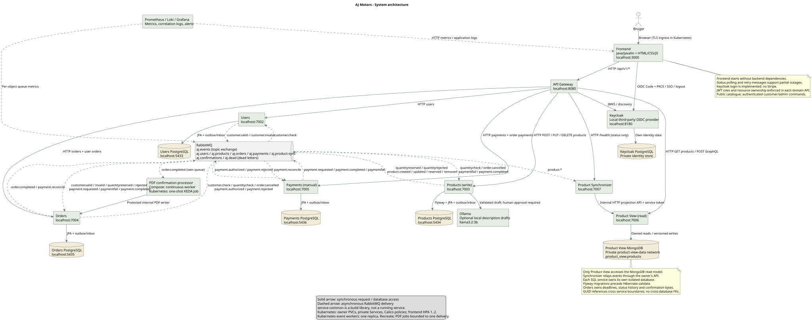
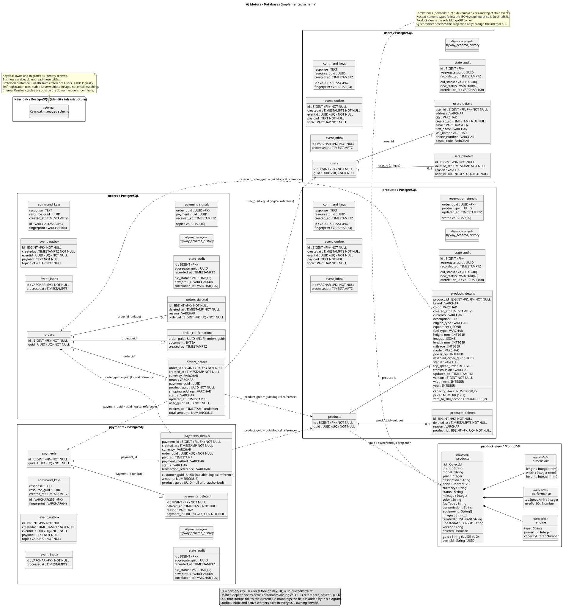
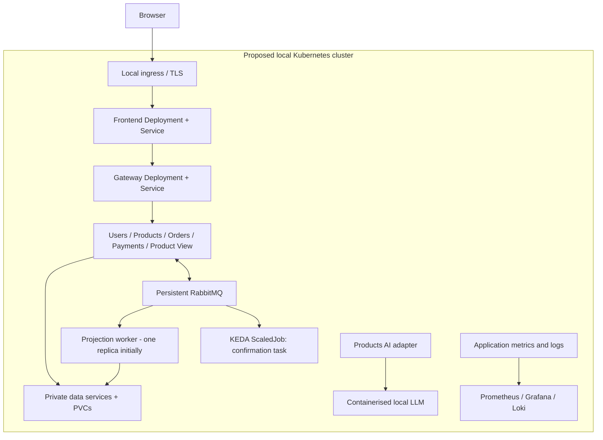
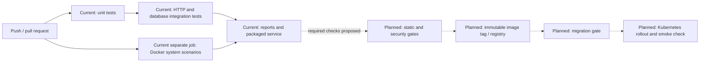
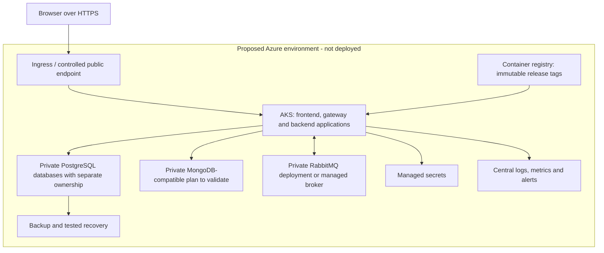

# AJ Motors

## Development of Large Systems — Project Report

**Authors**

- Ahmad Abdel Razak Hussein Alkaseb
- Jeppe Rønning Koch
- Asger Valdemar Bergøe
- Laith Abdel Razak Hussein Alkaseb

**Institution:** Business Academy Copenhagen (EK)  
**Course:** Development of Large Systems  
**Delivery date:** 11 December 2026  
**Status of this document:** Working report, reviewed against the application on 4 November 2026  
**Repository:** [AhmadAlkaseb/aj](https://github.com/AhmadAlkaseb/aj)

This report covers the technical and project-management topics in Mandatory Assignments 1 and 2 and follows the report structure in the final project description. It distinguishes implemented behaviour from proposed work. It does not claim that the application already satisfies every final-project requirement. The remaining work is recorded in [TODO.md](TODO.md). Administrative upload instructions and presentation material are outside this report's scope. [1], [2], [3]

The supplied *DLS Report Version One.docx* was used as an example and an initial description of the business idea. Statements in that document about React, Stripe, OAuth, deployed cloud infrastructure and planned capabilities have been checked against the current application rather than copied as implementation facts. [4]

## List of figures

| Figure | Description | Location |
| --- | --- | --- |
| 1 | Implemented application architecture | Section 2.1; [SVG](application/Architecture.svg) |
| 2 | Implemented databases and ownership references | Section 2.2; [SVG](application/Databases.svg) |
| 3 | Implemented API endpoints and request contracts | Section 2.3; [SVG](<application/API Contracts.svg>) |
| 4 | Implemented API response contracts | Section 2.3; [SVG](<application/API Contract Responses.svg>) |
| 5 | Proposed local Kubernetes environment | Section 3.2 |
| 6 | Current CI and planned release pipeline | Section 3.2.2 |
| 7 | Proposed Azure deployment | Section 3.3 |

## List of appendices

- Appendix A: Mandatory Assignment 1 coverage.
- Appendix B: Mandatory Assignment 2 coverage.
- Appendix C: Final-project requirement assessment.
- Appendix D: Installation and verification procedure.
- Appendix E: Evidence, documentation and outstanding decisions.

## Table of contents

1. [Introduction](#1-introduction)
2. [System architecture](#2-system-architecture)
3. [Environments description](#3-environments-description)
4. [Testing](#4-testing)
5. [Project management and team collaboration](#5-project-management-and-team-collaboration)
6. [Discussion](#6-discussion)
7. [Reflection](#7-reflection)
8. [Conclusion](#8-conclusion)
9. [References](#9-references)
10. [Appendix](#10-appendix)

The Markdown version uses navigable headings rather than page numbers. The final exported report must have a paginated contents page and be checked against the applicable page limit. The referenced course catalogue lists a maximum of 30 pages for a four-person group; this document has not yet been typeset or verified against that limit. [5]

# 1. Introduction

## 1.1. Problem description

AJ Motors is an online platform for a small, selected collection of exclusive cars. A customer should be able to inspect a car, register their details, reserve an available vehicle and complete an order when payment is recorded. Staff need to maintain listings and follow reservations and payments. The business idea is taken from the supplied project example; a claim that scarcity increases sales has not been measured by this project. [4]

The main technical problem is coordinating changes that belong to different services. Reserving a car, creating an order and registering payment must produce a consistent business outcome even though their records are stored in different databases. An interrupted connection must not silently lose an accepted update, and competing buyers must not both obtain the same car.

The implemented development system contains customer management, car management, a separate product catalogue, orders, manual payment registration and asynchronous catalogue synchronisation. Its frontend remains available when individual backend components fail and reports which functions are unavailable. It demonstrates distributed coordination rather than real financial settlement: the payment service records a result; it does not move money.

For examination demonstrations, startup automatically inserts 20 fictional customers, cars, orders and payments with stable references. Six examples are completed, four have pending payments and ten cars remain available after failed historical payments. Each service seeds only its own SQL data; catalogue snapshots use the existing outbox and projection workflow. Existing edits and soft-deleted identities are preserved. See [demonstration data](DEMO_DATA.md) for configuration and verification.

Stripe remains outside scope. The earlier OAuth exclusion has been replaced by a local Keycloak/OpenID Connect integration, selected so that no external Google or Microsoft account needs to be registered. Keycloak is a self-hosted third-party identity product with preconfigured demo users. Browser login/logout and a JWT-validated gateway identity endpoint are implemented; business-resource role and ownership enforcement remain outstanding under SEC-01. This is not federation to an external account provider. See [the identity decision](decisions/001-local-oidc.md) and [AUTH.md](AUTH.md). [3], [20], [31]

## 1.2. Functional and non-functional requirements

### Functional requirements

The requirements below separate the business capabilities in the prototype from capabilities needed to complete the final specification.

| ID | Requirement | Acceptance criterion | Current status |
| --- | --- | --- | --- |
| FR-01 | Maintain customer information | A valid customer can be created, retrieved, edited and soft-deleted; duplicate email addresses are rejected | Implemented; customer records are not login accounts |
| FR-02 | Browse the catalogue | The frontend lists cars from the product read model and opens a detailed view | Implemented |
| FR-03 | Search and filter cars | Search by brand/model and filter by availability; extend with price/year/mileage ranges | Brand/model/status implemented; range filters missing |
| FR-04 | Maintain car listings | Create and edit specifications and price; remove an eligible listing | Implemented; reserved/sold cars cannot be edited or deleted |
| FR-05 | Reserve a car | An order references one customer and one car; authoritative price and availability are checked | Implemented through asynchronous reservation |
| FR-06 | Prevent conflicting reservations | Concurrent requests for the same car leave only one successful reservation | Implemented and covered by a system test |
| FR-07 | Register payment | An eligible order receives one manual payment record; success sells the car and failure releases it | Implemented; no external payment execution |
| FR-08 | View and manage orders | Retrieve orders, including a customer's orders, and cancel eligible reservations | Implemented; personal ownership restrictions are absent |
| FR-09 | Report partial outages | Show a useful message and retry action while the frontend itself remains reachable | Implemented; this does not provide backend failover |
| FR-10 | Authenticate and authorise users | Validated tokens, roles and ownership protect customer and administrative operations | OIDC login/session implemented; business authorisation missing |
| FR-11 | Consume REST and GraphQL in a real frontend workflow | The frontend uses GraphQL for an agreed query and REST for a related command | REST implemented; GraphQL missing |
| FR-12 | Use an AI service in backend business logic | A backend invokes a defined AI API in an actual workflow with validation and failure handling | Not implemented |
| FR-13 | Execute an isolated serverless task | A separately triggered function/job performs a bounded task and terminates | Not implemented |

The final-project requirements for API interoperability, AI, authentication and serverless work are compulsory. They are not treated as optional product ideas. [3]

### Non-functional requirements

| ID | Requirement or target | Verification approach | Current evidence |
| --- | --- | --- | --- |
| NFR-01 | Normal interactive requests should complete within two seconds under an agreed load | Measure latency percentiles with a reproducible dataset and concurrency level | Target only; no load-test evidence |
| NFR-02 | Target at least 99% service availability, excluding agreed maintenance | Define an observation period and monitor requests and failures | Target from initial scope, not a measured result |
| NFR-03 | A committed domain change must not be lost merely because RabbitMQ is unavailable | Interrupt the broker and verify outbox delivery after recovery | A selected outage case passes; no universal durability claim |
| NFR-04 | One car must not be allocated to two active buyers | Exercise concurrent reservation attempts | Covered by one automated cooperation scenario |
| NFR-05 | Components should be reproducible and separately deployable | Build application images and start per-service Compose configurations | Implemented locally; shared build tooling remains a dependency |
| NFR-06 | Services should retain clear data boundaries | Review database connections and access rights | Each store has one owner; Synchronizer uses Product View's internal API |
| NFR-07 | Services should scale according to workload | Demonstrate HPA/KEDA and safe concurrent processing | Not implemented; workers currently assume one instance |
| NFR-08 | Sensitive actions and data must be protected | Verify TLS, identity, authorisation and secret handling | Local development configuration only; security requirements remain open |
| NFR-09 | Operational failures should be diagnosable across services | Correlated logs, metrics, dashboards and alerts | Console logs and health checks exist; distributed observability is missing |
| NFR-10 | Data and contracts must evolve predictably | Apply versioned migrations and compatibility tests | REST has `/api/v1`; migrations and message schema versioning are missing |
| NFR-11 | The interface should work on desktop and mobile | Browser checks at representative viewport sizes | Selected flows checked locally; no accessibility audit |

These targets give the project measurable acceptance criteria. Containerisation alone does not establish scalability, and a successful restart test does not establish a production availability percentage.

## 1.3. Technology stack and rationale

| Area | Current technology | Reason for the choice and its limitation |
| --- | --- | --- |
| Backend | Java 17, Maven and Javalin | Consistent language and HTTP framework across the services; Maven coordinates reproducible builds. A shared library reduces duplication but couples build-time changes |
| Frontend | HTML, CSS and JavaScript served by a Java/Javalin application | Supports the current catalogue and administrative flows without a separate JavaScript build toolchain. React was an earlier proposal, not the implemented frontend |
| Relational data | PostgreSQL 16 and Hibernate/JPA | Relational records and local transactional updates support customers, orders, payments and authoritative product state |
| Read model | MongoDB 7 | A denormalised product document contains the fields needed by catalogue queries. Document modelling is an explicit design choice, not proof that MongoDB is always faster than SQL. [30] |
| Messaging | RabbitMQ 4.1 using AMQP | Durable queues, publication confirmation and consumer acknowledgements support recoverable asynchronous delivery. [7] |
| HTTP contracts | REST with JSON and public UUIDs | Familiar resource operations; `/api/v1` separates the public contract from internal SQL IDs |
| Automated testing | JUnit 5, Mockito, H2 and Python unittest | Small isolated tests, HTTP/database integration checks and container-based workflows cover different failure boundaries |
| Development runtime | Docker and Docker Compose | Each application image includes its Java runtime; the environment also starts databases and the broker |
| CI | GitHub Actions, Maven Surefire and Failsafe | Service-specific workflows run shared checks and available service tests; a separate workflow starts the distributed system. [27], [28] |
| Diagrams | PlantUML source and SVG | Diagrams are editable, versionable and viewable without a live application |

GraphQL, AI integration, Kubernetes, serverless execution and an observability stack are proposed additions, not installed parts of this stack. Their concrete completion criteria are in the backlog.

# 2. System architecture

## 2.1. Introduction to the microservices architecture

The application separates customer information, authoritative product state, product queries, orders and payments. A gateway routes public API requests, while RabbitMQ coordinates reservation outcomes, payment outcomes and read-model changes.



*Figure 1. The implemented architecture. Solid arrows represent synchronous communication or database access; dashed arrows represent asynchronous delivery. Editable source: [Architecture.puml](application/Architecture.puml).*

There are five separately runnable domain/API backends: Users, Products, Product View, Orders and Payments. Product Synchronizer is an additional backend worker. This count does not include the frontend, the gateway, databases, RabbitMQ or the shared build library. The design therefore has at least five backend applications without relying on the gateway's inclusion. [3]

Each application has an independent process and container configuration. The monorepo also has a parent Maven build and `service-common`. Independence at runtime should not be confused with complete independence of source changes or build tooling.

The development environment has sixteen containers: eight applications, four business PostgreSQL servers, one MongoDB server, one RabbitMQ broker, Keycloak and its separate PostgreSQL identity database. Their current responsibilities and limitations are described below; the API diagrams and specifications are referenced rather than reproduced as implementation listings.

## 2.2. Microservices description

### Users

Users owns customer profile information: name, email, telephone and address. Keeping this responsibility separate avoids making orders the owner of customer maintenance. Its REST API supports profile management; it does not currently issue credentials, authenticate users or validate roles.

Its PostgreSQL database contains a stable identifier table, profile details and a deletion marker. Unique email addresses are checked by the database. Soft-deleted users disappear from ordinary reads while their identifying records remain available for existing logical references. Users does not produce or consume domain events in the current application.

Orders makes a synchronous customer lookup before accepting a new order. If Users is unavailable, that operation fails explicitly rather than bypassing validation. Independent read scaling is a possible future deployment improvement, but the current single database remains a dependency. Security and profile-deletion policy must be completed before the service handles real customer data.

### Products

Products owns the authoritative car description, sale price, availability and reservation owner. It exposes REST operations for listing maintenance and authoritative service-to-service reads. Public catalogue GET requests normally use Product View instead.

The service consumes `quantitycheck`, `order.cancelled`, `paymentfail` and `payment.completed`. A successful reservation changes the car to RESERVED and publishes `quantityreserved`; rejection publishes `quantityrejected`. Product changes produce `product.created`, `product.updated`, `product.reserved` or `product.removed` for the read model.

Its PostgreSQL database supports local transactions and locking around competing reservations. Price and currency are checked again when the reservation command is processed, preventing an order based on an outdated quoted amount from being silently accepted at a different price. A matching successful payment changes the car to SOLD; an eligible cancellation or failure releases it.

When RabbitMQ is unavailable, product maintenance can still commit an update with a pending outbox entry. The catalogue will lag until delivery recovers. This increases resilience to broker outages but can create a backlog. Current throughput, lock contention and multiple-worker safety have not been measured or demonstrated.

### Product View

Product View exposes a read-only REST catalogue backed by MongoDB. Its document contains the car's display fields and embedded engine, performance and dimension data. A catalogue query need not join customer, order or payment records.

Product View is the sole owner of the MongoDB projection. It does not consume RabbitMQ directly: its internal authenticated HTTP interface accepts full snapshots relayed by Product Synchronizer. The public query interface excludes deletion tombstones. A committed product update may temporarily be absent or outdated because delivery is asynchronous.

Read replicas of the application are a possible scaling direction, subject to database capacity and indexes. The present implementation loads matching results without pagination and performs the frontend's brand/model search in the browser. Large-catalogue efficiency has not been established.

### Product Synchronizer

Product Synchronizer consumes `product.*` snapshots and relays the original event identity, topic and snapshot to Product View. It has no MongoDB driver, database configuration or database-network access. Product View applies the newer version using conditional replacement and retains removal tombstones; stale and duplicate snapshots are acknowledged without overwriting newer state.

The worker exposes health endpoints but no public business API. Health covers RabbitMQ and the authenticated projection-owner connection. A delivery is acknowledged only after the owner's successful HTTP response. Network, storage and credential failures cause retry; invalid payloads rejected with 400 follow the dead-letter path. The worker accesses neither Products PostgreSQL nor MongoDB.

The original shared-database access was replaced by an explicit ownership boundary, recorded in [ADR-002](decisions/002-projection-ownership.md). MongoDB is on a private network connected only to Product View; its port is not exposed in normal startup. The internal writer is not forwarded by the public gateway and requires a separate service credential. Existing data and volumes are retained. See [PROJECTION.md](PROJECTION.md) for the interface and recovery contract. [3]

### Orders

Orders owns the commercial intent to buy one specific car and the progress of that transaction. REST operations create and inspect orders and permit eligible edits or cancellation. It stores its own PostgreSQL records with customer, product and payment UUID references; these are not foreign keys into other databases.

Creating an order stores PENDING and `customer.check` atomically. Users validates the customer asynchronously; Orders then becomes RESERVING and publishes `quantitycheck`. Products reserves under its own lock and returns the authoritative amount/currency. Reservation events move the order to RESERVED or REJECTED; the initial response has null amount/currency. Payment results can subsequently move it to COMPLETED or FAILED. Cancellation publishes `order.cancelled`, allowing Products to compensate by releasing the reservation.

A `payment.requested` message claims a RESERVED order under its lock and changes it to PAYMENT_PENDING. Orders commits the claim and `payment.authorized` invoice together; an ineligible order yields `payment.rejected`. This serialises payment start against cancellation without a distributed transaction or direct domain-service HTTP call.

An order may remain PENDING, RESERVING, RESERVED or PAYMENT_PENDING if an operation is abandoned. Automatic expiry and reconciliation are not implemented. These are important remaining business rules, particularly before introducing autoscaling or a real payment provider.

### Payments

Payments owns payment registration and its terminal outcome, isolating that responsibility from product availability. Its REST API creates and retrieves a manual payment and records COMPLETED or FAILED. The payment method indicates manual recording, bank transfer or cash; the service does not execute those transfers.

The amount is taken from an eligible order rather than accepted from the client. A deterministic payment identity and a unique order reference make repeated creation return the same record. A terminal result cannot be changed to the opposite result. Successful and failed outcomes are published as `payment.completed` and `paymentfail`.

Its PostgreSQL database is private to Payments. Creation stores a REQUESTED payment and `payment.requested` before claiming the order. Authorisation supplies product/amount/currency and changes the payment to PENDING; rejection is terminal REJECTED. Durable replies and retry recover temporary consumer failures without a client retry. Automatic business expiry and reconciliation for permanently abandoned payments remain missing.

### Frontend, gateway and supporting infrastructure

The frontend also provides Keycloak login/logout, silent SSO and a validated identity display. Its public client uses Authorization Code + PKCE S256; tokens remain in memory and gateway verification checks signature, issuer, audience and lifetime. Identity data belongs to Keycloak, with customer UUID attributes linking the imported demonstration identities to customer profiles. [20], [31]

The frontend provides catalogue, customer, order and payment views. It consumes backend APIs through its same-origin proxy and the gateway. It supports REST only at present. It is an administrative development interface as well as a customer-flow demonstration; its administrative buttons are not protected by roles.

The gateway routes product reads to Product View, writes to Products and the remaining resource operations to their owning services. It aggregates backend health for the status view. This centralises public routing but also makes the gateway a failure boundary. If it is stopped, the frontend still serves its assets and displays an API connectivity error; no alternate gateway is automatically selected.

RabbitMQ and the databases are infrastructure, not additional business microservices or third-party integrations. Running them in local containers does not make them external services in the business architecture. They are nevertheless independent failure domains.

### Data model and ownership



*Figure 2. Current database model. Source: [Databases.puml](application/Databases.puml). SQL field types and constraints were checked against the running development databases.*

Users, Products, Orders and Payments each use a main identifier table, a details table and a deletion table. The details relation is one-to-one; the deletion relation permits at most one marker through a unique local foreign key. This layout separates identity and removal metadata, but the details remain mutable. It is not an immutable history of every change.

Order and payment references use public UUIDs so that services need not share internal numeric IDs. Local SQL foreign keys protect local relations only. Cross-service existence is checked through the owning API or a workflow, with the usual risk that remote state changes after a lookup.

The MongoDB read model contains a complete product snapshot, a version, an event identity and a deletion flag. Price is stored as Decimal128. SQL and read-model timestamp representations are currently not fully uniform, which should be made explicit in machine-readable contracts.

## 2.3. Communication between microservices

### REST and API interoperability

Public REST resources use `/api/v1` and JSON field names in camelCase. UUIDs identify resources. The common success responses are 200, 201 and 204; validation, absence, conflicts and unavailability use structured 400, 404, 409 and 503 responses respectively. Product list responses currently contain full snapshots, not a separate reduced listing DTO.


*Figure 3. Implemented operations and requests. Source: [API Contracts.puml](<application/API Contracts.puml>); detailed contracts: [API.md](API.md).*


*Figure 4. Implemented response representations. Source: [API Contract Responses.puml](<application/API Contract Responses.puml>).*

The diagrams and prose are useful documentation, but they are not an OpenAPI specification. Machine-readable REST contracts and Swagger/OpenAPI presentation remain required. OpenAPI defines a standard description of HTTP interfaces that can be used by tooling and consumers. [21]

For GraphQL, the proposed first workflow is catalogue discovery: Product View would expose typed car queries, and the frontend would use those queries before creating a reservation through REST. This gives a concrete interoperability example without assigning price authority to GraphQL or duplicating order commands. GraphQL's schema and field selection support this query interface. No GraphQL endpoint or frontend consumer has yet been implemented in AJ Motors. A separate GraphQL exercise under `system-integration/` does not satisfy the application requirement. [3], [19]

### Asynchronous messages

The `aj.events` topic exchange distributes JSON messages to five durable consumer queues. A shared envelope contains `eventId`, `eventType`, `occurredAt`, `correlationId`, `schemaVersion: 1` and `payload`. AMQP `messageId` matches eventId. The order UUID follows the entire purchase as correlationId, including derived product snapshots. Product payload.version remains a separate state version.

| Routing key | Producer | Consumers | Business purpose |
| --- | --- | --- | --- |
| `customer.check` | Orders | Users | Validate the referenced customer |
| `customer.valid`, `customer.invalid` | Users | Orders | Continue or reject customer validation |
| `quantitycheck` | Orders | Products | Request an exclusive car reservation and authoritative price |
| `quantityreserved` | Products | Orders | Confirm the reservation |
| `quantityrejected` | Products | Orders | Reject an unavailable or outdated-price reservation |
| `order.cancelled` | Orders | Products | Release an eligible reservation |
| `payment.requested` | Payments | Orders | Claim an eligible RESERVED order |
| `payment.authorized`, `payment.rejected` | Orders | Payments | Supply authoritative invoice or reject creation |
| `payment.completed` | Payments | Orders, Products | Complete the order and mark the car sold |
| `paymentfail` | Payments | Orders, Products | Fail the order and release the car |
| `product.created`, `product.updated`, `product.reserved`, `product.removed` | Products | Product Synchronizer | Update the catalogue snapshot or tombstone |

The queues are `aj.users`, `aj.products`, `aj.orders`, `aj.payments` and `aj.product-sync`. Invalid messages can be moved through the dead-letter exchange to `aj.dead`; transient dependency failures are retried. There is no bounded retry policy, operator replay interface or dead-letter alerting yet.

Reservation requests include order/product/customer references and initially null price fields; confirmation adds the authoritative amount/currency. Payment requests include order/payment identifiers; authorisation adds invoice fields, and outcomes include the product reference. Product messages contain the complete public snapshot. Consumers validate common metadata and accept old raw payloads to drain existing queues; the local stack must be upgraded together. Timeout, retry and compatibility rules are in [ASYNC.md](ASYNC.md). Formal AsyncAPI documentation remains required. [4], [22]

### Why both communication styles are used

HTTP provides immediate user-facing commands and queries, health status and OIDC/JWKS exchange. Customer validation, product reservation, payment initiation and outcomes use RabbitMQ, so these domain interactions can wait for an unavailable consumer. Nested collections filter local data and return empty lists for unknown UUIDs. The remaining internal projection HTTP call preserves Product View as sole MongoDB owner and supplies storage confirmation before broker acknowledgement. These boundaries are recorded in [ADR-003](decisions/003-asynchronous-commerce.md). [3]

## 2.4. Patterns and techniques

### 2.4.1. CQRS

Products is the command-side authority, while Product View serves a separate MongoDB query representation. This is a concrete application of CQRS to a read-oriented catalogue rather than a requirement to split every domain. The additional projection introduces eventual consistency and another operational dependency. CQRS permits different read and write models, but does not by itself prove better performance; the project has no comparative benchmark. [6]

### 2.4.2. Immutable data, tombstones and snapshots

Deletion markers in PostgreSQL and tombstones in MongoDB retain evidence that a record was removed. Product messages carry full-state snapshots, allowing the projection to replace a product's display state without retrieving each individual field from Products.

These mechanisms are limited forms of immutable information. Customer, product, order and payment details are still updated in place, and old outbox rows are deleted after confirmed publication. There is no complete event-sourcing log, historical snapshot archive or general time-travel query. Retaining deleted personal data also requires a retention and erasure policy before production use.

### 2.4.3. Idempotence

SQL consumers record processed event identities in an inbox as part of the transaction that changes business state. A redelivered event with the same identity is ignored. Payment creation uses one stable identity per order, and repeating the same terminal payment result does not emit another outcome.

This is not a general idempotency guarantee for public POST requests. Repeating a customer, car or order creation can still create a conflict or another entity. A client retry key, request fingerprint and stored original response are required for broader command idempotence.

### 2.4.4. Commutative message handlers

Within a versioned projection, an older product version is ignored after a newer snapshot or tombstone has been applied. For distinct versions, that gives the projection the same final state whether an older snapshot arrives before or after the newer one.

The complete business workflow is not proven commutative. If a release or payment outcome is received before the corresponding reservation, the current handler can ignore it; processing the reservation later can then leave a different final state. The projection now uses a version-conditional atomic replacement and a unique GUID index, preventing stale HTTP retries and concurrent snapshots from overwriting newer data. Business message handlers and parallel outbox workers still require their own concurrency design. Tests for shuffled message sequences and state-transition rules are therefore necessary before marking this final-project requirement complete. Idempotence under duplicate delivery and commutativity under reordered delivery are different properties. [3]

### 2.4.5. Saga pattern

The implemented reservation/payment flow uses local database transactions and compensating release events. Successful reservation followed by `paymentfail` returns an eligible car to AVAILABLE and marks the order FAILED. Cancellation similarly releases a reservation. This is a partial choreography-based saga: services react to outcomes rather than participating in one distributed transaction. [8]

Important limitations remain. A customer can abandon a payment claim; there is no automatic expiry, timeout compensation, reconciliation process or comprehensive reordered-message test. The report therefore describes the existing compensation behaviour, not an assertion that every interrupted saga will terminate correctly.

### 2.4.6. Caching

No Redis cache or explicit application response cache is implemented. The MongoDB catalogue is a persistent read projection, not a disposable cache with a time-to-live. Caching could be evaluated for expensive catalogue reads after adding pagination and measurements, but it is not presented as a used pattern.

### 2.4.7. Transactional outbox and reliable delivery

A domain update and its outgoing outbox record commit in one local SQL transaction. A worker publishes the stored message and removes the outbox record only after broker confirmation. If publication succeeds but the database acknowledgement is interrupted, the same event may be published again. Inbox deduplication and projection versions handle selected duplicate cases. This implements the central outbox idea without a database/broker distributed transaction. [9]

Persistent messages, durable queues, publisher confirms and consumer acknowledgements serve different points in delivery. A consumer acknowledgement is issued after processing; a publisher confirm alone does not prove that business processing completed. These mechanisms support recovery but do not establish exactly-once execution. [7]

# 3. Environments description

## 3.1. Development environment with Docker Compose

The root Compose file starts the full development topology shown in Figure 1. Per-service Compose files support developing an application with its associated database, using shared messaging/network infrastructure. Services are addressed by container DNS names internally and exposed on loopback host ports for local development.

Demonstration seeding is enabled by default and can be disabled with `DEMO_DATA_ENABLED=false`. Stable fixture identities prevent duplicate insertion across restarts. These fixtures initialise historical example states; they are not evidence that twenty new purchases have been executed through live APIs at every startup. MongoDB receives the twenty product snapshots asynchronously.

| Component | Local port | Persistent storage |
| --- | --- | --- |
| Frontend / API Gateway | 3000 / 8080 | None |
| Users / PostgreSQL | 7002 / 5433 | Dedicated Users volume |
| Products / PostgreSQL | 7003 / 5434 | Dedicated Products volume |
| Orders / PostgreSQL | 7004 / 5435 | Dedicated Orders volume |
| Payments / PostgreSQL | 7005 / 5436 | Dedicated Payments volume |
| Product View / MongoDB | 7006 / private (optional debug 27018) | Dedicated projection volume |
| Product Synchronizer | 7007 | No database; RabbitMQ and owner API |
| RabbitMQ / management interface | 5672 / 15672 | Broker volume |

MongoDB is private in the standard environment. An explicit debug override can expose loopback port 27018 for local JVM development. Java applications use internal port 7000. SQL databases have their own application data networks, and the MongoDB network connects only Product View and its database.

Images include the Java runtime and run the application under a non-root user. Health checks distinguish process liveness from dependency availability. Named volumes survive an ordinary Compose shutdown. They are persistence, not a backup strategy. Development credentials and unencrypted local HTTP are unsuitable as a production security configuration.

## 3.2. Local Kubernetes deployment simulating production

**Status: proposed; no Kubernetes manifests or successful cluster run are currently included.** The final project explicitly requires a local Kubernetes environment, even though full cloud deployment is not required. Compose does not replace that requirement. [3]



*Figure 5. Planned topology, not a deployment that has been executed. `APIs` groups independent applications for readability. The projection ownership boundary is resolved by the internal owner API and must be preserved in the manifests.*

### 3.2.1. Technologies and isolated tasks

The proposed environment uses a local Kubernetes cluster with application Deployments and internal Services. Persistent data needs explicit volumes and operational policies; application rollouts do not make database changes reversible. Kubernetes Deployments support controlled updates of application replicas. [10]

An isolated order-confirmation task is proposed for the serverless requirement. A containerised job would consume a confirmation event, record an idempotent result in its own store or sink, and terminate. A KEDA ScaledJob can create jobs in response to queued work. It must have its own queue so that consuming a notification does not steal an event from an order or inventory consumer. The existing long-running synchronizer is not counted as a serverless function. [12]

The proposed AI workflow asks Products to generate a draft listing description from verified car attributes through a local Ollama API. The draft requires human approval and must not alter availability, price or payment decisions. A real backend call, input/output contract, model configuration, timeout and tests are needed; a stub alone does not establish AI integration. Ollama provides a generation API suitable for such an adapter. This feature is not implemented. [26]

### 3.2.2. CI/CD pipeline

Eight service workflows currently call one reusable Java verification workflow. The first stage runs unit tests; the second runs integration tests and packages the selected service and its shared dependency. A separate system workflow builds the full container environment, executes the cooperation scenarios, saves diagnostics and cleans up its isolated runner. This avoids starting the full system eight times for one shared-code change. [28]



*Figure 6. Existing CI and proposed release extension. The service and system workflows run independently; a shared release job waiting for all required checks is not implemented.*

Test failures return a non-zero result and fail their job. Reports are uploaded even on failure. The repository contains the workflow definitions, and their commands have passed locally; a successful remote GitHub run and branch-protection policy have not been established by the local test results. Registry publication, automated environment deployment and rollback are not present. The current pipeline is CI with a planned CD extension, not a completed cloud delivery pipeline.

### 3.2.3. Monitoring and logging

Implemented operational support consists of application/exception output, container logs, per-service health endpoints, gateway status aggregation and RabbitMQ's management interface. These help development diagnosis but are not a complete distributed logging and monitoring solution.

The proposed production-like setup collects structured logs in Loki and views them in Grafana; Loki provides central log aggregation. [24] Prometheus would scrape metrics and support alerts for service failures, latency, errors and accumulating queues. [25] Planned application fields include service name, request/correlation ID, event ID, order reference and outcome. Sensitive customer data and credentials should not be logged.

Useful measures are request latency percentiles, error rate, queue depth, oldest pending outbox age, dead-letter count, projection lag, database connection use and worker failures. A dashboard must distinguish an unavailable API from an API whose process is alive but cannot access its dependencies. Health polling alone does not measure historical availability or business correctness.

### 3.2.4. Autoscaling configuration

HPA is proposed for stateless HTTP services after resource requests, limits and metrics are defined. HPA adjusts replica counts from observed metrics; it does not remove a database bottleneck. [11] Event-driven scaling is appropriate for the isolated confirmation jobs, subject to idempotence and downstream capacity. [12]

Products, Orders, Payments and Product Synchronizer must not be scaled merely by increasing replicas. Current outbox polling and business state transitions require concurrency validation. Projection snapshots already use a conditional MongoDB replacement, but this does not establish the safety of every worker or workflow. Worker ownership, database contention and consistent message ordering must be addressed first. The local cluster will demonstrate application scaling separately from database replication and broker high availability.

## 3.3. Cloud deployment plan

### Provider investigation and choice

The supplied example selected Azure. This report retains Azure as the proposed cloud direction, while distinguishing that planning decision from deployed infrastructure. [4]

| Provider | Relevant option | Assessment for this project |
| --- | --- | --- |
| AWS | ECS for managed container orchestration | A viable container platform, but the team would still need to configure persistence, messaging, identity and operations around the application. [13] |
| Google Cloud | Cloud Run for container-based services | A viable managed service option; continuously running workers and persistent infrastructure require an explicit hosting design. [14] |
| Microsoft Azure | Container Apps or AKS | Container Apps offers managed container execution; AKS provides a Kubernetes-oriented path closer to the required local-cluster exercise. [15], [16] |

For the Kubernetes-aligned target, the plan is Azure Kubernetes Service for applications, a container registry for versioned images and managed PostgreSQL where justified. Azure Container Apps remains a simpler hosting alternative for suitable components, rather than an additional platform that must also be operated. Hosting choice will be confirmed against the team's budget and completed local deployment. [15], [16]



*Figure 7. Cloud planning diagram. No cloud subscription, cloud cluster, cloud identity service, managed database, certificate or managed broker is provisioned. The local Keycloak integration is described separately.*

### Application and database availability

The plan uses separate application replicas and rolling releases where business semantics permit. A managed PostgreSQL HA configuration can use separated primary/standby replicas, including zone-redundant options; this must be explicitly selected and funded. Four logical databases on one physical server retain some schema separation but share a failure domain, so physical separation is an explicit cost-versus-isolation decision. [17]

The MongoDB service must support the actual driver, Decimal128, indexes and update behaviour. A nominally compatible cloud database is not assumed to be a drop-in replacement without tests. RabbitMQ needs a persistence, backup and availability plan; the current single broker with durable queues is not a highly available cluster.

### Cost, latency and elasticity

The cost strategy starts with a measured workload, a budget ceiling and the smallest adequate development configuration. Main cost categories are application compute, stateful database capacity, persistent storage, backups, broker/observability resources, traffic and AI inference. Azure Container Apps offers consumption-based and other pricing options, but exact cost depends on the chosen region and workload. No fixed monthly figure is claimed. [18]

Keep chatty application and data dependencies near each other, bound request timeouts and measure end-to-end latency before selecting larger instances. Scale-to-zero may reduce cost for intermittent jobs, but cold starts can conflict with an interactive latency target. Database and broker capacity remain constraints even when application replicas increase.

### Security, data management and releases

The proposed production environment uses TLS, private data endpoints, restricted service access and centrally managed secrets. Customer and payment metadata require a retention policy and tested recovery procedure. Data volumes must not be treated as the only backup.

A release should use an immutable image identifier, pass automated quality gates, apply reviewed migrations, roll out gradually and run post-deployment checks. An application rollback must be compatible with the migrated schema. Automated publishing and deployment are backlog items, and local development passwords must not be copied into a cloud environment.

Actual cloud deployment is not required by the final project. The local Kubernetes simulation, its evidence and a justified cloud plan are required. [3]

# 4. Testing

## 4.1. Testing strategy and scope

The strategy separates isolated logic checks, component-boundary integration and cooperation of deployed services. Fast Java tests should reject simple defects before the more expensive container scenarios run. A passed test establishes the behaviour exercised by that scenario; it does not establish full coverage, production security or performance at scale.

The current suite contains thirteen unit tests, nine integration tests and six Python system scenarios when the failure option is enabled. An additional browser script checks selected desktop/mobile interactions and outage messages. The [test guide](TESTING.md) records the commands and limitations.

## 4.2. Unit testing

Three unit tests in the shared API library exercise canonical UUID validation, accepted/rejected money values, required text and restricted status choices. Three shared event-envelope unit tests cover metadata validation, inherited correlation and legacy payloads. Two gateway tests check command/query routing and ownership of nested resource routes. Mockito isolates the routing decision from a live HTTP server.

Three additional fixture tests check stable and non-colliding identities, consistency with the normal payment retry identity, and coherent product/order/payment example states. A separate demonstration-data verification script checks the actual API data and can restart the four applications to verify that edits survive without duplicate insertion.

The shared tests run when a service is built with its Maven dependencies. That is useful coverage of common behaviour, but it is not a substitute for the final requirement that each backend have unit tests of its core logic. Users, Products, Orders, Payments, Product View and Product Synchronizer do not yet have their own adequate business-logic unit-test suites. Reservation transitions, payment state changes, projection versions, tombstone precedence and message-order cases are priority additions. [3]

## 4.3. Integration testing

Two shared integration tests start actual Javalin HTTP servers on temporary ports. They verify structured validation errors through the proxy and a 503 response when the upstream is stopped. A product integration test exercises Hibernate persistence against H2 in PostgreSQL mode. Six further HTTP integration tests validate the owner's authentication/input/storage responses and the relay's event envelope/retry handling.

These establish HTTP-boundary and selected mapping behaviour. H2 is not the actual PostgreSQL engine, so its success does not prove all production database semantics. The full container scenarios do exercise PostgreSQL, MongoDB and RabbitMQ, and `check_async.py` separately inspects real broker envelopes and the dead-letter path without a UI. Isolated duplicate/ack assertions and upgrade fixtures remain part of TEST-02.

## 4.4. System-level cooperation testing

The current Python scenarios check:

1. Contract validation, missing references and duplicate email handling.
2. Successful reservation/payment, authoritative pricing and repeat payment requests.
3. Failed payment and release of the reserved car.
4. Concurrent attempts to reserve the same car.
5. Product updates, projection synchronisation and soft deletion.
6. Recovery after stopping the synchronizer, broker, Users database and gateway.

The system workflow starts the dependent containers before executing these scenarios. It preserves failure diagnostics and fails on a failing test. This is useful distributed behaviour evidence.

However, these scenarios are driven through the frontend proxy and public API as a complete business journey. The final description explicitly asks for a cooperation test focused on backend interaction rather than an end-to-end user workflow. The separate `check_async.py` now triggers direct backend reservation/payment interactions, inspects broker envelopes, and asserts authoritative state and recovery without frontend/gateway. It runs in CI against the Compose dependencies. A smaller isolated service fixture and wider fault/permutation coverage remain useful; these five checks do not establish arbitrary saga convergence. [3]

## 4.5. Security testing

Five gateway unit tests now verify valid access tokens and rejection of missing, malformed, expired, wrongly issued/audienced, identity and forged tokens. Real Keycloak browser tests exercise Code + PKCE login, role claims, SSO reload and logout for customer and administrator identities. Authorisation/ownership tests for business resources remain missing: those routes are still public pending SEC-01. A role claim in a valid token is not proof that a backend enforces the role. [20], [31]

Input validation tests are valuable, but they are not authentication or authorisation tests. Likewise, keeping an internal route out of gateway routing is not strong access control while direct development service ports remain accessible.

## 4.6. Static analysis and static testing

Actionlint was used locally to validate workflow syntax, and the UML sources were syntax-checked and rendered. These checks do not constitute an automated Java code-quality/security gate in the project's CI pipeline.

A static-analysis tool still needs to run automatically. Candidate checks include Java analysis for likely defects, dependency vulnerabilities and code scanning. GitHub documents code scanning as a way to analyse code for security issues, but tool selection must account for repository visibility and available licensing. The selected checks must produce reports and make the pipeline fail under an agreed severity policy. [29]

## 4.7. Test execution in CI/CD

Surefire executes unit tests during Maven's `test` phase; Failsafe executes `*IT` tests and verifies their results during `verify`. [27] The service workflows run both categories in separate steps. The system workflow executes `scripts/smoke.py --failures` after a health-checked Compose startup. Its exit code is preserved when output is copied to the test log.

| Local evidence reviewed on 4 November 2026 | Result | Interpretation |
| --- | --- | --- |
| Shared API unit tests | 3 passed | Selected input rules |
| Event metadata unit tests | 3 passed | Correlation propagation, schema validation and legacy reads |
| Gateway routing unit tests | 2 passed | Selected routing decisions |
| Demonstration fixture unit tests | 3 passed | Stable references and consistent example states |
| JWT verifier unit tests | 5 passed | Signatures, issuer/audience, expiry and token type |
| Real Keycloak browser checks | Customer and admin login/reload/logout passed | Local OIDC integration; business authorisation not yet covered |
| Shared HTTP integration tests | 2 passed | Error propagation and upstream failure |
| Product repository integration test | 1 passed | Selected Hibernate/H2 persistence |
| Internal projection HTTP integration tests | 6 passed | Owner credentials, payloads, storage errors and relay retries |
| Container-based Python system suite | 6 passed | Selected commerce and recovery scenarios |
| Direct backend/broker cooperation checks | 5 passed | Actual envelopes/dead-letter, asynchronous rejection and consumer recovery |
| Additional browser verification | Passed; no JavaScript errors recorded in that run | Selected interactions and viewport checks, not exhaustive UI coverage |
| Workflow syntax / UML validation | Passed locally | Definitions/rendering validated, not proof of remote CI or Kubernetes deployment |

The Java and system run summaries were reviewed from local reports produced during development. They are historical evidence, not a fresh performance benchmark performed to write this report. GitHub workflow execution and release evidence must be captured separately after the relevant changes are committed and pushed.

## 4.8. Limitations, risks and trade-offs

The suite is deliberately small. It does not cover every service in isolation, arbitrary message permutations, multiple worker replicas, prolonged outages, load, automated migrations, restore-from-backup, AI output validation or access control. System tests currently retain labelled test records, so their runner environment must be isolated from production data. A local test passing once is not proof of indefinite recovery or high availability.

The tests should be expanded around business failure boundaries before adding autoscaling. Adding many assertions about trivial getters would increase test counts without addressing the missing distributed guarantees.

# 5. Project management and team collaboration

## 5.1. Strategy and collaboration

The agreed working approach is lightweight and Scrum-inspired rather than a complete implementation of Scrum. The team plans short sprints, holds brief daily standups to discuss progress and blockers, and uses a shared To Do / In Progress / Review / Done board. Each sprint ends with a demonstration and a short retrospective. These are the working agreements adopted for the remaining project; no attendance record or completed sprint history is asserted here.

A task is Done when its behaviour meets its acceptance criteria, relevant checks pass, and contracts/documentation are updated. A local demonstration and a remotely verified release are recorded separately.

## 5.2. Methods, responsibilities and evidence

The following balanced allocation organises future work and review. It does not assign authorship of previously created code or substitute for each student's actual Git contributions.

| Named owner | Main responsibility | Reviewer |
| --- | --- | --- |
| Ahmad Abdel Razak Hussein Alkaseb | Users, identity and access control | Jeppe Rønning Koch |
| Jeppe Rønning Koch | Products, catalogue, GraphQL and AI | Asger Valdemar Bergøe |
| Asger Valdemar Bergøe | Orders, Payments, reliability and confirmation jobs | Laith Abdel Razak Hussein Alkaseb |
| Laith Abdel Razak Hussein Alkaseb | Kubernetes, observability, delivery and backup/restore | Ahmad Abdel Razak Hussein Alkaseb |

Frontend, tests, contracts and report updates accompany each workstream. Shared acceptance review checks the complete purchase flow. Each issue should retain an owner, reviewer, acceptance evidence and documentation links. Actual meeting examples, individual reflections and contribution evidence must be supplied or confirmed by the participants before they are presented as historical facts. The complete accepted implementation choices are recorded in [IMPLEMENTATION-PLAN.md](IMPLEMENTATION-PLAN.md).

## 5.3. Versioning strategies

### Source code

Source code is managed with Git in a monorepo. The intended policy uses short-lived feature branches, reviewed pull requests and protected release branches. Releases should have immutable tags and images tied to a commit identifier. The Maven modules currently share a `1.0.0` version; that alone is not evidence of independent release management. A meaningful group history and a reproducible release baseline remain to be established for the current work.

### Databases

Database schema evolution currently relies on Hibernate automatic updates. Payments also applies a narrow idempotent startup change to allow null product references while REQUESTED; existing data is preserved, but this is not a versioned migration framework. Existing SQL scripts do not form a migration-tool-based version history. This does not satisfy the final specification's migration requirement.

The proposed policy is a versioned migration sequence for each SQL-owning service, with a reviewed baseline and explicit tests against an empty database and an upgrade fixture. Flyway describes migrations as version-controlled changes applied consistently across environments. Application startup should validate the resulting schema instead of silently treating automatic DDL as a release policy. MongoDB projection changes also need a document-version/rebuild strategy. [23]

### APIs and messages

REST uses `/api/v1`. Compatible additions should preserve existing clients; breaking changes need an explicit migration or new REST version. The future GraphQL schema should evolve through compatible fields and deprecation, with schema-change checks rather than assuming every schema edit is safe. [19]

The implemented message envelope uses schemaVersion 1, separate from the product business-state version. Event identity/type/time/correlation are validated consistently. Unknown envelope versions dead-letter, and legacy raw payloads remain readable. This is persisted-message compatibility, not mixed-binary rolling-upgrade compatibility; [ASYNC.md](ASYNC.md) documents the deployment boundary.

## 5.4. Documentation strategy

Documentation belongs next to the source it describes. The monorepo README explains onboarding, `API.md` describes current REST/messages, `TESTING.md` records verification commands, and `application/` contains editable UML and viewable SVGs. This report explains system-level decisions and should reference those contracts rather than embed all API details again.

Each service still needs its own README. REST contracts need OpenAPI documents, GraphQL needs an actual schema and endpoint description, and message interfaces need AsyncAPI or an equivalent formal description. [21], [22] A documentation review should accompany changes to event names, service ownership, deployment topology and failure behaviour.

Architecture decisions should record context, alternatives and consequences. The identity-provider scope decision is now recorded in ADR-001. Projection ownership is resolved in ADR-002 and asynchronous commerce in ADR-003; worker concurrency remains an urgent decision. Proposed features must remain labelled as proposed until their implementation and evidence are reviewed.

# 6. Discussion

## 6.1. Advantages and challenges of distribution

Separating domains makes ownership and failure behaviour visible. An inventory rule belongs in Products, while recording payment belongs in Payments. The separate catalogue can keep serving its existing projection while product-message processing is temporarily interrupted.

The cost is distributed coordination. A database transaction cannot atomically commit an order, reserve a car and record a payment in three independent stores. Synchronous validation adds availability dependencies; asynchronous processing adds lag and requires explicit outcomes, retries and compensation. More deployable units also mean more configuration, health checks and diagnostic work.

The current application therefore demonstrates an educational distributed architecture. A small real-world car retailer might reasonably begin with a modular monolith and one transactional database. Microservices are justified here by the course's distributed-systems objectives, not by an unmeasured claim that this small catalogue requires large-scale infrastructure. [3]

## 6.2. Pattern benefits and costs

CQRS makes the catalogue representation independent of the write model, but introduces lag and projection recovery work. Tombstones prevent selected forms of accidental resurrection, but do not replace full audit history or a retention policy. The outbox bridges local commits to eventual publication, but duplicate delivery remains possible. Compensation makes selected payment failures recoverable, but missing expiry and reconciliation leave unfinished workflows.

The key lesson is that applying a named pattern is not equivalent to satisfying all its desired outcomes. The current versioned projection is a useful technique; it is not proof that every handler is commutative or safe under concurrent replicas.

## 6.3. Scalability and autoscaling

Application, messaging and database scaling must be evaluated separately. More HTTP replicas may increase throughput until database connections or locks become the bottleneck. More worker replicas may reduce backlog only if their state transitions and duplicate handling remain correct. A single broker or database host still limits availability even when application replicas increase.

The immediate scaling priorities are pagination, bounded database access, useful latency/backlog measurements and safe worker coordination. HPA/KEDA configuration should follow those measurements, rather than serve as a substitute for concurrency design. [11], [12]

## 6.4. Possible improvements

The highest-priority improvements are requirements alignment, identity/access control, GraphQL consumption, real backend AI use, local Kubernetes, isolated serverless execution and repeatable migrations. Distributed observability, complete contract standards and service-specific tests are equally necessary to demonstrate the final specification.

After those foundations, improvements can focus on abandoned reservations, recoverable payment claims, general command idempotency, reordered events, pagination, image handling, accessibility and a reproducible performance workload. [TODO.md](TODO.md) gives dependencies and acceptance criteria rather than treating these as completed features.

# 7. Reflection

This section records technical observations supported by the current artefacts. Personal learning, collaboration difficulties and meeting history must be reviewed and supplemented by all four authors before submission; they cannot be inferred from the source code.

**Designing the distributed workflow.** The most important design change was making a car reference and a reservation owner explicit instead of treating order creation as a sufficient inventory update. The resulting workflow exposes states such as PENDING, RESERVED and PAYMENT_PENDING. It also reveals unfinished cases: an abandoned claim is a business concern even if every process is healthy.

**Distinguishing planned and implemented work.** The example report proposed React, OAuth, Stripe and additional message metadata. The running prototype has a simpler frontend, manual payment and local Keycloak login; business authorisation is still incomplete. Keeping these differences visible is more useful than describing the earlier design as though it had already been delivered.

**Database experience.** Stable UUIDs across services differ from SQL foreign keys. Local integrity constraints cannot enforce every cross-service rule, and a read-model update is not simultaneous with a write-side commit. Soft delete retains a marker, not an immutable history of all details. These distinctions should influence both schema and test design.

**What to do differently next.** Review the final requirements before extending infrastructure, establish one owner for each data boundary, define message schemas and saga failure cases early, and add migration/security checks before storing real data. Develop a small vertical slice involving the intended REST/GraphQL/identity workflow before expanding administrative screens.

**Project-management reflection still to complete.** The team must add actual examples of planning, disagreements, reviews, mistakes, workload distribution and how they were resolved. Those claims require participant confirmation and evidence, not a template narrative.

# 8. Conclusion

AJ Motors has a functional local distributed prototype with five domain/API backends, an additional projection worker, a frontend, a gateway, isolated SQL databases and RabbitMQ. Selected workflows demonstrate exclusive reservation, manual payment outcomes, catalogue projection and recovery after dependency outages. The inspected Java test evidence contains thirteen passing unit tests and nine passing integration tests; the previously reviewed system run contains six passing scenarios. Automatic fictional data supports a demonstration without entering every example manually.

The application is not yet complete against the final project description. Major gaps include GraphQL use, AI integration, business authorisation, local Kubernetes, serverless work, database migrations, distributed observability, formal contracts, unit tests per backend and narrowly focused service-cooperation/security/static checks. Projection ownership is resolved; business message-order behaviour still requires explicit design work.

The report provides a coherent account of the implemented system and a justified plan for the remaining work. Completion requires implementing and verifying that backlog, completing API access rules, collecting remote CI evidence and finalising the authors' own project-management reflection. A production deployment or full final-project compliance is not claimed.

# 9. References

The references use numbered citations. Official documentation and original pattern descriptions support technical claims; source-code observations and local test evidence are identified separately. Online sources were consulted on 4 November 2026. Local assignment documents are supplied course material.

1. EK, *Mandatory Assignment 1 — Development of Large Systems*, supplied PDF, pp. 1–2. [Document][1].
2. EK, *Mandatory Assignment 2 — Development of Large Systems*, supplied PDF, pp. 1–2. [Document][2].
3. EK, *Final Project — Development of Large Systems: Project Description*, supplied PDF, pp. 1–7. [Document][3].
4. Project group, *DLS Report Version One.docx*, supplied example draft. The original local input is not copied into this repository by this report.
5. EK, *Development of Large Systems 2025/2026*, course catalogue. [Online][5].
6. Microsoft, *Command Query Responsibility Segregation (CQRS) pattern*, Azure Architecture Center. [Online][6].
7. RabbitMQ, *Consumer Acknowledgements and Publisher Confirms*. [Online][7].
8. C. Richardson, *Pattern: Saga*, Microservices.io. [Online][8].
9. C. Richardson, *Pattern: Transactional outbox*, Microservices.io. [Online][9].
10. Kubernetes, *Deployments*. [Online][10].
11. Kubernetes, *Horizontal Pod Autoscaling*. [Online][11].
12. KEDA, *Scaling Jobs*, version 2.18 documentation. [Online][12].
13. AWS, *What is Amazon Elastic Container Service?* [Online][13].
14. Google Cloud, *What is Cloud Run?* [Online][14].
15. Microsoft, *Azure Container Apps overview*. [Online][15].
16. Microsoft, *What is Azure Kubernetes Service (AKS)?* [Online][16].
17. Microsoft, *High availability in Azure Database for PostgreSQL flexible server*. [Online][17].
18. Microsoft Azure, *Azure Container Apps pricing*. [Online][18].
19. GraphQL Foundation, *Learn GraphQL*. [Online][19].
20. OpenID Foundation, *OpenID Connect Core 1.0 incorporating errata set 2*, 2023. [Specification][20].
21. OpenAPI Initiative, *OpenAPI Specification v3.1.1*, 2024. [Specification][21].
22. AsyncAPI Initiative, *AsyncAPI Specification 3.0.0*. [Specification][22].
23. Redgate, *Flyway: Migrations*. [Online][23].
24. Grafana Labs, *Loki overview*. [Online][24].
25. Prometheus, *Overview*. [Online][25].
26. Ollama, *Generate a response — API reference*. [Online][26].
27. Apache Maven, *Maven Failsafe Plugin — Introduction*. [Online][27].
28. GitHub, *Reuse workflows*. [Online][28].
29. GitHub, *About code scanning*. [Online][29].
30. MongoDB, *Best Practices for Data Modeling in MongoDB*. [Online][30].
31. Keycloak, *JavaScript adapter*, official documentation. [Online][31].

[1]: <mandatory assignments/Mandatory assignment 1.pdf>
[2]: <mandatory assignments/Mandatory assignment 2.pdf>
[3]: <mandatory assignments/Final project description.pdf>
[4]: #9-references
[5]: https://katalog.kea.dk/course/9942251/2025-2026
[6]: https://learn.microsoft.com/en-us/azure/architecture/patterns/cqrs
[7]: https://www.rabbitmq.com/docs/confirms
[8]: https://microservices.io/patterns/data/saga.html
[9]: https://microservices.io/patterns/data/transactional-outbox.html
[10]: https://kubernetes.io/docs/concepts/workloads/controllers/deployment/
[11]: https://kubernetes.io/docs/concepts/workloads/autoscaling/horizontal-pod-autoscale/
[12]: https://keda.sh/docs/2.18/concepts/scaling-jobs/
[13]: https://docs.aws.amazon.com/AmazonECS/latest/developerguide/Welcome.html
[14]: https://docs.cloud.google.com/run/docs/overview/what-is-cloud-run
[15]: https://learn.microsoft.com/en-us/azure/container-apps/overview
[16]: https://learn.microsoft.com/en-us/azure/aks/what-is-aks
[17]: https://learn.microsoft.com/en-us/azure/postgresql/high-availability/concepts-high-availability
[18]: https://azure.microsoft.com/en-us/pricing/details/container-apps/
[19]: https://graphql.org/learn/
[20]: https://openid.net/specs/openid-connect-core-1_0.html
[21]: https://spec.openapis.org/oas/v3.1.1.html
[22]: https://www.asyncapi.com/docs/reference/specification/v3.0.0
[23]: https://documentation.red-gate.com/flyway/flyway-concepts/migrations
[24]: https://grafana.com/docs/loki/latest/get-started/overview/
[25]: https://prometheus.io/docs/introduction/overview/
[26]: https://docs.ollama.com/api/generate
[27]: https://maven.apache.org/surefire/maven-failsafe-plugin/
[28]: https://docs.github.com/en/actions/how-tos/reuse-automations/reuse-workflows
[29]: https://docs.github.com/en/code-security/code-scanning/introduction-to-code-scanning/about-code-scanning
[30]: https://www.mongodb.com/docs/manual/data-modeling/best-practices/
[31]: https://www.keycloak.org/securing-apps/javascript-adapter

# 10. Appendix

## Appendix A. Mandatory Assignment 1 coverage

The matrix maps the substantive requirements of Assignment 1 to this report. A section containing a plan is not evidence that the corresponding system feature has already been built.

| Assignment topic | Report coverage | Remaining qualification |
| --- | --- | --- |
| Group and project idea | Cover; 1.1; 5.1 | Full names confirmed; group-process evidence still needed |
| Functional requirements | 1.2, FR-01–FR-13 | Implemented and missing capabilities are separated |
| Non-functional requirements | 1.2, NFR-01–NFR-11 | Performance/availability figures are targets, not measurements |
| Project-management strategy | 5.1–5.2 | Scrum-inspired plan; actual ceremonies and assignments require confirmation |
| Technology stack and choices | 1.3 | Corrected to the actual frontend and manual payment scope |
| Public GitHub monorepo | Cover; 5.2–5.3 | Origin known; public visibility and complete per-student contribution evidence to verify |
| Architecture diagram | 2.1, Figure 1 | Current implementation diagram |
| Frontend with REST and GraphQL | 2.3 | REST actual; concrete GraphQL workflow proposed, not implemented |
| Communication channels | 2.3 | HTTP, AMQP, producers and consumers described |
| Architectural patterns | 2.4 | Implemented mechanisms and missing guarantees distinguished |
| Team responsibility division | 5.2 | Proposed workstreams; named ownership must be agreed |
| Cloud provider investigation/selection | 3.3 | AWS/Google/Azure compared; Azure proposed, not provisioned |
| CI/CD pipeline | 3.2.2 | CI implemented; release/CD extension proposed |
| Unit/integration/cooperation strategy | 4.1–4.8 | Test evidence and coverage gaps documented |
| Production logging/monitoring options | 3.2.3 | Existing health/logs and planned central tools distinguished |
| Documentation strategy | 5.4 | Current files and required standards identified |
| Code/database/API versioning | 5.3 | Git and REST prefix exist; migration/version-policy work remains |
| Begin final-report structure | Sections 1–10 | This working report follows the required structure |

## Appendix B. Mandatory Assignment 2 coverage

| Assignment topic | Current evidence | Report section |
| --- | --- | --- |
| Continue implementing Assignment 1 design | Functional car/customer/order/payment prototype; differences from example disclosed | 1.1; 2.2 |
| At least partly functional development system | Docker Compose topology and selected passing business flows | 3.1; 4.7 |
| Containerised services, databases and queue | Application Dockerfiles; four PostgreSQL containers; MongoDB; RabbitMQ | 3.1 |
| Basic automated unit or integration tests executable in CI | Surefire/Failsafe tests and service workflows | 4.2–4.3; 4.7 |
| At least one asynchronous microservice interaction | Reservation results, payment outcomes and product projection | 2.3–2.4 |
| Existing-system documentation | Monorepo README, API/testing guides, UML/SVGs | 5.4 |
| Clear deployment plan; deployment not yet mandatory at this stage | Proposed local Kubernetes and cloud environments | 3.2–3.3 |
| Continue report with implementation work | Current system behaviour and verification evidence | 2; 3.1; 4 |

## Appendix C. Final-project requirement assessment

**Implemented** means an identifiable mechanism exists; **Partial** means the requirement is broader than the current evidence; **Missing** means the required application feature or artefact has not been found. The task IDs refer to [TODO.md](TODO.md).

| Requirement from final description | Status | Evidence or gap | Backlog |
| --- | --- | --- | --- |
| At least five backend microservices, excluding gateway/frontend/infrastructure | Implemented | Users, Products, Product View, Orders, Payments; extra synchronizer worker | — |
| Frontend consuming multiple backends | Implemented for REST | Catalogue, customers, orders and payments through gateway | — |
| Functional and non-functional specifications | Documented | Section 1.2 | DOC-01 for final review |
| Git, management strategy and visible contributions from every student | Partial | Repository/history and planned method; not all contribution/process evidence confirmed | DOC-01, CI-02 |
| Development through Docker Compose | Implemented | Root/per-service configurations | — |
| Local Kubernetes production simulation | Missing | No manifests or successful deployment evidence | OPS-01 |
| Cloud plan including availability, cost, security and data management | Proposed/documented | Section 3.3; no deployed cloud environment claimed | DOC-02 |
| Primarily asynchronous backend communication | Implemented for commerce interactions | Validation, reservation, payment initiation/outcomes use RabbitMQ; remaining HTTP boundaries justified in ASYNC.md | Ongoing contract/reliability work |
| Backend REST and GraphQL | Partial | REST exists; application GraphQL missing | API-01 |
| Frontend REST/GraphQL interoperability in real workflows | Missing for GraphQL | Proposed catalogue query plus REST reservation | API-01 |
| Token-based authentication and authorisation | Partial | Keycloak login and validated session; business access rules missing | SEC-01 |
| Third-party OAuth/OpenID Connect | Implemented locally | Self-hosted Keycloak; Code + PKCE, validated identity and logout; no external-account federation | ADR-001 / AUTH.md |
| AI API integrated into a backend workflow | Missing | Proposed description-draft workflow only | AI-01 |
| Independent service deployment | Implemented locally; release hardening pending | Separate processes/configurations; shared Maven build | OPS-01, CI-02 |
| Own data, no direct access to another service's database | Implemented | SQL ownership separated; Product View alone accesses MongoDB; relay uses owner API | ADR-002 / PROJECTION.md |
| Justified CQRS | Implemented | Product command/query split with projection | — |
| Immutable handling through tombstones and/or snapshots | Implemented in a limited scope | Removal markers and product snapshots; no full immutable history | DATA-02 |
| Idempotent requests without duplicate side effects | Partial | Event inbox and payment retry; general creation retries not protected | REL-01 |
| Commutative message handlers | Partial | Single-worker projection rejects old versions; business handlers not proven order-independent | REL-02 |
| Saga and compensating actions | Partial | Selected release compensation; abandoned workflows and reconciliation missing | REL-03 |
| Distributed logging/monitoring solution | Missing beyond basic logs/health | No central collection, correlation, metrics or alerts | OPS-02 |
| Containerised/cloud-native deployment architecture | Partial | Containers and plan; Kubernetes/scaling not demonstrated | OPS-01 |
| Automated unit/integration/system tests in CI | Implemented definitions and local execution | Remote run evidence and required gates need confirmation | CI-02 |
| Isolated serverless function/task | Missing | Proposed confirmation job only | OPS-03 |
| Source versioning | Partial operational evidence | Git exists; release baseline/current changes and all students need evidence | CI-02, DOC-01 |
| Database versioning using migration tools | Missing | Hibernate update and SQL files are not a migration history | DATA-01 |
| REST API versioning | Implemented prefix | `/api/v1`; compatibility policy still to enforce | CONTRACT-01 |
| Basic authentication/authorisation security testing | Partial | JWT and real login tests exist; resource roles/ownership tests missing | TEST-03 |
| Static analysis/testing executed in CI | Missing | Local Actionlint is not a Java/security CI gate | CI-01 |
| Core-business unit tests in each backend | Missing as complete coverage requirement | Shared tests and gateway routing only; no domain suite per backend | TEST-01 |
| API integration testing | Implemented for selected REST boundaries | Shared real-HTTP tests | TEST-02 for expansion |
| Message-queue integration testing | Missing as distinct focused suite | Broker behaviour covered only within broader system scenarios | TEST-02 |
| Database integration testing | Implemented in selected scope | Hibernate/H2 test and actual databases in system scenarios | TEST-02 for PostgreSQL-specific cases |
| Focused system cooperation test starting dependencies and checking backend interaction | Partial | Containers are started, but current scenarios follow public API business journeys | TEST-04 |
| All tests automated; failures fail pipeline | Implemented for current CI suites | Java and system workflows propagate failure | CI-02 for remote evidence/branch policy |
| Monorepo and per-service READMEs | Partial | Root README exists; application service READMEs missing | CONTRACT-01 |
| Swagger/OpenAPI for all REST APIs | Missing | Current Markdown/UML are not OpenAPI | CONTRACT-01 |
| GraphQL schema/endpoint docs | Missing | No application GraphQL implementation | API-01, CONTRACT-01 |
| AsyncAPI/equivalent standard for all message interfaces | Missing | Prose table exists; standard schemas/contracts absent | CONTRACT-01 |
| Overall architecture, communication and decision documentation | Implemented for current prototype | Report, API guide and four UML sources/SVGs | DOC-02 for final additions |
| Development and Kubernetes onboarding procedure | Partial | Development instructions exist; Kubernetes procedure cannot yet be verified | OPS-01, DOC-02 |
| Complete final report with references and reflection | Working draft | Team reflection, decisions, evidence and final pagination remain | DOC-01, DOC-02 |

## Appendix D. Installation and verification procedure

For a new developer, obtain the monorepo and use Docker Desktop or a compatible Linux-container engine with Docker Compose. Java 17 and Maven are needed only when building outside the supplied Maven-based container build. Python 3.12 is used for the system verification script.

From the repository root:

```powershell
docker compose up -d --build --wait --wait-timeout 180
docker compose ps
```

Open `http://localhost:3000`, create a customer and car, reserve the car, then record a manual payment from the order/payment views. PostgreSQL schemas are currently initialised through Hibernate and projection/broker data is created through normal application operation. There is not yet a reviewed migration-based initialisation procedure.

```powershell
mvn clean verify
python scripts/smoke.py --failures
docker compose logs -f orders
docker compose down
```

Ordinary `down` retains named volumes. The failure test temporarily stops this project's dependencies and restores them; run it only in an isolated development/test environment. Do not run two failure-test suites against the same stack simultaneously. For individual-service instructions, environment variables and local credentials, consult the [root README](../README.md).

A Kubernetes onboarding command is intentionally not invented: it must be added and tested once OPS-01 is completed. The final installation guide must then explain cluster creation, persistent storage, image loading, secrets, migration startup and health verification.

## Appendix E. Evidence and outstanding decisions

| Artefact | What it establishes |
| --- | --- |
| [Root README](../README.md) and [Compose file](../docker-compose.yml) | Current local topology, ports and startup |
| [API guide](API.md) | Current public fields, messages and transition rules |
| [Test guide](TESTING.md) | Test categories and repeatable commands |
| [Projection ownership](PROJECTION.md) | Sole database owner, internal API, version checks and recovery |
| [Demonstration data](DEMO_DATA.md) | Automatic fixtures, references, configuration and restart verification |
| [Application diagram index](application/README.md) | Editable UML sources and rendered figures |
| [Shared unit tests](../service-common/src/test/java/com/aj/common/ApiTest.java) | Selected validation checks |
| [Gateway unit tests](../apigateway/src/test/java/com/aj/gateway/RoutingTest.java) | Routing checks |
| [HTTP integration tests](../service-common/src/test/java/com/aj/common/HttpBoundaryIT.java) | Real HTTP/proxy error checks |
| [Repository integration test](../products/src/test/java/com/aj/products/ProductRepositoryIT.java) | Selected persistence mapping |
| [System scenarios](../scripts/smoke.py) | Selected API-driven commerce/recovery checks |
| [Service CI](../.github/workflows/service-ci.yaml) and [system workflow](../.github/workflows/system.yaml) | Automated definitions, not proof of a remote completed run |
| [Remaining work](TODO.md) | Requirement-linked tasks and acceptance criteria |

The reviewed baseline is the working tree on 4 November 2026. It contains changes not yet represented by the inspected HEAD commit `9860515`; that commit alone cannot reproduce this application version. Local Maven XML/text reports and development log files were reviewed for the result summary, but those ignored runtime files are not durable release evidence. A final tagged commit, CI run identifiers and archived reports should replace this provisional baseline.

The confirmed author names and delivery date are on the cover. Named responsibility allocation, actual sprint/review history and final cloud choice/budget remain for the group to confirm. The local identity-provider decision is recorded in ADR-001. None of those facts is silently supplied by the example report.
