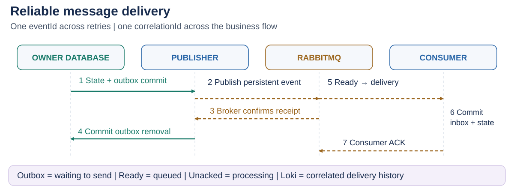
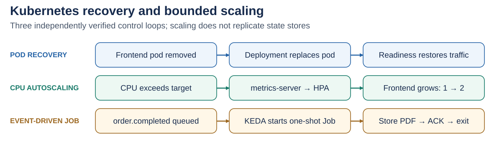
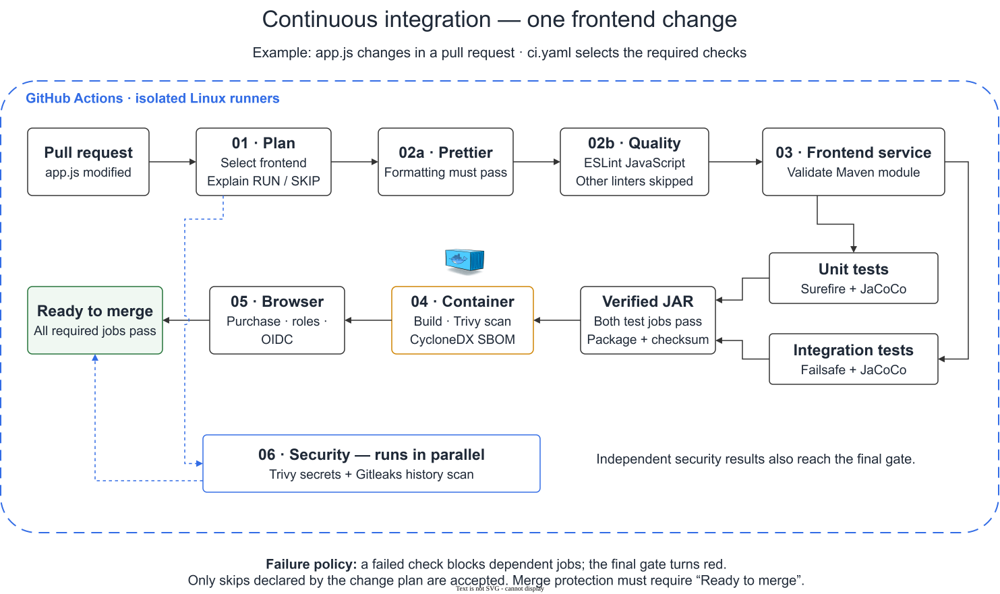
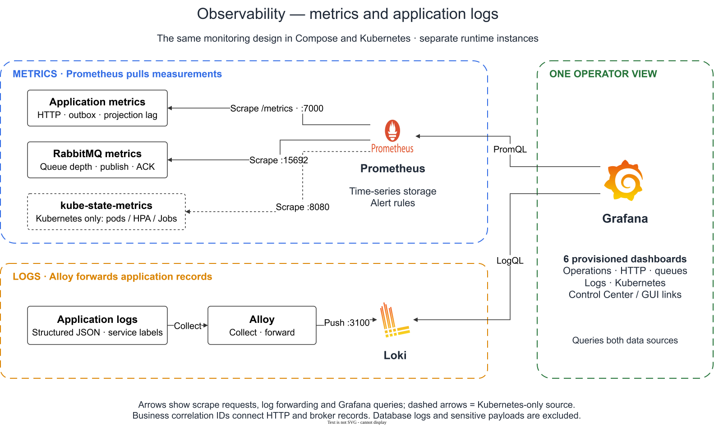
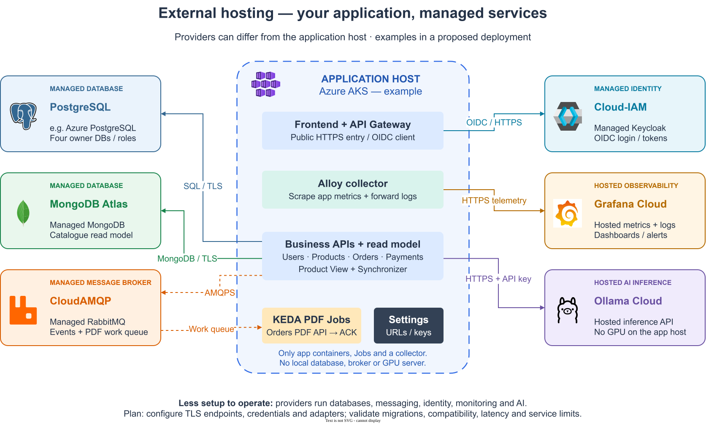
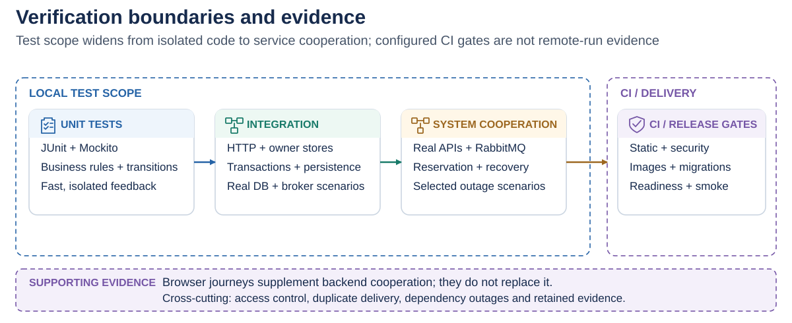

# AJ Motors

## Development of Large Systems — Project Report


**Authors**

- Ahmad Abdel Razak Hussein Alkaseb
- Jeppe Rønning Koch
- Asger Valdemar Bergøe
- Laith Abdel Razak Hussein Alkaseb

**Repository:** [AJ Motors on GitHub](https://github.com/AhmadAlkaseb/aj)

```{=latex}
\vspace{\baselineskip}
```

**Delivery date:** 11 December 2026

<!-- PDF layout: the cover has no page number; the next page starts at 1. -->
\thispagestyle{empty}
\clearpage
\pagenumbering{arabic}

## List of figures

| Figure | Description | Location |
| --- | --- | --- |
| 1 | System architecture | Section 2.1 |
| 2 | Databases and ownership references | Section 2.2 |
| 3 | API endpoints and request contracts | Section 2.3 |
| 4 | API response contracts | Section 2.3 |
| 5 | Reservation and payment saga | Section 2.4.5 |
| 6 | Reliable message delivery | Section 2.4.7 |
| 7 | Docker Compose system architecture | Section 3.1 |
| 8 | Local Kubernetes deployment | Section 3.2 |
| 9 | Kubernetes recovery and bounded scaling | Section 3.2 |
| 10 | Frontend CI workflow | Section 3.2.2 |
| 11 | Observability and message visibility | Section 3.2.3 |
| 12 | External hosting and managed services | Section 3.3 |
| 13 | Verification boundaries | Section 4.1 |

## List of appendices

- Appendix A: Mandatory Assignment 1 coverage.
- Appendix B: Mandatory Assignment 2 coverage.
- Appendix C: Final-project requirement assessment.
- Appendix D: Installation and verification procedure.
- Appendix E: Evidence and delivery boundaries.
- Appendix F: External identity activation and verification.

## Table of contents

1. [Introduction](#1-introduction)
2. [System architecture](#2-system-architecture)
3. [Environments description](#3-environments-description)
4. [Testing](#4-testing)
5. [Project management and team collaboration](#5-project-management-and-team-collaboration)
6. [Discussion](#6-discussion)
7. [Reflection](#7-reflection)
8. [Conclusion](#8-conclusion)
9. [References](#9-references)
10. [Appendix](#10-appendix)

Figures 1, 7 and 8 distinguish logical, Compose and Kubernetes architecture. [5]

# 1. Introduction

## 1.1. Problem description

AJ Motors is an online platform for a small, selected collection of exclusive cars. A customer should be able to inspect a car, register their details, reserve an available vehicle and complete an order when payment is recorded. [4]

The main technical problem is coordinating changes that belong to different services.

The implemented development system contains customer management, car management, a separate product catalogue, orders, manual payment registration and asynchronous catalogue synchronisation. Its frontend remains available when individual backend components fail and reports which functions are unavailable.

For examination demonstrations, startup automatically inserts 20 fictional customers, cars, orders and payments with stable references. Six examples are completed, four have pending payments and ten cars remain available after failed historical payments.

Stripe remains outside scope. Identity uses self-hosted Keycloak/OpenID Connect with exam accounts and self-registration. The requirement names an external identity provider; local Keycloak alone is therefore not asserted as unambiguously meeting that condition. GitHub federation is implemented as an idempotent broker configurator and redirect verifier; activation needs an owned OAuth app and a real browser login. The activation and verification procedure is included in Appendix F. [3], [20], [31], [35], [36]

## 1.2. Functional and non-functional requirements

### Functional requirements

| ID | Requirement and acceptance criterion | Status |
| --- | --- | --- |
| FR-01 | Create/read/edit/soft-delete customer profiles; reject duplicate email | Implemented; distinct from login identity |
| FR-02 | Browse catalogue and vehicle details | Implemented |
| FR-03 | Filter by brand/model/status/price/year/mileage with bounded pages | Implemented in GraphQL owner |
| FR-04 | Maintain car listings; block changes/removal of reserved or sold cars | Implemented |
| FR-05 | Reserve with validated customer, authoritative price and availability | Implemented asynchronously |
| FR-06 | Competing buyers cannot both reserve one car | Selected concurrent scenario passes |
| FR-07 | Record manual payment; sell on success or release on failure | Implemented; no money transfer |
| FR-08 | View own orders and cancel eligible reservations | Backend ownership enforced |
| FR-09 | Keep frontend available with useful dependency error/retry | Implemented; no backend failover |
| FR-10 | Token authentication, roles and ownership | Local OIDC implemented; external-provider boundary in Appendix C |
| FR-11 | Use GraphQL queries and REST commands in one real frontend workflow | Catalogue → reservation implemented |
| FR-12 | Backend AI API workflow with validation and failure handling | Real local draft workflow verified |
| FR-13 | Trigger an isolated task that finishes and terminates | KEDA PDF Job verified |

API interoperability, AI, authentication and isolated serverless work are compulsory. [3]

### Non-functional requirements

| ID | Target | Verification and limits |
| --- | --- | --- |
| NFR-01 | Interactive latency below 2s under defined load | 10,000 cars/20 clients: p95 3.782s, quieter repeat 1.139s; 4.8 |
| NFR-02 | 99% availability excluding agreed maintenance | Unmeasured target; no historical SLA claim |
| NFR-03 | Retain committed work through broker outage | Selected outbox/recovery scenario passes |
| NFR-04 | Exclusive car allocation | Concurrent reservation scenario |
| NFR-05 | Reproducible, independent deployment | Separate images/Compose; shared build coupling remains |
| NFR-06 | One owner per data store | Network/credential review and owner APIs; explicit GUI admin exception |
| NFR-07 | Workload-driven scaling | Real frontend HPA 1→2; KEDA Jobs; bounded stateful workers |
| NFR-08 | Protected identities, actions and sensitive data | Real-token ownership, TLS/isolation checks; production trust separate |
| NFR-09 | Diagnose distributed failures | Correlated logs, metrics, dashboards and controlled alert |
| NFR-10 | Predictable schema/contract evolution | Flyway, API v1 and message-envelope compatibility |
| NFR-11 | Desktop/mobile usability | Selected browser flows; no accessibility audit |

Targets are not guarantees: containers alone prove neither scalability nor availability.

## 1.3. Technology stack and rationale

| Area | Choice and rationale |
| --- | --- |
| Backend | Java 17/Javalin and Maven: consistent HTTP/runtime/build tooling; shared code reduces duplication but couples builds. |
| Frontend | HTML/CSS/JavaScript served by Javalin: real catalogue/admin workflows without React, which was only an earlier proposal. |
| Owner data | PostgreSQL 16, Hibernate/JPA and Flyway: constraints, local transactions/locks and explicit schema history. |
| Catalogue | MongoDB 7: bounded document queries over denormalised product snapshots; no claim of intrinsic superiority to SQL. [30] |
| Communication | REST/JSON commands, GraphQL catalogue queries and RabbitMQ AMQP events with outbox/inbox recovery. [7], [19] |
| Identity and AI | Keycloak OIDC/JWT; Products calls local Ollama for bounded, human-reviewed drafts. [20], [26], [31] |
| Runtime | Compose for development; kind/Calico/HPA/KEDA for local production simulation, owner isolation and isolated Jobs. |
| Verification | JUnit/Mockito/H2 plus real container tests, Playwright, static/contract/security checks and gated GitHub Actions. [27], [28] |
| Operations/models | Prometheus, Alloy, Loki and Grafana; editable PlantUML/Mermaid/SVG figures and native administration GUIs. |

Choices support the course's distributed-systems goals. Their trade-offs and actual evidence, including bounded concurrency and a single-node environment, are discussed below.

# 2. System architecture

## 2.1. Introduction to the microservices architecture

Figure 1 presents the group's architecture design: the Frontend communicates through an API Gateway with Users, Products, Product View, Orders and Payments. Separate stores hold customer, product, order and payment data. Product Synchronizer consumes product events to update the catalogue read model.


*Figure 1. Group architecture design. Blue boxes denote internal services and red boxes external integrations. Solid arrows show synchronous communication; dashed arrows show asynchronous messages. The RabbitMQ boxes identify product events, quantitycheck/quantityreserved and paymentfail.*

The design includes Stripe and a generic OAuth integration. In the implemented system, payment is registered manually and Stripe is outside scope. Keycloak/OpenID Connect handles browser login, and backends validate its tokens. The drawn Synchronizer-to-read-store connection is realised through Product View's authenticated owner API, rather than direct Synchronizer database access (Section 2.2). Section 2.3 lists all implemented events; Figures 7–8 show runtime infrastructure and the confirmation processor.

There are five separately runnable domain/API backends: Users, Products, Product View, Orders and Payments. [3]

Each application has an independent process and container configuration. The monorepo also has a parent Maven build and `service-common`. Independence at runtime should not be confused with complete independence of source changes or build tooling.

The full Compose environment has twenty-four containers: eight application containers, a PDF worker, five PostgreSQL servers, MongoDB, RabbitMQ, Keycloak, four observability containers and three administration GUIs. Kubernetes uses separate workload resources and starts a terminating PDF Job on demand; its pod count is therefore not the Compose container count.

## 2.2. Microservices description

### Users

Users isolates customer profile maintenance and customer-existence decisions from commercial orders. Its protected REST API manages names, email, telephone and address; Keycloak issues credentials, while Users independently validates tokens, roles and ownership. It consumes `customer.check` and produces `customer.valid` or `customer.invalid`, allowing Orders to wait without a synchronous dependency on Users.

Its PostgreSQL store owns customer UUIDs, profile fields, unique emails and deletion markers, with local transactions and inbox/outbox records. PostgreSQL supplies the constraints required by profile updates; no other business service reads this store. Broker failure retains accepted outgoing work; database failure blocks profile commands. Workers remain single-replica pending broader concurrency verification. Public contracts and event payloads are referenced in Section 2.3.

### Products

Products owns authoritative vehicle details, sale price, availability and reservation ownership. Isolating these rules prevents Orders or the catalogue from choosing inventory outcomes. REST supports administrative maintenance and a human-reviewed AI description draft; public catalogue queries normally use Product View. Products consumes `quantitycheck`, `order.cancelled`, `paymentfail` and `payment.completed`, and produces reservation outcomes and `product.*` snapshots.

Its private PostgreSQL database supports constraints, transactional reservation locks, retained release signals and inbox/outbox records. The actual Ollama call receives only bounded vehicle facts and cannot change price or inventory. A broker outage causes projection lag while local updates remain queued; an unavailable database rejects commands. Inventory workers use one replica and Recreate rollout because arbitrary parallel-worker histories have not been verified.

### Product View

Product View separates catalogue queries from authoritative product commands. It exposes read-only REST and typed GraphQL consumed by the real frontend, plus a private authenticated projection-write API. It neither subscribes directly to RabbitMQ nor produces business events: Product Synchronizer relays the original product event identity and snapshot to its owner API.

MongoDB owns the `product_view` document model, embedding the display fields needed by catalogue filters without cross-service joins. Conditional version updates, inbox identity and tombstones reject stale snapshots and resurrection. Query depth, page size and filters are bounded. Reads can continue from an existing projection while messaging is unavailable, with visible eventual-consistency limits; MongoDB failure prevents catalogue reads. Section 4.8 reports the 10,000-car measurement rather than assuming the projection is faster. The ownership decision keeps the MongoDB driver, credentials and network access exclusively in Product View; the synchronizer forwards events through its authenticated API and acknowledges only after successful storage.

### Product Synchronizer

The synchronizer isolates reliable event delivery from catalogue query/storage responsibilities. It consumes `product.created`, `product.updated`, `product.reserved` and `product.removed` from `aj.product-sync`, forwarding the envelope to Product View's authenticated internal HTTP API. It exposes health/metrics, no public business API, and emits no new domain event.

It owns no database and has neither MongoDB credentials nor database-network access. Acknowledgement follows successful owner storage; temporary owner/broker failures retry and malformed data dead-letters. Original event identity and projection versions make selected redeliveries harmless. It remains a bounded single-replica worker; raising replicas is a separate verification task. Local database GUIs have explicit administration access, an exception to application ownership rather than another business writer.

### Orders

Orders isolates purchase intent and saga progress from customer, inventory and financial ownership. Its REST API creates/views orders, cancels eligible reservations and serves owned PDF confirmations. Its private PostgreSQL store contains order state, deadlines, public customer/product UUID references, status audit, PDF, inbox and outbox. Local relational integrity does not create foreign keys into other services.

Creation commits PENDING with `customer.check`. Valid customer outcomes lead to `quantitycheck`; reservation outcomes produce RESERVED or rejection. `payment.requested` claims a reserved order and produces `payment.authorized` or `payment.rejected`. Payment outcomes complete/fail the order; completion emits `order.completed`. Cancellation and expiry release eligible inventory; `payment.reconcile` requests stored outcomes. New validation expires after five minutes and unpaid reservations after thirty; ambiguous payment becomes REVIEW_REQUIRED. The API, confirmation writer and workers enforce separate access boundaries. Broker outages retain committed work; database outages block commands. Single-replica workers/Recreate and retained signals bound currently verified concurrency.

### Payments

Payments owns manual payment registration and immutable terminal outcomes, separately from inventory and order lifecycle. REST creates/retrieves payment records and permits authorised outcome registration; it does not transfer money. Its PostgreSQL store owns amounts, payment/order references, status audit and inbox/outbox. Unique order references and a deterministic payment identity prevent duplicate creation; terminal success cannot be changed to failure.

It publishes `payment.requested`, consumes `payment.authorized`/`payment.rejected`, and takes invoice values from the authorised owner response rather than client input. Terminal outcomes emit `payment.completed` or `paymentfail`; `payment.reconcile` republishes a stored outcome for recovery. Broker failure leaves outgoing work pending, while database failure blocks registration. Processing remains single-replica: adding workers without verifying cross-order locking and replay semantics would not establish safe scalability.

### Confirmation processor

The isolated processor consumes `order.completed` from `aj.confirmations`, generates a PDF and stores it through Orders' private authenticated API. It has no own database and emits no business event. Orders retains the first PDF per order, so retrying storage does not create duplicate documents. Transient failures requeue; malformed messages dead-letter. Compose keeps the processor available as a worker; Kubernetes uses a KEDA ScaledJob that terminates after one delivery, with a configured maximum of two concurrent Jobs. This isolates an elastic background task without treating an always-running HTTP service as serverless. [12]

### Frontend, gateway and supporting infrastructure

The frontend also provides Keycloak login/logout, silent SSO and a validated identity display. [20], [31]

The frontend provides a public catalogue and role-aware customer, order and payment views.

The gateway routes product reads to Product View, writes to Products and the remaining resource operations to their owning services.

RabbitMQ and the databases are infrastructure, not additional business microservices or third-party integrations. Running them in local containers does not make them external services in the business architecture. They are nevertheless independent failure domains.

### Data model and ownership


*Figure 2. Group database design: PostgreSQL identifier, details and deletion tables, and a denormalised MongoDB product model. This design view is not a complete physical schema; implementation differences are explained below.*

Users, Products, Orders and Payments each own a PostgreSQL database with identifier, details and deletion tables. PK marks a primary key, FK a local foreign key, and UQ uniqueness. MongoDB belongs exclusively to Product View; Product Synchronizer writes through its owner API.

The diagram's `Orders_details.user_id` and `Payments_details.order_id` are conceptual relationships. The implementation uses `user_guid` and `order_guid` UUIDs, with product/payment UUID references where needed; there are no SQL foreign keys across services. Local foreign keys connect each owner's tables. Remote existence is checked through owner APIs or workflows and can change afterwards.

The physical schema also includes inbox/outbox, command deduplication, status history and saga recovery state omitted from the diagram. SQL specifies numeric precision and timestamp variants; order notes use VARCHAR rather than the drawn TEXT. MongoDB stores camelCase snapshot fields, a UUID-formatted string `guid`, `version`, `eventId` and a deletion flag; price uses Decimal128. Its timestamp representation differs from SQL. These details qualify the diagram's generic types and field names.

## 2.3. Communication between microservices

### REST and API interoperability

Public REST resources use `/api/v1` and JSON field names in camelCase.


*Figure 3. Group API design: HTTP methods and paths for Payments, Users, Orders and Products. The model lists selected endpoints rather than request-body fields.*


*Figure 4. Group response design: example JSON and HTTP status codes. The panels are arranged on two pages for readability; the second page continues the same figure.*

Figures 3 and 4 show the group's API design, not exhaustive runtime contracts. The implementation adds profile mapping, order history/PDF, AI and GraphQL endpoints. User creation returns the full profile; updates return that profile rather than the drawn `guid`/`updatedAt` pair. New orders return 201 with PENDING; new payments return 201 with REQUESTED, and existing payments return 200. Invoice values arrive asynchronously from their owners and can initially be null. Protected operations also return 401/403. OpenAPI, GraphQL SDL and AsyncAPI validate implementation interfaces. [21], [22]

Product View exposes typed GraphQL catalogue queries used by the actual frontend. [3], [19]

The frontend queries `POST /api/v1/graphql` using the bounded filters in FR-03, then reserves through REST. Order creation requires `userGuid`, `productGuid` and `shippingAddress`, with optional `notes`; price is resolved by Products. Payment creation uses `orderGuid` and optional `paymentMethod`, not a client-supplied amount.

### Asynchronous messages

The `aj.events` topic exchange distributes JSON messages to six durable consumer queues. A shared envelope contains `eventId`, `eventType`, `occurredAt`, `correlationId`, `schemaVersion: 1` and `payload`. AMQP `messageId` matches eventId. The order UUID follows the entire purchase as correlationId, including derived product snapshots. Product payload.version remains a separate state version.

Event identity remains stable across retries while correlation follows the order. The envelope fields are listed above, and the payload content is described below the routing table.

| Routing key | Producer | Consumers | Business purpose |
| --- | --- | --- | --- |
| `customer.check` | Orders | Users | Validate the referenced customer |
| `customer.valid`, `customer.invalid` | Users | Orders | Continue or reject customer validation |
| `quantitycheck` | Orders | Products | Request an exclusive car reservation and authoritative price |
| `quantityreserved` | Products | Orders | Confirm the reservation |
| `quantityrejected` | Products | Orders | Reject an unavailable or outdated-price reservation |
| `order.cancelled` | Orders | Products | Release an eligible reservation |
| `payment.requested` | Payments | Orders | Claim an eligible RESERVED order |
| `payment.authorized`, `payment.rejected` | Orders | Payments | Supply authoritative invoice or reject creation |
| `payment.completed` | Payments | Orders, Products | Complete the order and mark the car sold |
| `paymentfail` | Payments | Orders, Products | Fail the order and release the car |
| `product.created`, `product.updated`, `product.reserved`, `product.removed` | Products | Product Synchronizer | Update the catalogue snapshot or tombstone |
| `order.completed` | Orders | Confirmation job | Generate and persist one PDF artifact |
| `payment.reconcile` | Orders | Payments | Republish the stored terminal outcome for recovery |

The queues are `aj.users`, `aj.products`, `aj.orders`, `aj.payments`, `aj.product-sync` and the isolated `aj.confirmations` queue. Invalid messages can be moved through the dead-letter exchange to `aj.dead`; transient dependency failures are retried.

Reservation requests include order/product/customer references and initially null price fields; confirmation adds the authoritative amount/currency. Payment requests include order/payment identifiers; authorisation adds invoice fields, and outcomes include the product reference. [4], [22]

### Why both communication styles are used

HTTP provides immediate user-facing commands and queries, health status and OIDC/JWKS exchange. Customer validation, product reservation, payment initiation and outcomes use RabbitMQ, so these domain interactions can wait for an unavailable consumer. [3]

## 2.4. Patterns and techniques

### 2.4.1. CQRS

Products is the command-side authority, while Product View serves a separate MongoDB query representation. This is a concrete application of CQRS to a read-oriented catalogue rather than a requirement to split every domain. [6]

### 2.4.2. Immutable data, tombstones and snapshots

Deletion markers in PostgreSQL and tombstones in MongoDB retain evidence that a record was removed. Product messages carry full-state snapshots, allowing the projection to replace a product's display state without retrieving each individual field from Products.

The immutable information is deliberately scoped: removal markers, versioned snapshots and append-only order/payment status audit. Profile and product detail fields remain mutable, and confirmed outbox entries are removed.

### 2.4.3. Idempotence

SQL consumers record processed event identities in an inbox as part of the transaction that changes business state. A redelivered event with the same identity is ignored. Payment creation uses one stable identity per order, and repeating the same terminal payment result does not emit another outcome.

Users, Products and Orders support identity-scoped Idempotency-Key headers. A request fingerprint, original result and outbox commit in the owning SQL transaction.

### 2.4.4. Commutative message handlers

Within a versioned projection, an older product version is ignored after a newer snapshot or tombstone has been applied. For distinct versions, that gives the projection the same final state whether an older snapshot arrives before or after the newer one.

Products retains reservation signals so cancellation/failure received before quantitycheck blocks a late reservation. Paid inventory cannot be freed by a stale cancellation. [3]

### 2.4.5. Saga pattern


Each step commits locally. `payment.completed` completes the order and sells the car. On `paymentfail`, Orders and Products consume the same event: the order becomes FAILED and its reservation returns to AVAILABLE. The red loop shows inventory becoming reusable; the failed order remains recorded. This is compensation, not a cross-service database rollback. [8]

Before payment, cancellation/unpaid expiry emits `order.cancelled` and releases the reservation. Invalid customers or unavailable cars give REJECTED without a reservation. Unknown payment outcomes instead enter REVIEW_REQUIRED after the deadline: retain the car and reconcile the stored outcome with `payment.reconcile` or manual review. Broker failures retry retained messages; stale cancellation cannot release a paid car. Tests cover selected failure histories.

### 2.4.6. Caching

Product View uses cache-aside for paginated GraphQL searches by validated filters, offset and limit. Hits skip MongoDB count/item queries. Misses load MongoDB and cache immutable results for 20 seconds: at most 256 entries, each limited to 256 KiB serialised JSON. Eviction is least-recently-used; oversized results and failures bypass caching.

Successful projection inserts/replacements, including reservations and tombstones, clear the local cache after storage. A generation check prevents an older in-flight read from repopulating it after invalidation. Each process owns its cache: other replicas expire independently, and concurrent misses may repeat database work. Caching adds temporary staleness to projection lag; Products still validates price and availability for reservation. Customer, order and payment data, unpaginated REST lists and single-product reads are not cached. MongoDB remains the persistent read model; Redis is not used.

On 18 November 2026, ten new tests verified expiry, eviction, size bounds, immutable results, keys and invalidation races. A real MongoDB 7 check recorded two read commands on the first search and zero additional reads for 100 identical searches; removal invalidation caused two fresh reads and excluded the car. GraphQL resolved the cached result without errors. These checks prove selected behaviour, not a new latency benchmark.

### 2.4.7. Transactional outbox and reliable delivery

A domain update and its outgoing outbox record commit in one local SQL transaction. A worker publishes the stored message and removes the outbox record only after broker confirmation. [9]

SQL consumers commit the business handler and inbox insertion together. The acknowledgement follows the completed transaction; an exception takes the retry/dead-letter path.

Persistent messages, durable queues, publisher confirms and consumer acknowledgements serve different points in delivery. A consumer acknowledgement is issued after processing; a publisher confirm alone does not prove that business processing completed. These mechanisms support recovery but do not establish exactly-once execution. [7]



*Figure 6. Distinct persistence and acknowledgement boundaries. The consumer commits its local state and inbox before acknowledging; the publisher removes the outbox record after broker confirmation.*

Figure 6 also explains the operational states: outbox entries are waiting to be sent, Ready messages are waiting in RabbitMQ, and Unacked messages have been delivered but not yet acknowledged. A fast transition may fall between metric scrapes; correlated logs retain the observed publish/process/acknowledge events.

\clearpage

# 3. Environments description

## 3.1. Development environment with Docker Compose

Figure 7 follows the course example: containers, networks and port mappings. `./scripts/start.ps1` starts all twenty-four containers in project `aj`. Containers use service DNS; published ports bind to `127.0.0.1`. For example, `7002:7000` maps host TCP 7002 to Users' container TCP 7000.


*Figure 7. Compose network deployment. Each Docker icon is a container. Blue/red/orange boundaries are networks; green is host loopback, grey administration. Overlap denotes dual membership. Labels show host:container mappings or private TCP ports; arrows select connections; Figure 1 shows business flows.*

The gateway joins `aj-edge` and `aj-backend`; each owner API also joins its dedicated data network. Databases stay outside backend. Adminer explicitly joins five SQL networks and Mongo Express the MongoDB network, as listed in the grey area. `product-view-db` is the MongoDB container name; its service DNS name is `product-view-mongo`. Prometheus joins backend and edge; its repeated blue boundary means the same edge network. Volumes retain databases, broker state and monitoring history, preserved across project migration.

Grafana's **AJ Control Center** links databases, Headlamp, RabbitMQ, Keycloak, Swagger and Actions in separate tabs. Headlamp is read-only without Secret access. Tools share a configurable local admin login but retain separate forms; service credentials remain distinct. `CONFIRMATION_WORKER=true` keeps the Compose PDF worker running; Kubernetes terminates it after one delivery. Appendix D covers startup, accounts and checks.

Demonstration seeding is enabled by default and can be disabled with `DEMO_DATA_ENABLED=false`. Stable fixture identities prevent duplicate insertion across restarts. These fixtures initialise historical example states; they are not evidence that twenty new purchases have been executed through live APIs at every startup. MongoDB receives the twenty product snapshots asynchronously.

| Component | Local port | Persistent storage |
| --- | --- | --- |
| Frontend / API Gateway | 3000 / 8080 | None |
| Users / PostgreSQL | 7002 / 5433 | Dedicated Users volume |
| Products / PostgreSQL | 7003 / 5434 | Dedicated Products volume |
| Orders / PostgreSQL | 7004 / 5435 | Dedicated Orders volume |
| Payments / PostgreSQL | 7005 / 5436 | Dedicated Payments volume |
| Product View / MongoDB | 7006 / private (optional debug 27018) | Dedicated projection volume |
| Product Synchronizer | 7007 | No database; RabbitMQ and owner API |
| RabbitMQ / management interface | 5672 / 15672 | Broker volume |
| Keycloak / identity PostgreSQL | 8180 / private | Dedicated identity volume |
| Grafana / Prometheus / Loki | 13001 / 9090 / 3100 | Separate monitoring volumes |
| Alloy / confirmation worker | No public port | Collector positions / Orders-owned PDF |
| Adminer / Mongo Express / Headlamp | 18080 / 18081 / 14466 | Local administration; ignored Headlamp kubeconfig |

MongoDB has no published database port in normal startup. Adminer joins the five SQL owner networks and Mongo Express joins the MongoDB network for explicit local administration; business services retain their ownership boundaries. Java applications use internal port 7000.

Images include the Java runtime and run the application under a non-root user. Health checks distinguish process liveness from dependency availability. Named volumes survive an ordinary Compose shutdown. They are persistence, not a backup strategy. Development credentials and unencrypted local HTTP are unsuitable as a production security configuration.

## 3.2. Local Kubernetes deployment simulating production

The local `kind-aj-exam` environment runs a Kubernetes node as a Docker container. Kubernetes manages its own pods rather than adopting the existing Compose containers. Figure 8 maps the logical system to namespace `aj`, Deployments, ClusterIP Services, owner PVCs, Calico policies and Traefik TLS ingress at `https://localhost:8443`. SQL init containers migrate before application schema validation. This is a tested single-node simulation, not host-failure HA. [3], [10]


*Figure 8. Application resources inside namespace aj and the supporting cluster controllers. Grouped owner APIs represent separate Deployments and Services. Persistent stores keep individual claims and owner-only ingress policies.*

Compose and Kubernetes use separate persistent data. Active Kubernetes mode pauses Compose. Normal local startup keeps the control plane reachable by Headlamp in standby, scales AJ Deployments to zero and pauses the confirmation ScaledJob. The control-plane container is separate from the twenty-four Compose containers; data is not deleted. Runtime Secrets and TLS keys remain outside committed manifests. Image-ID annotations cause changed local images to roll out even when the `:local` tag is reused. Probes gate traffic and container recovery; resource requests/limits bound workloads. Keycloak has additional CPU and startup allowance for its first schema import. Appendix D gives the runtime-switching and access procedure.



*Figure 9. Separate control loops for pod replacement, CPU-driven frontend scaling and queue-driven PDF Jobs. More frontend replicas do not replicate the databases or RabbitMQ.*

The 11 November local verification replaced a deleted frontend pod, completed a TLS purchase and KEDA PDF Job, blocked an unrelated pod from Users' database, and scaled frontend from one to two ready replicas. Temporary load/probe resources were removed. These are observed local results, not an availability guarantee; the tested outcomes and their limits are summarised in Section 4.8.

### 3.2.1. Technologies and isolated tasks

The `kind` tool supplies the local cluster; Calico enforces owner network boundaries. Random runtime secrets and local TLS keys are kept outside committed manifests. The confirmation console application consumes its own durable `order.completed` queue, generates a PDF, writes through the Orders owner API and exits. It acknowledges only after storage; repeating the task preserves the first document. KEDA ScaledJob supplies event-driven scheduling rather than a permanently running service renamed as serverless. [10], [12]

Products calls an actual local Ollama model to draft descriptions from validated brand/model/year. It forwards no customer/payment information, applies schema/output/time limits, and inserts text for human approval. It cannot change invoice values or availability. Adapter failure tests and an actual browser-to-model run passed in the recorded local verification (Section 4.8). The model and Kubernetes can be demonstrated separately within the workstation memory budget. [26]

### 3.2.2. CI/CD pipeline

The `ci.yaml` entry point handles PRs, main pushes and merge queues; Development pushes alone do not trigger it (Section 5.3). Its change plan explains RUN/SKIP decisions. Documentation edits skip application builds; frontend edits select browser checks; backend edits select API/cooperation checks. Shared build changes and unknown Git bases select full verification. Figure 10 follows one frontend JavaScript change; other workflows are omitted. Weekly and release runs retain full security verification. [27], [28], [29]



*Figure 10. One frontend change through CI. Solid arrows show prerequisites; dashed arrows show the independent security track. Packaging waits for both test jobs. Selected failures block dependent jobs and fail the final gate.*

Each service separates validation, parallel unit/integration jobs and packaging. Containers copy the checksummed JAR from the successful service pipeline. The final gate always runs and rejects failed, cancelled, missing or unexpectedly skipped work; configure **Ready to merge** as the required branch check. Native summaries show selection reasons and test results. Matrices run at most three services concurrently and superseded PR runs are cancelled.

Prettier precedes selected quality checks. Ruff, Hadolint, Kubeconform, ESLint, SpotBugs, Actionlint, zizmor, Trivy, Gitleaks, Bandit and dependency audits need no external accounts. JaCoCo reports coverage; Trivy exports container SBOMs. Actions use immutable SHAs; checkouts retain no credentials. CodeQL is public-repository-only. Fixable HIGH/CRITICAL image findings block promotion. [29], [34]

Release readiness precedes image publication. Server-side validation and bounded owner Flyway Jobs precede application changes; migration proofs bind the release and unchanged target state. Staging verifies HTTPS/authentication and compensation; production promotes identical image digests. Compatible rollback restores images, not database history. Actual GitHub runs and environment protection settings are documented only after observation; local passes do not establish remote execution. Appendix E summarises the observed results and remaining delivery boundaries.

### 3.2.3. Monitoring and logging

Prometheus scrapes application histograms/counters, outbox age/count, projection lag and RabbitMQ queue metrics. Alloy forwards application-only logs to Loki. HTTP and broker records share business correlation IDs without recording payloads, tokens or passwords; database logs are excluded. Figure 11 separates the metrics and log paths. [24], [25]



*Figure 11. Separate metrics and log paths queried by Grafana. Dashed arrows identify Kubernetes-only metrics; both runtimes provision the same six dashboards.*

The dashboards cover operations, HTTP/services, RabbitMQ/delivery, logs and Kubernetes operation. Control Center adds links to all administration GUIs; Headlamp can inspect standby resources independently of active Kubernetes application metrics.

Compose monitoring belongs to project `aj`; Kubernetes deploys its own Prometheus, Loki, Alloy, Grafana and kube-state-metrics. The 12 November Compose checks validated six dashboards, thirty-five panel queries, nine healthy scrape targets and isolated RabbitMQ delivery. GUI checks passed five SQL logins, Mongo Express and read-only Headlamp node access; reading Secrets returned 403. The earlier active Kubernetes baseline had ten healthy scrape targets.

### 3.2.4. Autoscaling configuration

Frontend HPA uses real CPU metrics with a one-to-two replica range. [11], [12]

Application scaling is separate from database replication and broker HA. More replicas cannot remove a single state-store failure or guarantee faster queries. The local cluster demonstrates the configured mechanisms; its observed scaling and job results are described in Sections 3.2 and 4.8.

## 3.3. External hosting and managed services plan

### Provider investigation and choice

The proposal hosts our application remotely and delegates infrastructure to managed providers. Providers can differ from the app host. AKS is an example that preserves the tested Kubernetes/Job model without hosting every dependency. [4], [16]

| Provider | Relevant option | Assessment for this project |
| --- | --- | --- |
| AWS | ECS for managed container orchestration | A viable container platform, but the team would still need to configure persistence, messaging, identity and operations around the application. [13] |
| Google Cloud | Cloud Run for container-based services | A viable managed service option; continuously running workers and persistent infrastructure require an explicit hosting design. [14] |
| Microsoft Azure | Container Apps or AKS | Container Apps offers managed container execution; AKS provides a Kubernetes-oriented path closer to the required local-cluster exercise. [15], [16] |

Figure 12 separates our application host from independently hosted databases, RabbitMQ, identity, observability and AI. The named providers are concrete examples, not provisioned accounts. Our cluster keeps application APIs, terminating PDF Jobs and an Alloy collector; provider endpoints replace local infrastructure containers. TLS, credentials and network access rules cross each provider boundary. [37]–[41]



*Figure 12. Proposed external hosting. The central application host is separate from six managed-service examples; colours and logos identify their responsibilities. Connections use configured TLS endpoints rather than local container names.*

| Component | Selected target and trade-off |
| --- | --- |
| Applications and releases | AKS is one host option. Deploy GHCR digest-pinned application images, PDF Jobs and Alloy; keep migrations, readiness checks and bounded workers. [16] |
| Relational stores | Managed PostgreSQL, e.g. Azure PostgreSQL Flexible Server: four owner databases and restricted roles. The provider operates the server; we retain schema/migration and recovery verification responsibilities. [17] |
| Catalogue | MongoDB Atlas hosts the MongoDB read model. Configure a TLS URI and test Decimal128, indexes and update semantics with the existing driver before migration. [37] |
| Messaging | CloudAMQP hosts RabbitMQ. Configure AMQPS, permissions and KEDA trigger credentials; choose a plan supporting the required queue topology and recovery behaviour. [38] |
| Identity | Cloud-IAM hosts Keycloak and its supporting infrastructure. Migrate realm/clients and validate issuer, JWKS, redirect URLs and role mappings. GitHub brokering still needs an OAuth app. [39] |
| AI and PDF | Ollama Cloud moves inference to an external HTTPS API; the current local adapter needs API-key support and model/output tests. Human approval remains. PDF Jobs stay with the application and consume the external broker. [41] |
| Operations and secrets | Grafana Cloud hosts dashboards, metrics and logs. Alloy needs remote-write/log credentials and new configuration. Store endpoint credentials in the deployment secret store; restrict operator access. [40] |

### Application and database availability

Scale application replicas where business semantics permit. Managed PostgreSQL HA is an explicit service-plan choice; four databases on one server still share a failure domain. External hosting reduces server setup and patching, while application owners retain access control, migrations and tested recovery. [17]

Atlas and CloudAMQP service tiers must be checked for replica/queue features, backups, limits and recovery objectives. Re-run the reservation, outbox, retry, projection and PDF-deduplication tests against staging endpoints. A local single-node pass does not establish the hosted providers' availability or migration compatibility.

### Cost, latency and elasticity

Compare application-host costs with each managed service's capacity, storage, retention, backup and traffic charges. Reduced setup effort does not establish a lower total bill. Set a budget ceiling and alerts before provisioning; this report makes no cloud purchase or fixed monthly-price claim. [33]

Choose nearby compatible provider regions, measure cross-provider latency and egress, and bound all remote calls. HPA/KEDA scales application compute; provider quotas and stateful-service capacity remain independent constraints. Hosted inference avoids operating a GPU server but requires an explicit data policy and service budget.

Scale-to-zero can suit intermittent PDF work, while cold starts must fit the latency target. Keep service-specific settings outside application images so endpoints can change without replacing domain logic.

### Security, data management and releases

Use TLS, least-privilege credentials and provider network restrictions; use private connectivity where the selected plans support it. Database/broker ports and admin consoles are not unrestricted public application endpoints. Retain customer-data policies, credential rotation and tested backups across providers.

A release should use an immutable image identifier, pass automated quality gates, apply reviewed migrations, roll out gradually and run post-deployment checks. An application rollback must be compatible with the migrated schema. Publishing and deployment workflows are defined but their remote execution remains unverified; and local development passwords must not be copied into a cloud environment.

Actual cloud deployment is not required by the final project. The local Kubernetes simulation, its evidence and a justified cloud plan are required. [3]

# 4. Testing

## 4.1. Testing strategy and scope



Tests progress from isolated rules to service cooperation. A recorded Java run had 28 unit and 14 integration tests; API had six scenarios. Appendix E states evidence limits.

## 4.2. Unit testing

JUnit/Mockito covers rules, transitions and tokens. Fixed UUIDs:

```java
@Test
void shouldRejectAnotherBuyerForReservedInventory() {
    UUID currentOwner = new UUID(0L, 1L);
    UUID anotherBuyer = new UUID(0L, 2L);
    boolean canReserve = InventoryRules.canReserve("RESERVED", currentOwner, anotherBuyer);
    assertFalse(canReserve);
}
```

## 4.3. Integration testing

Products DAO example; H2 does not verify PostgreSQL locking:

```java
@Test
void shouldPersistAndReloadProduct() {
    ProductDao productDao = new ProductDao(HibernateUtil.getSessionFactory());
    Product product = Product.builder().guid(UUID.randomUUID()).build();
    Product saved = productDao.save(product);
    Optional<Product> loaded = productDao.findById(saved.getId());
    assertThat(loaded.orElseThrow().getGuid()).isEqualTo(product.getGuid());
}
```

\clearpage

## 4.4. API and system-level cooperation testing

`scripts/smoke.py` tests competing buyers via the gateway. With one order reserved:

```java
String rejected = given().body(orderRequest(buyerB, car))
    .post("/api/v1/orders").then().statusCode(201).extract().path("guid");
awaitOrderStatus(rejected, "REJECTED");
given().get("/api/v1/products/{guid}", car).then()
    .statusCode(200).body("status", equalTo("RESERVED"));
```

Illustrative E2E; setup signs in an administrator and seeds available `Fixturebil`:

```typescript
test('admin can reserve Fixturebil', async ({ page }) => {
  await page.goto('/');
  await page.getByRole('button', { name: 'Biler', exact: true }).click();
  await page.locator('#search').fill('Fixturebil');
  await page.locator('[data-detail]').click();
  await page.getByRole('button', { name: /Reservér bilen/ }).click();
  await page.getByLabel('Leveringsadresse').fill('Testvej 1');
  await page.getByRole('button', { name: /Opret reservation/ }).click();
  await expect(page.locator('#order-list')).toContainText('Reserveret', { timeout: 20000 });
});
```

Examples are illustrative; system/browser suites use Python. Broker and owner checks: `check_async.py` and `cooperation.py`. [3]

## 4.5. Security testing

Local browser/provider tests cover customer/admin login, reload/logout and ownership. Direct-port tests verify denied admin actions, protected customer mapping and 401/403. Internal projection/PDF writers use separate credentials; Kubernetes adds TLS and network policies. These checks do not prove production trust or external federation; real-account verification remains pending. [20], [31]

## 4.6. Static analysis and static testing

SpotBugs fails configured high-priority findings. CI runs selected Prettier/ESLint, contract, Actionlint/zizmor, Trivy/Bandit and dependency checks; CodeQL is public-repository only. Static passes do not prove vulnerability absence. [29]

## 4.7. Test execution in CI/CD

Surefire runs unit tests; Failsafe runs integration tests. Selected service checks gate packaging, and scans precede system acceptance. Security/docs tracks join the always-run `Ready to merge` gate; failures, cancellations and unexpected skips block it. Artifacts retain JUnit reports and diagnostics. [27], [28]

The 12 November local review passed 47 Python policy/deployment/federation tests, Actionlint, formatting and high-confidence/high-severity zizmor checks. These results verify local logic and workflow definitions, not GitHub runner execution. Section 3.2.2 and Appendix E explain the remaining remote boundary.

## 4.8. Evidence, limitations and trade-offs

Recorded evidence includes OIDC ownership, AI, retries/recovery, PDF deduplication, migrated owners, restore, correlated alerts and HTTPS/Kubernetes checks. Results apply only to those runs.

With 10,000 cars, 200 GraphQL queries and 20 clients, first p95 was **3.782s** (target: 2s); a quieter repeat had median **0.616s**, p95 **1.139s**, max **1.263s**. Both are retained; this is direct-backend latency, not an internet SLA or availability result.

Coverage excludes unrestricted concurrency, contradictory outcomes and host-failure HA. The single-node cluster cannot survive host loss; availability and remote evidence remain unverified.

\clearpage

# 5. Project management and team collaboration

## 5.1. Strategy and collaboration

The adopted approach is lightweight and Scrum-inspired: short sprints, brief standups, a To Do / In Progress / Review / Done board, demonstration and retrospective. This is a working agreement, not evidence that ceremonies occurred. Done requires acceptance behaviour, relevant checks and updated contracts/documentation. The September–November plan is distinct from dated verification results.

Observed technical corrections include replacing shared projection access with an owner API, retaining saga signals for retries, consolidating local administration and introducing change-aware CI gates. These source/test observations do not establish attendance or individual personal experience.

## 5.2. Methods, responsibilities and evidence

| Proposed owner | Responsibility | Reviewer |
| --- | --- | --- |
| Ahmad | Users, identity and access | Jeppe |
| Jeppe | Products, catalogue, GraphQL and AI | Asger |
| Asger | Orders, Payments, reliability and confirmation | Laith |
| Laith | Kubernetes, observability, delivery and restore | Ahmad |

Frontend, contracts, tests and report accompany each workstream. The allocation is a review plan, not attribution of existing code. Actual issues/PRs should identify owner, reviewer and acceptance evidence.

Each participant has a planned workstream and review role, sharing frontend/test/report work. This does not measure historical effort. Authentic per-student branches/PRs remain part of the final delivery; this report does not include a verified per-author commit or review ledger and therefore does not establish historical contribution shares or equal working hours.

## 5.3. Versioning strategies

**Source.** The group uses `Development` for development and testing, and `main` (Main) as the stable production/release branch. Changes are always tested in Development before a pull request merges them into main. Failed checks are resolved before promotion. This separation reduces the risk of untested changes reaching the production branch; merging alone does not deploy production. CI checks are described in Section 3.2.2; branch protection remains unverified (Appendix E). Release manifests bind image digests to a source revision; shared Maven `1.0.0` coordinates builds.

**Data.** SQL owners apply immutable Flyway migrations before Hibernate validation. Fresh databases run the full sequence; existing reviewed local schemas require explicit baseline opt-in. Upgrade tests and migration proofs gate deployment. Orders V3 preserves status transitions separately from mutable details. Backups/restore and MongoDB deletion fences are owner responsibilities. Application rollback never reverses database history. [23]

**Interfaces.** REST uses `/api/v1`; breaking changes require migration or a new version. GraphQL adds compatible fields/deprecations with schema checks. Message schemaVersion 1 differs from product-state version; unknown envelopes dead-letter and legacy raw payloads remain readable. This does not establish arbitrary mixed-binary rolling compatibility. [19]

## 5.4. Documentation strategy

Per-service documentation, OpenAPI/Swagger, GraphQL SDL and AsyncAPI describe interfaces. Reviews update contracts, tests, figures and prose together. This PDF includes ownership, architecture, workflow rules, verification and installation without requiring separate documentation. [21], [22]

# 6. Discussion

## 6.1. Advantages and challenges of distribution

Separating domains makes ownership and failure behaviour visible. An inventory rule belongs in Products, while recording payment belongs in Payments. The separate catalogue can keep serving its existing projection while product-message processing is temporarily interrupted.

The cost is distributed coordination.

This is an educational distributed architecture. [3]

## 6.2. Pattern benefits and costs

CQRS separates catalogue reads from authoritative writes while adding projection lag and recovery work.

Named patterns do not guarantee their intended outcomes. Versioned projection updates do not prove every handler commutative or safe across concurrent replicas.

## 6.3. Scalability and autoscaling

Application, messaging and database scaling must be evaluated separately.

Scaling priorities are measured catalogue/query tuning, cache effectiveness, backlog monitoring and safe worker coordination. HPA/KEDA configuration should follow those measurements, rather than serve as a substitute for concurrency design. [11], [12]

## 6.4. Possible improvements

The implemented extension covers backend access control, GraphQL consumption, real local AI, Kubernetes, isolated job execution, migrations, distributed observability and service-specific tests. Remaining delivery evidence is tracked separately from local acceptance; the authors must provide authentic collaboration examples and individual reflections.

Further improvements include measured query/index tuning, longer-running availability observation, stricter broker permissions per producer, broader fault/permutation testing and managed data-store HA. The measured latency target and remaining human/remote evidence are reported honestly; feature completion is not a claim of production readiness.

# 7. Reflection

The following lessons follow from source changes and observed tests. They do not replace the authors' personal accounts.

**Distributed workflow.** Order creation alone could not enforce stock ownership. Explicit reservation ownership, retained early outcomes and deadlines make recovery possible, but ambiguous payment must remain visible for reconciliation rather than release inventory automatically.

**Design correction.** Product Synchronizer's shared database access became an authenticated owner API. This improved ownership while adding an HTTP failure boundary that must preserve broker retry identity. Separately, consolidated administration improves usability without removing each tool's authentication or application network boundaries.

**Delivery.** An independent green job is insufficient when required work silently skips. The new pipeline declares expected tracks and checks failures/cancellations/unexpected skips. A local syntax/test pass still differs from a successful remote run and deployment.

**Database learning.** Public UUIDs are cross-service references, not SQL foreign keys. Read models lag, mutable details are not an event archive, and migrations/rollback need compatibility rather than assuming application rollback restores data.

**Next iteration.** Begin with a real REST/GraphQL/identity vertical slice, define owner contracts and failure histories early, and test migrations/security before storing important data. The first latency run missed its target; retain failures alongside improvements rather than selecting only favourable measurements.

**Individual reflection drafts for participant approval.** The following balanced technical perspectives follow the agreed workstream model; they are drafts, not assertions of personal events or completed meetings.

| Participant | Reflection draft |
| --- | --- |
| Ahmad | Access control needs independent backend ownership checks. A next iteration should define customer mapping and own-versus-other tests before administrative UI work. |
| Jeppe | A separate catalogue enables flexible queries but adds lag. AI drafts need bounded facts and human approval; future optimisation should follow reproducible measurements. |
| Asger | Local transaction success does not finish a purchase. Retained signals, deadlines and manual review make retries/ambiguous payments explicit; define these histories before implementation. |
| Laith | Reliable delivery needs migration/readiness gates and useful logs, not only containers. Establish restore and outage checks early, and separate local evidence from remote release claims. |

The Scrum-inspired retrospective asks whether integration tests and cross-review exposed problems early enough. Dates, attendance, personal examples and actual effort remain for author confirmation; the proposed working model is included in Section 5.

# 8. Conclusion

AJ Motors demonstrates five domain APIs, asynchronous commerce, separate data ownership, real REST/GraphQL, local identity/AI and a terminating Kubernetes task. Selected tests establish reservation, compensation, projection and recovery behaviour. Independent deployment requires explicit contracts, retained state and verification. Local results remain distinct from production guarantees, remote release evidence and personal collaboration accounts.

# 9. References

Numbered citations identify technical sources; all project explanations are included in this PDF. Online sources were consulted on 4 and 12 November 2026. Appendices A–C summarise the supplied course requirements; local observations are distinguished from source claims.

1. EK, *Mandatory Assignment 1 — Development of Large Systems*, supplied PDF, pp. 1–2.
2. EK, *Mandatory Assignment 2 — Development of Large Systems*, supplied PDF, pp. 1–2.
3. EK, *Final Project — Development of Large Systems: Project Description*, supplied PDF, pp. 1–7.
4. Project group, *DLS Report Version One.docx*, supplied example draft. Used as background for the problem description in Section 1.1; no separate draft is required to read this report.
5. EK, *Development of Large Systems 2025/2026*, course catalogue.
6. Microsoft, *Command Query Responsibility Segregation (CQRS) pattern*, Azure Architecture Center.
7. RabbitMQ, *Consumer Acknowledgements and Publisher Confirms*.
8. C. Richardson, *Pattern: Saga*, Microservices.io.
9. C. Richardson, *Pattern: Transactional outbox*, Microservices.io.
10. Kubernetes, *Deployments*.
11. Kubernetes, *Horizontal Pod Autoscaling*.
12. KEDA, *Scaling Jobs*, version 2.21 documentation.
13. AWS, *What is Amazon Elastic Container Service?*.
14. Google Cloud, *What is Cloud Run?*.
15. Microsoft, *Azure Container Apps overview*.
16. Microsoft, *What is Azure Kubernetes Service (AKS)?*.
17. Microsoft, *High availability in Azure Database for PostgreSQL flexible server*.
18. Microsoft Azure, *Azure Container Apps pricing*.
19. GraphQL Foundation, *Learn GraphQL*.
20. OpenID Foundation, *OpenID Connect Core 1.0 incorporating errata set 2*, 2023.
21. OpenAPI Initiative, *OpenAPI Specification v3.1.1*, 2024.
22. AsyncAPI Initiative, *AsyncAPI Specification 2.6.0*.
23. Redgate, *Flyway: Migrations*.
24. Grafana Labs, *Loki overview*.
25. Prometheus, *Overview*.
26. Ollama, *Generate a response — API reference*.
27. Apache Maven, *Maven Failsafe Plugin — Introduction*.
28. GitHub, *Reuse workflows*.
29. GitHub, *About code scanning*.
30. MongoDB, *Best Practices for Data Modeling in MongoDB*.
31. Keycloak, *JavaScript adapter*, official documentation.
32. Microsoft, *Baseline architecture for an AKS cluster*.
33. Microsoft, *Best practices for cost optimization in AKS*.
34. GitHub, *GitHub Actions billing*.
35. Keycloak, *Server Administration Guide — GitHub identity provider*.
36. GitHub, *Creating an OAuth app*.
37. MongoDB, [*MongoDB Atlas documentation*](https://www.mongodb.com/docs/atlas/).
38. CloudAMQP, [*Getting started — managed RabbitMQ*](https://www.cloudamqp.com/docs/).
39. Cloud-IAM, [*Managed Keycloak documentation*](https://documentation.cloud-iam.com/).
40. Grafana Labs, [*Send data to Grafana Cloud*](https://grafana.com/docs/grafana-cloud/send-data/).
41. Ollama, [*Cloud API authentication*](https://docs.ollama.com/api/authentication).

# 10. Appendix

The following appendices are included in this PDF. They map the assignment requirements to report sections and provide installation, verification, evidence boundaries and external-login procedures.

## Appendix A. Mandatory Assignment 1 coverage

| Required topic | Delivered report coverage |
| --- | --- |
| Idea, functional/non-functional requirements, stack | 1.1–1.3: acceptance criteria, rationale and limits |
| Architecture, frontend REST/GraphQL and channels | 2.1–2.3: Figure 1, API figures, message envelope and event table |
| Patterns, ownership and responsibilities | 2.2–2.4; 5.2: implemented mechanisms and named proposed owners |
| Cloud investigation, CI/CD, testing and monitoring | 3.2–3.3; 4: selected cloud target and verification boundaries |
| Management, documentation and versioning | 5: actual evidence separated from proposed practice |
| Public repository and presentation | The system and workflow are described in Sections 2–4; a separate presentation is outside this PDF and is not claimed as included evidence |

## Appendix B. Mandatory Assignment 2 coverage

| Required topic | Delivered evidence and report coverage |
| --- | --- |
| Partly functional development environment | 3.1: containerised services, private stores and broker |
| Automated basic tests executable in CI | 4.2–4.7: unit/integration plus reusable workflows |
| Asynchronous interaction | 2.3–2.4: reservation/payment/projection via RabbitMQ |
| Existing-system documentation and deployment plan | 2.2–2.3: service responsibilities and interfaces; 3.2–3.3: deployment models; Appendix D: installation |
| Continued report and presentation | This PDF provides the report; a separate presentation is outside this PDF and is not claimed as included evidence |

## Appendix C. Final-project assessment

| Requirement family | Coverage and remaining qualification |
| --- | --- |
| Five backends; real REST/GraphQL/frontend workflow | 2.1–2.3: five domain APIs, separate worker and confirmation task |
| Async communication and owned stores | 2.2–2.3: AMQP business workflow, authenticated owner writers |
| CQRS, immutable information, idempotence, commutativity, saga | 2.4: implemented scope; tested histories do not imply arbitrary concurrency |
| Authentication, authorisation and external identity | 4.5: real local OIDC/access tests; GitHub broker tooling implemented; owned OAuth credentials and real browser login pending |
| Actual AI and isolated serverless task | 3.2.1: Products/Ollama workflow and terminating KEDA PDF Job |
| Compose, Kubernetes, monitoring, migrations and scaling | 3.1–3.2; local evidence, single-node HA limitation |
| Unit, API/queue/database integration and backend cooperation | 4: CI selection and strict failure gates; GitHub run evidence remains separate |
| Standard interfaces and per-service documentation | 2.2–2.3: service descriptions, API figures, envelope and event table; 5.4: documentation strategy |
| Contribution history and personal reflection | 5; 7: proposed allocation and reflection drafts; verified individual contribution evidence remains pending |

## Appendix D. Installation and verification

Installation requires a local application checkout, Git, PowerShell, Python and running Docker Desktop with Linux containers. From the application root, run `./scripts/start.ps1` to build applications, migrate databases, configure local accounts and start twenty-four Compose services while preserving volumes. Java/Maven are required only for host-side Java tests. Verification commands follow below.

Open AJ Motors at `http://localhost:3000` and Grafana Control Center at `http://localhost:13001`. Default local administrator: `admin / Admin123!`; customer: `kunde01 / Demo123!`. Override the common administrator in ignored `.env`. These are local demonstration accounts, not cloud credentials. Verify with `python scripts/check_local.py`, `python scripts/check_gui_hub.py` and `python scripts/check_operations.py`.

Use `python scripts/kubernetes.py standby` for read-only Headlamp while Compose serves the app. Use `./scripts/start.ps1 -Runtime kubernetes` for the active Kubernetes demo and `https://localhost:8443`; it uses separate persistent data and generated runtime credentials. Grafana uses username `admin` and RabbitMQ uses `aj`; the startup-generated passwords can be inspected locally with the command below. Return with `./scripts/start.ps1`. Install Playwright/Chromium for browser checks and run outage demonstrations sequentially. Named volumes provide persistence; backup/restore is verified separately.

Run these commands from the application root. Java checks require JDK 17 and Maven. Browser checks require the Python Playwright package and its Chromium browser:

```powershell
# Java unit/integration tests and packaging
mvn clean verify
# System scenarios, including controlled dependency outages
python scripts/smoke.py --failures
# Browser dependencies and frontend verification
python -m pip install playwright
python -m playwright install chromium
python scripts/browser_check.py
```

The failure suite stops and restarts selected dependencies and must run alone. H2-based Java tests do not require Docker; the system and browser checks require the running application and real containers. Test scenarios retain audit data, so use a demonstration environment.

For Kubernetes, inspect the generated UI passwords locally, reopen access after a restart and run the cluster verification:

```powershell
Get-Content test-results/k8s/secrets.json | ConvertFrom-Json |
  Select-Object grafana-password,rabbit-password
python scripts/kubernetes.py access
python scripts/check_operations.py --runtime kubernetes
python scripts/kubernetes.py verify
```

The password file is runtime output containing secrets, not a documentation attachment. Do not submit it. The Kubernetes application uses a local development TLS certificate. Compose data is not copied automatically into Kubernetes. `docker compose stop` preserves data, and `docker compose down` retains named volumes; adding `-v` deletes Compose-owned database volumes.

## Appendix E. Evidence and delivery boundaries

The 12 November local review passed 47 CI/deployment/federation policy tests, Actionlint, formatting and high-confidence/high-severity zizmor checks; twenty-four Compose containers, six dashboards, thirty-five panel queries, nine metrics targets and isolated RabbitMQ publish/consume; and browser logins for five SQL GUIs, Mongo Express and Headlamp with Secret reads denied. Raw logs/screenshots are not attached to this PDF.

A runtime-only CI image was built from a packaged JAR locally; no new GitHub run, published release, branch-protection setting, registry digest or cloud rollout is established. Broker configuration has five safety tests, but external identity still needs owned app credentials and real login. Participants must confirm personal experience and supply missing contribution evidence.

Assignments 1–2 require report, repository link and PowerPoint in itsLearning; final delivery requires report, repository link and installation in WISEflow. Students must confirm upload and group registration; separate submissions are not established by this PDF.

## Appendix F. External identity activation and verification

Keycloak issues AJ Motors tokens even with GitHub federation; backend issuer, audience, role and ownership checks remain in force. Broker configuration and redirect verification are implemented; completed external login remains pending. [20], [31], [35], [36]

For the local Compose environment, register a GitHub OAuth application using an account owned by the group. Set the application name to `AJ Motors local login`, homepage to `http://localhost:3000/` and authorisation callback to `http://localhost:8180/realms/aj/broker/github/endpoint`. Generate a client secret, then run these commands from the application root:

```powershell
python scripts/configure_federation.py setup
python scripts/configure_federation.py check
python scripts/configure_federation.py verify
```

`setup` idempotently configures the realm using a locally entered Client ID and hidden secret; credentials stay in Keycloak and ignored runtime storage. `check` reports sanitised status; `verify` checks redirect app ID, callback and state without completing login. Never submit or commit credentials.

For acceptance, use a private browser window to log in through GitHub, authorise the app and complete Keycloak profile steps. Verify own profile/orders, denied admin actions, logout and login again. Record sanitised observations. Linking an existing email requires proof of account control.

The broker requests only `user:email`, retains no GitHub tokens and grants `customer`, never admin. Profiles use trusted issuer/subject mapping, not email alone. Kubernetes/cloud need environment-specific issuer, callback and runtime secrets. Successful external-account login remains pending.
