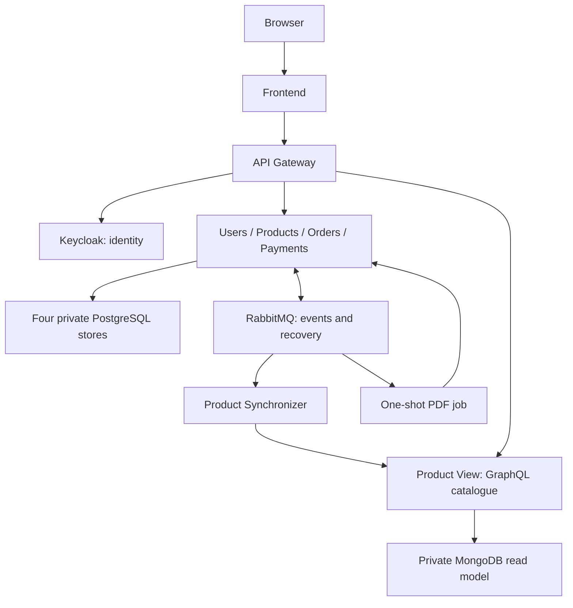
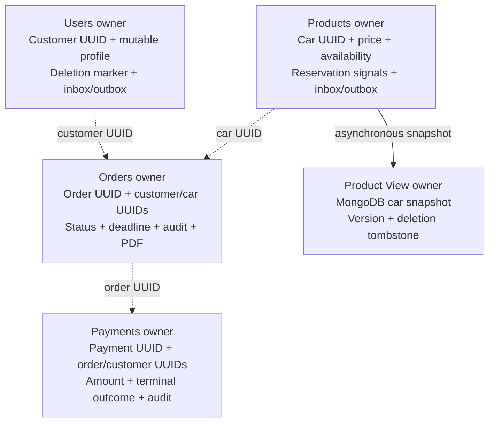
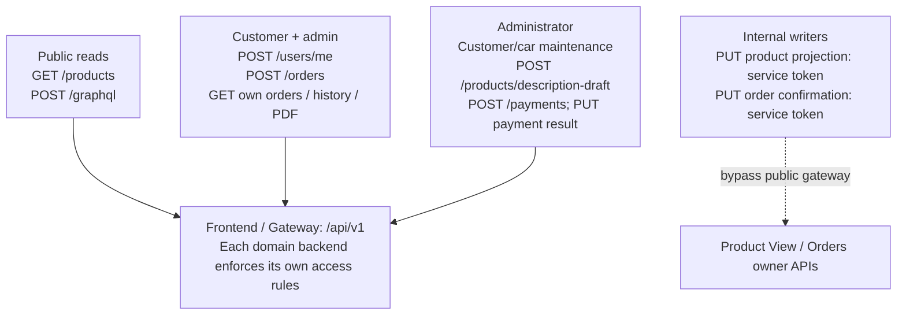
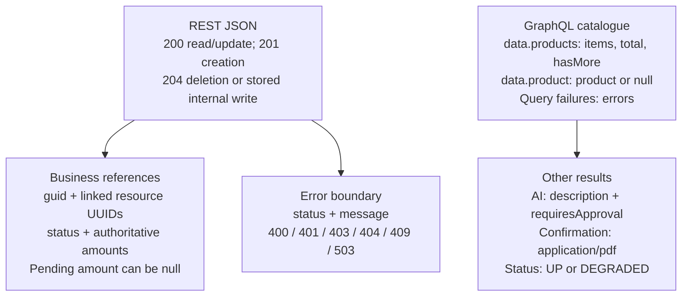

# Report figure sources

Compact overviews for readable A4 figures. Complete editable UML and field-level models
remain in [application](../application/README.md); these views deliberately omit details.
Regenerate SVGs with `python scripts/render_report_figures.py`.

## architecture

## databases

## api-contracts

## api-responses

