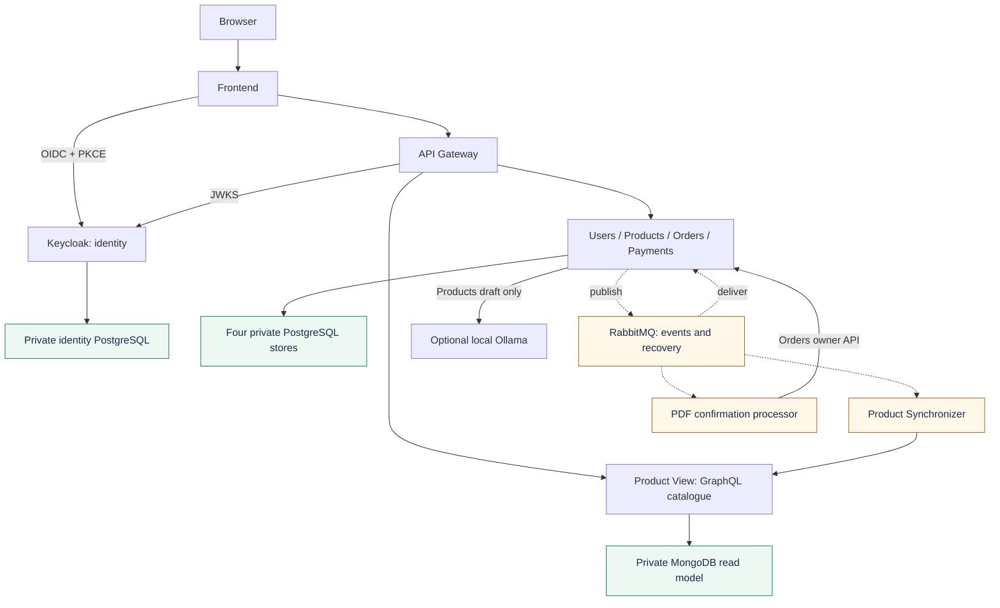
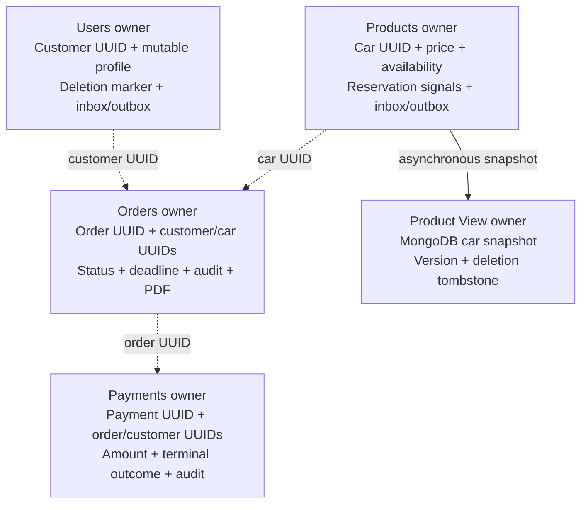
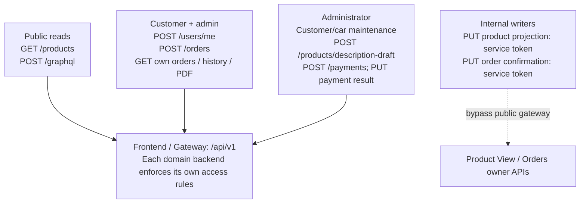
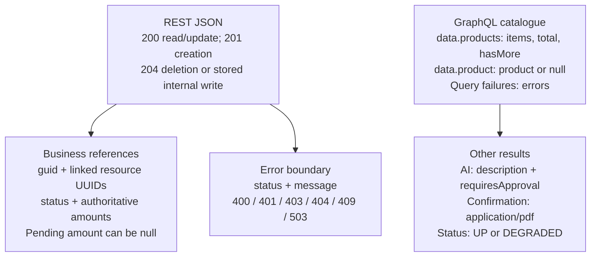

# Report figure sources

Compact overviews for readable A4 figures. Complete editable UML and field-level models
remain in [application](../application/README.md); these views deliberately omit details.
Regenerate SVGs with `python scripts/render_report_figures.py`.
The ten architecture/deployment/operational models are editable vector drawings generated with
`python scripts/render_architecture_models.py`. Their layout uses one colour per
responsibility: blue for HTTP/workloads, green for storage, amber for messaging and
purple for observability. Text stays vector-based in the report PDF.
Dashed boundaries, outlined pictograms and tinted card headers follow the visual
conventions in the supplied diagrams.net XML reference. All icons are local SVG paths.

| Model | Source | SVG |
| --- | --- | --- |
| System architecture | `scripts/render_architecture_models.py`: `system()`; detailed UML in `../application/Architecture.puml` | [architecture.svg](architecture.svg) |
| Docker Compose system architecture | `scripts/render_architecture_models.py`: `compose()` | [docker-compose.svg](docker-compose.svg) |
| Local Kubernetes deployment | `scripts/render_architecture_models.py`: `kubernetes()` | [kubernetes-deployment.svg](kubernetes-deployment.svg) |
| Reliable message delivery | `scripts/render_architecture_models.py`: `delivery()` | [message-delivery.svg](message-delivery.svg) |
| Observability | `scripts/render_architecture_models.py`: `observability()` | [observability.svg](observability.svg) |
| Kubernetes recovery and scaling | `scripts/render_architecture_models.py`: `recovery()` | [kubernetes-recovery.svg](kubernetes-recovery.svg) |
| Reservation and payment saga | `scripts/render_architecture_models.py`: `purchase()` | [purchase-saga.svg](purchase-saga.svg) |
| Verification boundaries | `scripts/render_architecture_models.py`: `testing()` | [testing-strategy.svg](testing-strategy.svg) |
| Change-aware CI and release | `scripts/render_architecture_models.py`: `pipeline()` | [ci-pipeline.svg](ci-pipeline.svg) |
| Selected Azure target | `scripts/render_architecture_models.py`: `cloud()` | [azure-deployment.svg](azure-deployment.svg) |

## Logical architecture reference

The Mermaid reference below preserves a text-only view of the logical connections.
The print-layout SVG is generated by `system()` in the indexed Python source.

## databases

## api-contracts

## api-responses

