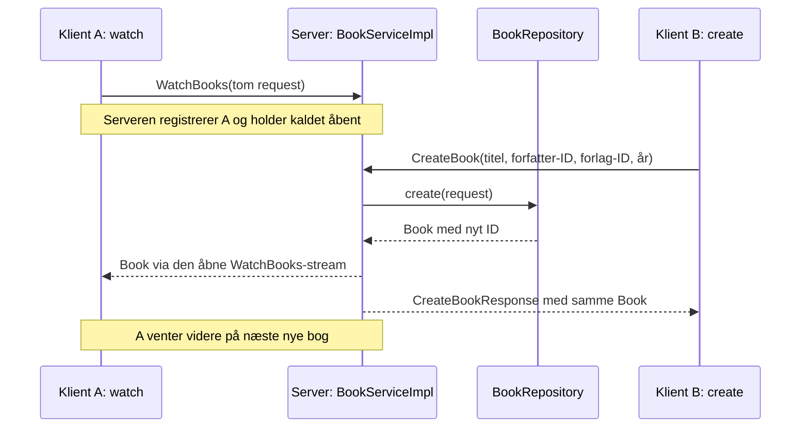

# gRPC Remote Procedure Calls (gRPC)

RPC betyder **Remote Procedure Call**, på dansk et kald til en metode i et andet
program. gRPC er teknologien, som lader vores klient kalde bogmetoder på serveren
over netværket. Selve bogopslaget og oprettelsen udføres på serveren.

Det fulde navn er **gRPC Remote Procedure Calls**. Forkortelsen indgår altså selv
i navnet; det kaldes en rekursiv forkortelse. Navnet følger
[gRPC-projektets egen forklaring](https://grpc.io/docs/what-is-grpc/faq/#what-does-grpc-stand-for).

I dette projekt starter du serveren i én terminal. Fra andre terminaler kan du
hente en bog, oprette en bog eller abonnere på nye bøger med klientprogrammet.
Begge programmer kører på din computer, men de kommunikerer gennem en
netværksforbindelse på port `50052`.

Læs først forklaringen i rækkefølgen **protofil → genereret Java-kode og stubs →
de fire Java-klasser → et konkret kald**. Derefter følger kommandoerne til at køre
programmet. Korte danske kommentarer forklarer metodernes formål og de dele,
som kræver lidt ekstra forklaring, fx streaming og indlæsning af startdata.

## 1. Først: Protocol Buffers og protofilen

**Protocol Buffers**, ofte forkortet **protobuf**, beskriver strukturen af de data,
vi sender, og omsætter dem til et binært format under kommunikationen.
I vores [book_service.proto](src/main/proto/book_service.proto) beskriver vi både
data og de metoder, serveren tilbyder. Klient og server bygger deres Java-kode
fra denne fælles kontrakt. Det er den almindelige fremgangsmåde med
[gRPC og Protocol Buffers](https://grpc.io/docs/what-is-grpc/introduction/).

### Hvilke data sendes?

En `message` er en beskrivelse af en besked. Fx:

```proto
message GetBookByIdRequest {
  int64 book_id = 1;
}
```

Det betyder, at forespørgslen indeholder et bog-ID som et 64-bit heltal.
`= 1` er feltets identifikationsnummer i protobuf-formatet. Det sætter **ikke**
bog-ID'et til 1. Klienten kan fx udfylde feltet med værdien `1000`.

| Message i protofilen | Hvorfor har vi den? |
| --- | --- |
| `Book` | Beskriver en bog: ID, titel, forfatter-ID, forlag-ID og udgivelsesår. |
| `GetBookByIdRequest` | Indeholder det bog-ID, klienten vil slå op. |
| `CreateBookRequest` | Indeholder de fire bogoplysninger, klienten vil oprette med. |
| `CreateBookResponse` | Indeholder den oprettede `Book`, nu med et ID tildelt af serveren. |
| `WatchBooksRequest` | Er tom, fordi tilmelding ikke kræver ekstra oplysninger. |

### Hvilke metoder kan klienten kalde?

`service BookService` samler de tre metoder. `rpc` angiver et kald til serveren:

```proto
rpc GetBookById(GetBookByIdRequest) returns (Book);
rpc CreateBook(CreateBookRequest) returns (CreateBookResponse);
rpc WatchBooks(WatchBooksRequest) returns (stream Book);
```

De første to er **unary**: én forespørgsel giver ét svar.
Den sidste er **server-streaming**: én tilmelding giver en åben svarstrøm, hvor
serveren kan sende flere `Book`-beskeder efterhånden. Ordet `stream` er forskellen
i kontrakten. Protofilen beskriver mulighederne; vores Java-kode udfører arbejdet.

## 2. Dernæst: genereret Java-kode og stubs

Java-programmet skal have Java-klasser, som passer til kontrakten. Når du kører
`mvn clean compile`, bruger Maven protobuf-compileren `protoc` og gRPC-plugin'et
til at generere dem. Derefter kompileres både den genererede kode og vores egne
klasser. Maven-opsætningen findes i [pom.xml](pom.xml).

En **stub** er klientens lokale stedfortræder for serverens metoder. Når
`BookClient` kalder `service.getBookById(request)`, sørger stubben og
gRPC-bibliotekerne for at sende forespørgslen over forbindelsen og levere svaret
tilbage som et Java-objekt. Stubben indeholder ikke vores boglager eller
bogopslagskode. Det arbejde udføres i serverprogrammet.

| Genereret Java-kode | Hvad bruger vi den til? |
| --- | --- |
| `Book`, `GetBookByIdRequest`, `CreateBookRequest` osv. | Java-typer, som svarer til protofilens messages og kan omsættes til/fra protobuf-data. |
| `BookServiceGrpc.BookServiceBlockingStub` | Klientens adgang til RPC-metoderne. Oprettes med `BookServiceGrpc.newBlockingStub(channel)`. |
| `BookServiceGrpc.BookServiceImplBase` | Serverens grundklasse med RPC-metoder, som vores `BookServiceImpl` overskriver. |

En **blocking stub** venter på svaret. Ved `get` og `create` får klienten ét
færdigt svar. Ved `watch` får den en iterator; `hasNext()` venter på næste bog
eller på, at streamen afsluttes. Derfor bliver `watch`-programmet kørende.
Stubben og serverens grundklasse genereres fra samme kontrakt, så metoder og
beskedtyper passer sammen. Se også
[gRPC Javas gennemgang af kodegenerering og stubs](https://grpc.io/docs/languages/java/basics/).

```text
src/main/proto/book_service.proto
    │ Maven kører protoc og gRPC-plugin'et
    ├── target/generated-sources/protobuf/java/org/example/book/
    │     Book.java, GetBookByIdRequest.java osv.
    └── target/generated-sources/protobuf/grpc-java/org/example/book/
          BookServiceGrpc.java med stub og serverens grundklasse
```

De genererede filer ligger i `target` og skal ikke redigeres manuelt. Hvis vi
ændrer kontrakten, retter vi protofilen og bygger projektet igen. Protofilens
`GetBookById` bliver til metoden `getBookById` i den genererede Java-kode.

## 3. Dernæst: vores fire Java-klasser

Vi har selv skrevet fire klasser. Kun **BookServer** og **BookClient** er
programmer, som startes fra terminalen: de har en `main`-metode. De to øvrige
klasser bruges internt af serveren. Der er altså stadig én server og ét
klientprogram, selv om kildekoden er fordelt på fire filer.

### BookServer: starter serverprogrammet

[BookServer.java](src/main/java/org/example/book/BookServer.java) opretter først
`BookRepository`, som indlæser startbøgerne. Derefter opretter den
`BookServiceImpl(repository)`, tilknytter servicen med `addService(...)` og
starter en gRPC-server på port `50052`.

Klassen er nødvendig for at **starte og holde serveren kørende**.
`awaitTermination()` holder hovedtråden i live, mens gRPC håndterer klientkald.
En shutdown hook beder serveren stoppe, når Java-processen lukker.

### BookClient: omsætter terminalkommandoen til et gRPC-kald

[BookClient.java](src/main/java/org/example/book/BookClient.java) spørger først,
om du vil bruge `get`, `create` eller `watch`. Ved `get` spørger den bagefter om
bog-ID. Ved `create` spørger den om titel, forfatter-ID, forlag-ID og år ét ad gangen.
En titel skrives som almindelig tekst, også når den indeholder mellemrum.

`main` opretter forbindelsen og vælger den relevante metode: `getBook`,
`createBook` eller `watchBooks`. Hjælpemetoden `readInput` viser et spørgsmål og
læser dit svar. Der er ingen kode til at opdele kommandolinjer eller anførselstegn.
`String[] args` er en del af Javas almindelige `main`-metode, men bruges ikke her.
De to `catch`-blokke håndterer henholdsvis ugyldige tal og fejl fra gRPC.

Klienten opretter en **channel** til `localhost:50052` og en stub, der bruger
den kanal. En channel beskriver forbindelsen; stubben giver os de metoder,
vi kan kalde gennem forbindelsen. Klienten bygger en request, kalder stubben
og viser resultatet. Den åbner aldrig databasefilen.

Klassen er nødvendig for at **sende brugerens forespørgsler og vise svar**.
`get` og `create` lukker efter svaret. `watch` bliver ved med at vente på bøger,
indtil forbindelsen afsluttes eller du stopper klienten med `Ctrl+C`.

### BookServiceImpl: udfører serverens bogfunktioner

[BookServiceImpl.java](src/main/java/org/example/book/BookServiceImpl.java)
arver fra den genererede `BookServiceGrpc.BookServiceImplBase`. `@Override`
markerer de metoder, hvor vi leverer vores egen implementering af kontrakten.

Klassen er nødvendig for at **bestemme, hvad serveren faktisk gør ved et kald**:

- `getBookById` kontrollerer ID'et, henter bogen fra repository og sender et svar eller en fejl.
- `createBook` kontrollerer oplysningerne, gemmer bogen, sender den til abonnenterne og svarer den klient, som oprettede den.
- `watchBooks` gemmer klientens svarstrøm i abonnentlisten, så den kan modtage fremtidige bøger.

`StreamObserver` er serverens objekt til at sende svar. `onNext(...)` sender en
besked, `onCompleted()` afslutter kaldet, og `onError(...)` afslutter med en fejl.
Ved unary-kaldene sender vi ét svar og afslutter. Ved `watchBooks` afslutter vi
ikke efter tilmeldingen, fordi svarstrømmen skal bruges senere.

Når en abonnent afbryder, fjerner serveren den fra listen.
`synchronized` sørger for, at tilmelding, fjernelse og udsendelse bruger samme
lås. Så kan to samtidige oprettelser ikke skrive til samme abonnentstrøm samtidig.

### BookRepository: holder styr på data

[BookRepository.java](src/main/java/org/example/book/BookRepository.java)
indlæser de 997 eksisterende bøger fra SQLite-filen ved serverstart. Den kopierer
databasefilen til en midlertidig fil, læser rækkerne via JDBC og lukker derefter
databaseforbindelsen og sletter kopien. JDBC er Javas grænseflade til databaser.

Klassen er nødvendig for at **samle læsning, lagring og tildeling af bog-ID'er**.
Efter opstart ligger bøgerne i en `Map<Long, Book>`: et bog-ID peger på én bog.
`findById` slår op i dette lager, og `create` tildeler et nyt ID og gemmer bogen.
`findAll` bruges kun internt til at tælle bøger ved serverstart; den er ikke en RPC.
Metoderne er `synchronized`, så flere servertråde kan bruge datalageret sikkert.

Nye bøger gemmes i hukommelsen. Ved genstart indlæses den oprindelige database
igen. Derfor starter serveren hver gang med de samme eksisterende data.

## 4. Sådan hænger delene sammen under kørsel

Når du bygger projektet, starter du med protofilen. Når du **kører** det,
starter du først `BookServer` og derefter `BookClient`, som venter på din kommando.

### Eksempel: hent bog 1000

1. Du starter klienten, skriver `get` og svarer `1000`, når den spørger om bog-ID.
2. `BookClient` bygger en `GetBookByIdRequest` med `book_id = 1000`.
3. Klientens stub sender requesten gennem kanalen til serveren.
4. gRPC fører kaldet videre til `BookServiceImpl.getBookById(...)`.
5. Servicen beder `BookRepository.findById(1000)` om bogen.
6. Repository returnerer det `Book`-objekt, som ligger i hukommelsen.
7. Servicen sender bogen med `onNext(book)` og afslutter med `onCompleted()`.
8. Stubben leverer bogen tilbage til `BookClient`, som udskriver den og lukker.

### Eksempel: én klient abonnerer, en anden opretter



Klient B får altså svaret på sin oprettelse. Klient A får en besked gennem sit
allerede åbne abonnement. A skal ikke spørge serveren igen for hver ny bog.

gRPC bruger HTTP/2 som transport, men vores programmer bruger de genererede
RPC-metoder til kommunikationen. Du skriver ikke HTTP-requests manuelt.
Se [gRPC-projektets forklaring af transporten](https://grpc.io/docs/what-is-grpc/faq/#why-is-grpc-better-than-any-binary-blob-over-http2).

## 5. Små kodebegreber, du møder i filerne

| Kode | Betydning i projektet |
| --- | --- |
| `newBuilder()` | Starter opbygningen af en protobuf-besked. |
| `.setBookId(1000)` | Udfylder et felt i beskeden. |
| `.build()` på en message-builder | Laver den færdige besked, som ikke kan ændres bagefter. |
| `getBookId()` | Læser værdien af et beskedfelt. |
| `getDefaultInstance()` | Giver en besked med standardværdier; bruges til vores tomme `WatchBooksRequest`. |
| `var` | Java udleder variablens type fra værdien på højre side. |
| `extends` | Lader en klasse arve fra en anden, fx serverens genererede grundklasse. |
| `try (...)` | Lukker automatisk de angivne ressourcer, fx en databaseforbindelse. |
| `finally` | Kører oprydning efter et `try`, også ved en fejl. |
| `withDeadlineAfter(5, TimeUnit.SECONDS)` | Giver ét unary-kald en tidsgrænse på fem sekunder. |
| `channel.shutdownNow()` | Lukker klientens kanal og afbryder aktive kald på den. |

## Kør programmet

### Krav

- Java 17 eller nyere
- Maven (`mvn` skal være tilgængelig i terminalen)

Kør alle kommandoer fra denne mappe (`grpc`).

### Byg projektet

```powershell
mvn clean compile
```

Maven genererer automatisk Java-kode fra `src/main/proto/book_service.proto`.
Den genererede kode ligger i `target/generated-sources/protobuf` og skal ikke
redigeres manuelt.

### Start serveren

Kør i terminal 1:

```powershell
mvn -q exec:java "-Dexec.mainClass=org.example.book.BookServer"
```

Serveren indlæser startdata og lytter på port `50052`. Stop den med `Ctrl+C`.

### Kommandoer til klienten

Lad serveren køre i terminal 1. Start klienten i terminal 2:

```powershell
mvn -q exec:java "-Dexec.mainClass=org.example.book.BookClient"
```

Du kan også starte `BookClient.main` med **Run** i editoren uden startargumenter.
Klienten spørger `Skriv get, create eller watch:`. Skriv én af de tre handlinger
og tryk Enter. Svar derefter på de spørgsmål, klienten stiller.
Du skriver inde i den kørende klient, ikke i PowerShell.

Hent bog-ID `1000` (*Harry Potter and the Sorcerer's Stone (Book 1)*):

```text
Skriv get, create eller watch:
get
Bog-ID:
1000
```

Opret en bog ved at svare på spørgsmålene ét ad gangen:

```text
Skriv get, create eller watch:
create
Bogtitel:
Min nye bog
Forfatter-ID:
394
Forlag-ID:
74
Udgivelsesår:
2026
```

Titler med mellemrum kræver ingen anførselstegn.
`get` og `create` viser serverens svar og **lukker derefter klienten**.
Start klienten igen, når du vil sende en ny forespørgsel.
Serveren bliver kørende og beholder nye bøger, indtil serveren genstartes.

Abonner på nye bøger:

```text
watch
```

`watch` **holder klienten åben** og viser nye bøger løbende. Stop med `Ctrl+C`.
Opret bøger fra en anden klient i en tredje terminal.
Ved en ugyldig kommando eller serverfejl vises en besked, og klienten lukker.

Startkommandoen og korte eksempler står også som kommentarer i `BookClient.java`.

Et ukendt bog-ID giver gRPC-status `NOT_FOUND`, som klienten viser som **Ikke fundet**.
Tom titel eller ikke-positive ID'er/år giver `INVALID_ARGUMENT`, hvor klienten viser
serverens korte forklaring. Forfatter- og forlag-ID gemmes som tal;
programmet kontrollerer ikke, om de findes i forfatter- og forlagstabellerne.
Hvis serveren ikke er tilgængelig, viser klienten `Serveren er ikke tilgængelig.`
SLF4J er konfigureret med en stille logger, så dens opstartsadvarsler ikke vises.
Unary-kald har en tidsgrænse på fem sekunder. Streaming holdes åben, indtil
klienten lukker, serveren stopper, eller forbindelsen fejler.

### Test streaming med to klienter

1. Start serveren i terminal 1.
2. Start klient A i terminal 2, skriv `watch`, og tryk Enter.
3. Lad abonnementet stå åbent, og åbn terminal 3.
4. Start klient B i terminal 3, skriv `create`, og svar på spørgsmålene med fx `Min nye bog`, `394`, `74` og `2026`.
5. Klient B får den nye bog og dens ID som svar. Klient A modtager automatisk bogen gennem sin åbne stream.
6. Start klient B igen, og opret endnu en bog. Den vises også hos klient A.
7. Stop `watch` med `Ctrl+C`. Serveren fjerner klientens abonnement.

`WatchBooks` sender kun bøger oprettet efter serverens registrering af abonnementet.
Startdata sendes ikke gennem streamen. Alle aktive abonnenter modtager nye bøger.
Du kan starte `watch` i flere terminaler. Ved forbindelsesfejl kan du køre
`watch`-kommandoen igen for at starte et nyt abonnement.

## Startdata

Den vedlagte SQLite-database er kopieret ind i projektet som
`src/main/resources/library.db`. Den indeholder 997 bøger i tabellen `tbook`.
Bøgernes ID'er starter ved `1000`, og næste nye bog får ID `2000`.

Ved hver serverstart indlæses bøgerne i hukommelsen fra en midlertidig kopi af
databasen. Nye bøger gemmes kun i hukommelsen og forsvinder ved genstart.
Dermed starter serveren altid med de samme eksisterende data.
Startdatabasen ændres ikke, og programmet kræver ikke adgang til Downloads-mappen.
Forfattere og forlag findes også i databasefilen, men udstilles ikke som separate services.

## Filer og kald

| Fil | Ansvar |
| --- | --- |
| `src/main/proto/book_service.proto` | Fælles kontrakt med messages og de tre RPC-metoder |
| `src/main/java/org/example/book/BookServer.java` | Starter gRPC-serveren |
| `src/main/java/org/example/book/BookClient.java` | Terminalkommandoerne `get`, `create` og `watch` via en genereret blocking stub |
| `src/main/java/org/example/book/BookServiceImpl.java` | Håndterer kald og sender nye bøger til abonnenter |
| `src/main/java/org/example/book/BookRepository.java` | Indlæser startdata og holder bøgerne i hukommelsen |
| `src/main/resources/library.db` | Eksisterende startdata |

Protofilen indeholder opgavens tre RPC'er:

```proto
rpc GetBookById(GetBookByIdRequest) returns (Book);
rpc CreateBook(CreateBookRequest) returns (CreateBookResponse);
rpc WatchBooks(WatchBooksRequest) returns (stream Book);
```

- `GetBookById` er unary: returnerer én bog ud fra ID.
- `CreateBook` er unary: modtager titel, forfatter-ID, forlag-ID og udgivelsesår og returnerer den oprettede bog i et svar.
- `WatchBooks` er server-streaming: modtager én abonnementsforespørgsel og sender løbende en bog, hver gang en ny bog oprettes.

Kommunikationsvejen er: **klient → gRPC-kald → server → gRPC-svar → klient**.
Der bruges ingen HTTP-requestfil eller separat testklient-extension.

Opsætningen følger [gRPC Javas officielle vejledning](https://grpc.io/docs/languages/java/basics/).
