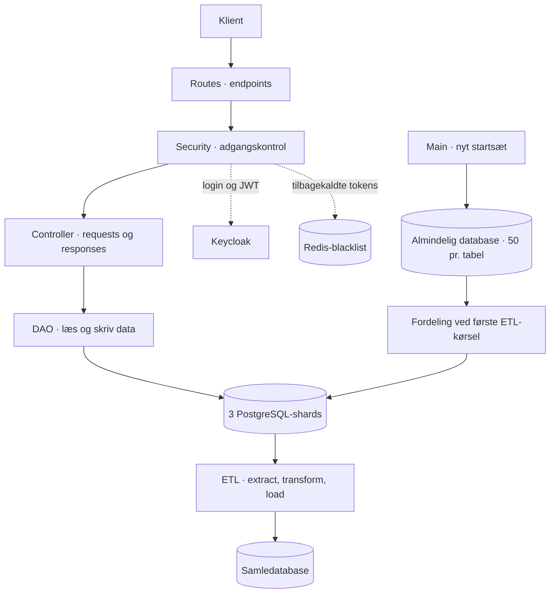

# Book Catalog 📚

Et REST API til bøger, forfattere og kategorier. Bygget med **Java 17, Javalin,
JPA og Hibernate**, med PostgreSQL som database.

## Start programmet

1. Start containerne med `docker compose up -d`.
2. Kør **Main.java**. API'et starter på **http://localhost:7070**.

Ved hver opstart nulstilles den almindelige bogdatabase til **50 forfattere,
50 kategorier og 50 bøger** med virkelige navne og titler, fx Jane Austen og
Pride and Prejudice. Dette er et bevidst startsæt til undervisningsopgaven.

Log ind via [login-siden](http://localhost:7070/api/v1/auth).
Keycloak håndterer login, eventuelt via GitHub, og udsteder et JWT access token.
Requests sendes med `Authorization: Bearer <token>`. Eksempler findes i `http/api.http`.

## Sådan hænger det sammen



## Mapper og ansvar

| Fil / mappe | Ansvar |
|---|---|
| `Main.java` | Starter API'et og lukker server og databaseforbindelser ved stop. |
| `routes` | Definerer endpoints under `/api/v1` og forbinder dem til controllerne. |
| `controller` | Laget mellem routes og DAO'er. Validerer input og returnerer statuskoder, JSON og HATEOAS-links. |
| `dao` | Kommunikerer med databaserne via JPA. Hver DAO er en singleton og bruger try-with-resources. |
| `persistence/model` | Indeholder JPA-entities: Book, Author og Category. Lombok genererer getters og setters. |
| `persistence/DatabaseSeeder.java` | Nulstiller den almindelige database og indsætter de 50 eksempler pr. tabel ved opstart. |
| `security` | JWT-validering, OAuth2/OIDC via Keycloak, Redis-blacklist samt beskyttelse mod XSS og CSRF. SQL-injection forebygges med bundne parametre i DAO'er og ETL. |
| `etl/DatabaseResourceManager.java` | Opretter databaseforbindelser og Hibernate-factories og lukker dem ved nedlukning. |
| `etl` | Vælger shard via hash og samler data i en separat database. |
| `docker` / `compose.yaml` | Opsætning af PostgreSQL, pgAdmin, Keycloak og Redis. |
| `http` | Én HTTP-fil med 10 requests efter login i browseren. Det private token gemmes i `.env`. |

## Sikkerhed: hvor og hvordan?

### SQL-injection

**Hvor:** [AuthorDAO](src/main/java/dao/AuthorDAO.java),
[BookDAO](src/main/java/dao/BookDAO.java) og [CategoryDAO](src/main/java/dao/CategoryDAO.java).

Søgetekst og ID'er bindes som **værdier** med `setParameter`. De sættes ikke direkte
ind i forespørgslens kode. Derfor bliver fx `' OR 1=1 --` behandlet som søgetekst,
ikke som en SQL-kommando. `locate` finder teksten; parameterbindingen giver beskyttelsen.

[WarehouseEtlService](src/main/java/etl/WarehouseEtlService.java) og
[DatabaseSeeder](src/main/java/persistence/DatabaseSeeder.java) bruger tilsvarende
`PreparedStatement` med bundne værdier. ETL's tabelnavne kommer kun fra faste lister i koden.

### XSS — Cross-Site Scripting

**Hvor:** [AuthController](src/main/java/controller/AuthController.java), især
`escapeHtml`, og [HttpSecurityConfig](src/main/java/security/HttpSecurityConfig.java).

`escapeHtml` omdanner specialtegn, før loginoplysninger indsættes i HTML.
Fx bliver `<` til `&lt;`, så input ikke kan blive til nye HTML-tags eller scripts.
Login-sidens fejlbeskeder indsættes med `textContent`, som behandler dem som tekst.

Bogdata returneres som JSON. `Content-Type` og `nosniff` fortæller browseren,
at indholdet skal læses som JSON. CSP-reglen `default-src 'none'` blokerer desuden
scripts som udgangspunkt. Login-siderne tillader kun deres egne scripts med en
**nonce**: en tilfældig markering, som skal matche mellem scriptet og CSP-headeren.

### CSRF — Cross-Site Request Forgery

**Hvor:** `register` i [HttpSecurityConfig](src/main/java/security/HttpSecurityConfig.java),
`validState` i [AuthController](src/main/java/controller/AuthController.java) samt
[AuthRoutes](src/main/java/routes/AuthRoutes.java) og [AccessTokenValidator](src/main/java/security/AccessTokenValidator.java).

Ved ændrende requests afviser vi en fremmed `Origin` eller `Sec-Fetch-Site: cross-site`
med **403 Forbidden**. Beskyttede endpoints kræver også et JWT i `Authorization`-headeren.
En fremmed hjemmesides formular sender ikke automatisk dette Bearer-token.

Under login skal `state` matche browserens login-cookie. Cookien bruger `SameSite=Lax`,
og loginforsøgets serveroplysninger kan kun bruges én gang i Redis.
[KeycloakOAuthService](src/main/java/security/KeycloakOAuthService.java) bruger desuden PKCE til at
binde autorisationskoden til den verifier, serveren oprettede ved starten af login.

## Sharding og ETL

Forfatterens UUID hashes til shard **0, 1 eller 2**. Forfatteren og forfatterens bøger
ligger på samme shard. Bogens ID indeholder forfatterens UUID, så API'et automatisk
kan vælge den rigtige database. Kategorier findes som fælles referencedata på alle tre.

Den første ETL-kørsel efter opstart erstatter indholdet i de tre shards med startsættet
fra den almindelige database. Forfattere og bøger fordeles efter hash; de 50 kategorier
kopieres til hver shard. Senere ETL-kørsler i samme opstart bevarer API'ets ændringer.
En ny Main-opstart gør et nyt startsæt klar til næste fordeling.

ETL læser derefter alle tre shards og indlæser data i **warehouse**. Kombinationen af shardnummer
og kilde-ID forhindrer ID-konflikter. Upsert undgår dubletter ved genkørsel, og sletninger
overføres også. Fejler indlæsningen, rulles den tilbage.

Fjern `//` fra denne linje i **Main.java** for at fylde shards og køre ETL ved opstart:

```java
// new etl.WarehouseEtlService().run();
```

ETL kan også startes manuelt med et gyldigt JWT via `POST /api/v1/etl/runs`.
API'et læser fra shards: på en tom installation skal ETL køres før HTTP-eksemplerne.
Fordelingen giver i alt 50 forfattere og 50 bøger på tværs af shards, ikke 50 pr. shard.
Warehouse bevarer kategorikopiernes oprindelse og får derfor 150 kategorirækker.
Databaserne kan ses i [pgAdmin](http://localhost:5050) under gruppen **ETL**.

